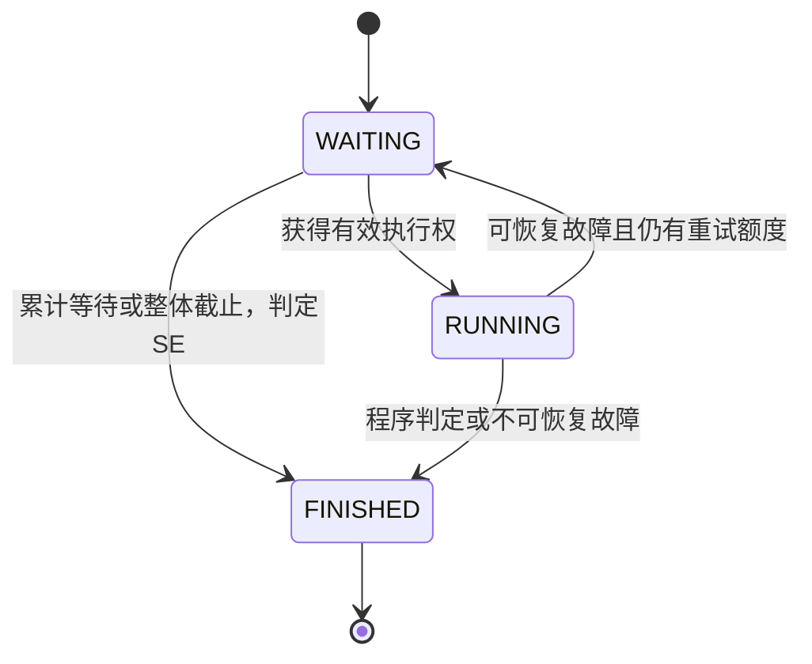

# Byte Judge 需求规格说明书

**毕业设计题目：基于 Spring Cloud 的算法在线评测系统的设计与实现**

| 文档属性 | 内容 |
| --- | --- |
| 文档编号 | BJ-SRS-001 |
| 版本 / 日期 | V1.1 / 2026-11-02 |
| 输入文档 | 用户指定的[需求功能树](./assets/需求功能树.png)、[01.需求文档.md](./01.需求文档.md) V1.1、[原始调研](./00.OJ系统调研.md)及[图片范围补充调研](./00.图片范围补充调研.md) |
| 评审方式 | V1.0由产品、开发、测试子代理评审；V1.1按用户图片扩展范围，补充官方调研、产品同步修订及测试覆盖复核 |
| 文档状态 | 团队子代理评审后的开发与验收基线；未代表导师、真实用户或项目负责人签字确认 |
| 适用范围 | 本科毕业设计首期设计、实现、测试与演示 |

## 1. 引言与使用约定

### 1.1 编写目的

本说明书把调研及初步需求转化为能够设计、实现和验收的确定要求，明确项目目标、功能边界、角色权限、用户体验、评测规则、数据与接口约束及验收方式。产品、开发和测试应使用相同编号追踪工作。

本文件是本次评审的正式产出。V1.1以用户功能树为范围依据，图片中的用户、题库、竞赛、管理端功能全部纳入P0；V1.0把竞赛和自定义运行列为扩展的决定已废止。`01.需求文档.md` 同步更新为需求收集与分析依据，具体行为以本规格为准，图片逐项追踪见第15节。本文没有声称已经实现功能或执行测试，也没有补造访谈、问卷、真实团队会议或外部批准记录。

### 1.2 规范词与编号

- **应 / 必须**：本期验收要求；**可**：允许的行为，不自动成为独立功能；**不纳入**：不计入本期交付。
- `G` 为目标；`FR` 为功能需求；`UX` 为用户体验要求；`BR` 为业务规则；`DR` 为数据要求；`IR` 为接口约束；`AR` 为架构约束；`NFR` 为质量要求；`AT` 为验收场景；`RV` 为评审处置项。
- 保留原编号并细化既有要求，新增 FR-17～FR-25、BR-10～BR-15 等覆盖图片新增范围；新增编号不表示旧需求已删除。各编号均可通过第11节验收追踪。
- 本期所有 FR、UX、BR、DR、IR、AR、NFR 均为 P0。扩展表中的 P1/P2 不进入本期通过条件。

### 1.3 术语

| 术语 | 本项目定义 |
| --- | --- |
| OJ | 接收源代码，在受限环境中依据测试数据自动评测的在线系统 |
| 提交 Submission | 一次成功受理的代码提交，具有不变的编号、源码、题目版本和语言环境 |
| 评测轮次 Round | 对一条提交发起的一次完整评测；初判、人工重判分别创建轮次 |
| 执行尝试 Attempt | 一个轮次内因可恢复平台故障重新执行的次数；不新增用户提交 |
| 有效结果 | 当前用于个人状态、AC 数及通过率的评测结果；可能与最近一次失败重判的结果不同 |
| 题目版本 | 题面、数据、启用语言、资源限制及校验信息的一份不可变发布快照 |
| 提交场景 | PRACTICE普通练习、CONTEST正式比赛、POST_CONTEST赛后练习；独立运行RUN不属于正式提交 |
| 竞赛 | 本期为个人ACM赛制，无组队、Rating、封榜；比赛冻结题目版本，报名、受理、排名按服务器时间及正式记录决定 |
| 隐藏测试数据 | 不向普通用户公开的输入与期望输出，区别于公开样例 |
| CPU 时间 / 墙钟时间 | 程序进程组消耗的处理器时间 / 从启动到终止的实际经过时间 |
| KiB / MiB | 分别为 1024 字节 / 1024² 字节；页面不得与十进制 KB/MB 混用 |

## 2. 项目目标、范围与约束

### 2.1 目标及成功标准

| 编号 | 项目目标 | 完成标准 |
| --- | --- | --- |
| G-01 | 支持学习者完成算法练习闭环 | 页面完成登录、筛题、阅读、编码、提交、查看判定及历史；三种语言各完成至少一条 AC 和一条已知非 AC 提交 |
| G-02 | 支持管理员维护可信题库 | 页面完成草稿、数据、分语言校验、发布和下架；不完整或校验失败版本不能发布 |
| G-03 | 提供可信、受限、可追溯的评测 | 八类判定有稳定验收样例；隐藏数据与他人源码不可越权获取；重判和重复消息不重复计数 |
| G-04 | 展示 Spring Cloud 服务协作 | 通过统一网关及服务发现完成业务；两个判题实例分配任务，停止其中一个后任务可恢复，题库和历史仍可浏览 |
| G-05 | 提供可复现的毕业设计成果 | 需求、实现、测试可按编号对应；交付部署说明、接口说明、测试报告及备份恢复记录 |
| G-06 | 完成个人竞赛全流程 | 管理员建赛/组题/发布，用户浏览/报名/参赛/查榜/赛后练习，覆盖未开赛、进行中、已结束及结算状态 |
| G-07 | 完成通知与后台运营闭环 | 用户查询删除本人系统消息；管理员按ID/手机号/昵称管理用户，并安全维护和查看预定义定时任务 |

“完成”必须有端到端流程和验收证据，不能仅依据页面存在、依赖已添加或接口返回 HTTP 200 判定。

### 2.2 本期功能范围

系统定位为支持高校算法练习和个人竞赛的中小型 Web OJ。本期采用**单文件、标准输入输出、普通 token 比较、全部测试点通过才 AC**的题目模式；系统支持 C++17、Java 21、Python 3。每道题可启用其中的非空子集，平台演示与验收应覆盖全部三种语言。独立运行、比赛正式提交和赛后练习必须分开标识。

```text
Byte Judge 首期需求
├── 用户与权限：注册登录、个人资料/手机号、我的消息、我的竞赛
├── 题库与练习：难度/全文搜索/分页、切题、在线编辑、独立运行
├── 提交与记录：正式提交、自动判题、结果获取、历史与个人统计
├── 竞赛：推荐/历史列表、时间筛选、报名、参赛、实时榜、赛后练习
├── 评测核心：隔离执行、八类判定、版本固定、故障恢复
├── 后台管理：题目CRUD、竞赛CRUD/发布撤销、用户搜索封禁、定时任务CRUD
└── 微服务与质量：网关、发现、身份、双节点、监控、安全与验收
```

### 2.3 后续扩展与排除范围

| 级别 | 内容 | 处理原则 |
| --- | --- | --- |
| P1 后续可选 | 收藏、题单、站外独立解题排行榜、题解讨论、批量导入/重判、个性化推荐 | 仅图片之外的增强能力；本期运行、竞赛及竞赛排名已属P0，不得继续延后 |
| P2 本期排除 | 商业收费、招聘、AI 出题/辅导、代码查重、远程判题、OI 部分得分、SPJ、交互题、多文件项目、第三方/微信登录、邮件短信找回密码、大规模集群与多地域容灾 | 本期不开发、不依赖 |

### 2.4 前提与约束

1. 沿用 Spring Cloud 方向，具体注册中心、消息设施、物理数据库划分、前端实现框架和组件库在概要设计选型；需求不要求同时引入多个同类中间件。
2. 身份管理沿用仓库说明的 Session + Cookie 方向，跨实例须保持一致；不因微服务拆分自动改用 JWT。
3. 代码执行环境为支持所需隔离与资源计量能力的 Linux。Windows 可用于开发，最终资源与故障验收应在规定 Linux 环境完成。
4. 管理员账户通过受控初始化过程建立，不提供网页自助提权；初始化不得包含公开默认密码。
5. 输入文档的工程现状属于历史快照。本次只确认仓库仍有后端依赖声明，前后端存在未完成改动；不能据此认定任何业务已运行通过。现有未提交改动不属于本次文档评审修改范围。
6. 使用自编或明确授权的题面及测试数据。演示数据与性能压测元数据分开，生成的题目元数据不等于可判题题库。
7. 图片没有确定的细节由本规格选择：开赛前截止报名、个人ACM20分钟错交罚时、实时不封榜、基于时间的推荐列表、可选未认证联系手机号、预定义业务处理器调度。这些是项目规则，不冒充所有OJ的通行规则。

## 3. 角色、权限与运行场景

### 3.1 角色模型

游客是未登录状态；普通用户与管理员是业务角色；禁用是账户状态，不是权限等级；判题节点使用内部服务身份。本期不单独建立教师、题目审核员或超级管理员角色。

| 资源与操作 | 游客 | 正常普通用户 | 正常管理员 |
| --- | --- | --- | --- |
| 已发布题库、题面、公开题目统计 | 允许 | 允许 | 允许 |
| 注册、登录 | 允许 | 可退出后切换账户 | 同普通用户 |
| 本人资料、密码、提交、历史代码与统计 | 不允许 | 仅本人 | 仅本人 |
| 他人提交及源码 | 不允许 | 不允许 | 仅管理用途，记录访问审计 |
| 草稿、隐藏数据、校验程序、内部诊断 | 不允许 | 不允许 | 允许，记录敏感访问审计 |
| 题目/数据维护、发布、下架、删除 | 不允许 | 不允许 | 允许 |
| 检索普通用户、禁用与恢复 | 不允许 | 不允许 | 允许；不能操作管理员角色账户 |
| 重判、运行概况、审计查询 | 不允许 | 不允许 | 允许 |
| 本人消息列表、详情、已读和删除 | 不允许 | 仅本人 | 仅本人 |
| 已发布竞赛概要与已开放的正式榜 | 允许 | 允许 | 允许 |
| 报名、我的竞赛、独立运行、赛后练习提交 | 不允许 | 按竞赛状态和本人资格允许 | 以个人身份遵守相同规则 |
| 进行中竞赛题面/运行/正式提交 | 不允许 | 仅已报名者，且在允许时间内 | 管理访问可预览；计入榜单须以报名个人身份按同规则参赛 |
| 竞赛维护、发布撤销、定时任务管理 | 不允许 | 不允许 | 允许 |
| 内部执行及结果回写接口 | 不允许 | 不允许 | 网页登录身份也不授予内部执行权限 |

禁用后所有受保护操作均被拒绝，仍可按游客浏览公开题库。禁用不取消已经受理的提交；恢复后应重新登录，旧会话不自动复活。所有权限均应由服务端验证。

### 3.2 典型使用过程

| 场景 | 触发与前置条件 | 正常结果 | 关键异常 |
| --- | --- | --- | --- |
| UC-01 注册与登录 | 游客希望开始练习 | 建立普通用户及有效会话 | 重复账户、错误凭据、禁用、登录限频 |
| UC-02 完成练习 | 用户阅读已发布题目并提交代码 | 可查询的提交及最终结果，历史保留 | 过期登录、题目更新/下架、响应丢失、平台故障 |
| UC-03 回顾记录 | 正常用户查看本人练习情况 | 筛选历史、查看代码及有效结果 | 无记录、越权、旧题已下架、查询断网 |
| UC-04 发布题目 | 管理员准备题面、数据及校验程序 | 通过校验的版本成为当前发布版本 | 缺字段、校验失败、校验后又修改、版本竞争 |
| UC-05 管理用户 | 管理员管理正常/禁用的普通用户 | 禁用及时生效，恢复不丢数据 | 无权限、尝试操作管理员、操作状态已变更 |
| UC-06 处理评测故障 | 系统发现故障或管理员重判 | 有界恢复或明确 SE，旧有效结果受保护 | 消息重复、迟到回调、连续故障、重判 SE |
| UC-07 在线运行 | 用户提供源码和自己的输入 | 返回运行状态、实际输出/错误和资源值，不产生AC及比赛成绩 | 编译失败、限额、网络超时、无题面访问资格 |
| UC-08 参加比赛 | 已发布、未开赛时正常用户报名 | 我的竞赛显示状态，开赛后按资格答题，结束后查看成绩/练习 | 重复报名、截止边界、未报名、撤销发布、赛题保密 |
| UC-09 接收系统消息 | 报名、赛程变更、结算或成绩更正事件 | 本人收到可查看和删除的通知 | 重复事件、投递失败、越权删除、目标已下架 |
| UC-10 管理运营任务 | 管理员创建预定义处理器计划 | 按时执行并可查结果，启停/删除不破坏业务正确性 | 非法cron/参数、并发触发、失联、滞后执行 |

UC-02 中用户主动再次作答产生新提交；网络重试确认同一次受理使用原请求标识。UC-06 的自动重试和人工重判都不能增加用户提交总数。

## 4. 功能需求

### 4.1 FR-01 账户注册、登录与退出

- 输入为账户、密码及注册时的确认密码；注册成功只创建普通用户，不接受客户端传入角色。
- 账户为 4～32 位 ASCII 字母、数字或下划线，去除首尾空白后按小写归一化并唯一；注册后不可修改。密码为 8～64 个 Unicode 码点，不得自动去除空格或截断；确认密码应一致。
- 密码应使用带随机盐的自适应摘要，不存明文、不回传摘要。登录失败使用统一的账户/密码错误提示，不透露是否存在账户。
- 同一账户标识和同一来源地址分别累计失败；任一在 15 分钟内达到 10 次失败，后续登录应受限 15 分钟并明确可重试时间。仅对登录接口生效，不影响公开题库。
- 登录成功建立会话；默认闲置 30 分钟失效。退出、修改密码或禁用后旧会话应失效，相关界面进入游客状态。验收：AT-01、AT-02、AT-19。

### 4.2 FR-02 本人资料与密码

- 正常登录用户应能查看/修改本人昵称和简介：昵称 1～30 个 Unicode 码点，简介最多 500 个；昵称不得为空白。
- 应支持可选联系手机号：7～15位ASCII数字，可有一个前置`+`；保存时去除首尾空白，不接受内部空格。字段不要求唯一，仅作联系信息，不提供短信登录/找回或认证标记；本人可修改/清空，其他普通用户不可读取。
- 修改密码应验证旧密码及两次新密码，新密码满足 FR-01；成功后撤销所有旧会话，提示重新登录。错误旧密码不得修改任何数据。
- 普通资料接口不得接受角色、禁用状态、他人标识等越权字段作为可修改属性。验收：AT-02、AT-19。

### 4.3 FR-03 题库检索

- 应分页返回当前已发布且未删除的题目；默认每页 20 条，可选 10/20/50，页号至少为 1，超过末页返回空列表，非法分页参数明确拒绝。
- 应支持关键词全文搜索，范围为题号、标题、公开题面和输入/输出说明，禁止搜索隐藏数据、校验程序、未公开题目或未到开放时点的赛题。关键词去首尾空白并按空白分词，各词均须命中某一可搜索字段（词之间AND、字段之间OR），忽略拉丁字母大小写，不要求模糊纠错或中文自动分词。
- 关键词与难度、标签、个人状态之间取 AND；多标签要求全部匹配。没有关键词时显示普通列表；清空条件恢复默认列表。只要满足语义和性能，不强制使用Elasticsearch。
- 难度固定为简单/中等/困难；标签可组合。默认题号升序，采用唯一题号保证顺序稳定；并发题库更新期间不承诺跨页快照，刷新应可获得当前列表。
- 个人练习状态只向本人展示：无受理记录为“未尝试”；存在有效 AC 为“已通过”；其余有记录为“已尝试（未 AC）”，必要时附加排队、运行或 SE 状态。游客不展示个人状态筛选。
- 用户通过状态按题目身份汇总，不因题目发布新版本自动清零；历史通过对应哪个版本应可查询。验收：AT-03、AT-12。

### 4.4 FR-04 题目详情

- 应展示题号、当前发布版本、标题、难度、标签、题面、输入输出说明、全部样例、启用语言及各语言资源限制；展示比较规则和入口约定。
- 对未发布、下架、删除或无权访问的题目，普通详情接口返回统一的“题目不存在或不可访问”，不得借不同错误泄漏草稿。
- 普通响应不得包含隐藏数据、存储地址、管理员校验程序和内部节点信息；样例输入/输出应可分别复制。
- 本人历史提交详情应展示其绑定题面快照并标记“历史版本”，即使该题已下架；该入口不得转为浏览其他未公开版本的通道。验收：AT-03、AT-11、AT-19。

### 4.5 FR-05 在线代码编辑

- 题目页应支持语言切换、语法高亮、代码输入、缩进及复制粘贴；用户不能编辑编译参数或安装依赖。
- 应明确三种语言的入口和版本；Java 使用无自定义 package 的 `Main` 类，Python 使用单个脚本入口，C++ 使用标准 `main` 入口。
- 同一浏览器标签页内按账户/游客、场景及赛事、题目版本、语言隔离草稿。语言切换、刷新、登录失效返回后按 UX-03 恢复；不要求云端保存或跨设备同步。
- 应提供上一题/下一题或题目切换列表：题库按当前筛选结果顺序，比赛/赛后按管理员冻结的赛事题序；边界按钮禁用，切换不丢当前草稿，不跨越题目访问权限。
- 应分别提供“运行”和“提交”按钮。运行使用用户自定义输入，正式提交使用平台测试数据，二者结果和统计清楚区分。验收：AT-04、AT-29、AT-30。

### 4.6 FR-06 提交受理

- 输入应包含题号、用户阅读版本、语言及环境标识、源码、请求标识和场景；竞赛场景还含竞赛编号/赛题编号。身份由会话确定，不信任客户端用户编号；场景由服务端按入口和资格校验，不能任意把赛后提交标为正式提交。
- 应依次执行身份/账户状态校验、幂等确认、新请求的版本/可见性检查、语言/源码校验、配额校验。普通练习检查题库公开状态，正式比赛/赛后练习检查对应赛事状态、资格和快照；已受理的同内容重试不因题目后来下架、比赛结束或配额满而重复失败。
- 普通题库阅读版本不再是当前发布版本时，新提交应被拒绝，提示刷新题目并保留代码；比赛和赛后练习固定赛事绑定快照，不与题库最新版本比较。不能静默改用新数据。受理与版本/发布状态、报名/比赛时间检查应具有一致的业务时点。
- 应先持久化提交及可恢复的任务安排信息，再确认成功并返回唯一提交编号。响应丢失时按 BR-06 确认；空白代码、超大小、语言不可用、限频、活跃任务超限均不得产生正式提交。
- 成功受理后源码、题目版本和环境不再变更；题目下架或用户随后禁用不取消此提交。验收：AT-05、AT-06、AT-11。

### 4.7 FR-07 异步自动评测

- 正式提交应先排队再由可用判题节点处理，接口不得等待整个编译运行完成；编译和运行都处于受限环境。
- 应以绑定的题目版本、测试数据和语言环境完成编译/语法检查，再按固定顺序运行测试点、比较输出并汇总；已知用户程序结果不得当作平台故障重试。
- 应支持 AC、WA、CE、TLE、MLE、RE、OLE、SE，并保留有界诊断、资源值及未执行测试点状态，具体规则见 BR-01～BR-05。
- 管理员发布校验与普通评测使用同样的运行规则，但前者不生成普通用户提交记录、不改变练习统计。验收：AT-07、AT-08、AT-10。

### 4.8 FR-08 状态与结果反馈

- 应按提交编号展示生命周期、阶段、排队时间、有效判定、最新轮次状态、时间/内存、编译诊断及测试点序号/结果；无指标显示“—”，不得填 0 冒充测量值。
- 隐藏测试点不得显示原始输入、期望输出、程序实际输出或原始运行标准错误；编译诊断可显示，但需去除内部路径并转义。样例本身公开，正式结果仍使用统一展示边界。
- 查询断网不改变提交状态。首次评测结束且无重判进行时停止轮询；重新进入页面应读取最新状态。重判时并列展示旧有效结果及新轮次进度。
- SE 应说明平台故障及提交编号；不得引导用户把平台故障当成算法错误修改代码。验收：AT-09、AT-14、AT-15。

### 4.9 FR-09 本人提交历史

- 应按题目、语言、有效结果、生命周期、场景、竞赛编号及时间范围筛选本人提交，默认提交时间倒序、提交编号倒序作为同时间次序；使用 FR-03 相同分页规格。RUN使用独立运行记录，不混入正式提交列表。
- 详情应保存并展示本人源码、题目版本、语言环境、提交时间、各轮次概要与有效结果。时间过滤采用开始时间包含、结束时间不包含的区间，统一显示时区。
- 不得通过枚举提交编号、查询参数或下载地址访问他人记录；管理员通过专门管理入口访问并留痕。验收：AT-09、AT-19。

### 4.10 FR-10 个人学习统计

- 应展示累计受理提交数、有效 AC 提交数、去重通过题目数、已通过题目列表；按 BR-07 统计，不计管理员发布校验。
- 重试和重判不新增提交数；同题多次 AC 只增加 AC 提交数，不重复增加通过题目数。
- 有效结果切换后统计应在 5 秒内一致；若采用派生汇总，界面应标明最近更新时间，禁止长期保留错误计数。验收：AT-12、AT-14。

### 4.11 FR-11 题目生命周期管理

- 管理员应能检索、新建、编辑、保存草稿、发布、下架、逻辑删除题目，并维护题目标签和难度。
- 后台列表应支持标题包含搜索、难度筛选及FR-03相同分页规格；两条件取AND，默认创建时间倒序/题号倒序。应区分题库公开状态及赛事占用状态，不能公开被未结束竞赛保留的赛题。
- 发布标题为 1～100 个非空白 Unicode 码点；题面、输入/输出说明必填，题面及说明合计 UTF-8 不超过 100 KiB；每题最多 5 个标签，每个 1～20 个非空白码点；题号唯一且不复用。
- 草稿可不完整；发布需满足字段、语言、限制、样例及隐藏数据和分语言校验要求。编辑已发布版本应生成新草稿，旧发布版本继续服务；发布以管理员确认的草稿版本为准，已被他人修改则拒绝覆盖并提示刷新。
- 下架不删除历史；逻辑删除后不得重新发布，需先下架，关联提交和快照继续保留。验收：AT-10、AT-11。

### 4.12 FR-12 测试数据与发布校验

- 管理员应逐项录入、修改、排序样例和隐藏测试数据；至少一组样例、一组隐藏数据，总数最多 20 组。输入或期望输出可以为空，但字段必须存在，大小按 UTF-8 字节检查。
- 每种启用语言至少提供一份校验程序，使用该草稿绑定的数据、环境及资源配置验证全部测试点，全部 AC 才能发布。
- 应区分未验证、验证中、通过、失败；草稿任何内容、启用语言、环境或数据改变均使该草稿此前验证失效。运行中发生变更的旧校验结果不能用于发布。
- 校验程序、数据和验证记录仅供管理员及被授权内部服务使用；发布后形成不可变版本。ZIP 导入与第三方题包兼容不在本期。验收：AT-10、AT-19。

### 4.13 FR-13 普通用户管理

- 管理员应能按用户ID精确、归一化完整手机号精确、昵称包含、账户关键词及正常/禁用状态分页查询普通用户；非空条件取AND，分页同FR-03，默认创建时间倒序/ID倒序。应执行禁用和恢复，不提供管理员角色变更、提权或禁用入口。
- 列表手机号掩码显示（保留至多前3后4位，中间为`*`）；必要的完整值仅在管理员受控详情及本人资料中展示。精确手机号搜索不意味着可公开枚举手机号。
- 禁用操作成功后，下一次受保护请求必须被拒绝，不能只等待浏览器主动退出；恢复后仍需重新登录。
- 禁用/恢复不得删除历史或取消已受理任务，重复设置相同状态应返回当前状态且不产生重复副作用。验收：AT-13、AT-19。

### 4.14 FR-14 提交管理与单条重判

- 管理员应能按用户、题目、语言、有效结果、生命周期和时间范围查询全站提交，查看受控诊断及访问审计，对一条无活动评测轮次的提交发起重判。
- 重判应使用原提交源码、题目/数据/资源版本及相同环境制品，生成新轮次；不得在原编号下偷偷换为新题目数据。原环境不可获得时应明确失败，不使用近似环境替代。
- 同一提交同时仅允许一个活动轮次；并发重判应只创建一个，其他请求返回当前活动轮次或明确冲突。
- 新轮次为非 SE 时切换有效结果；重判 SE 应保留此前非 SE 有效结果并单独显示失败；初判 SE 或原有效结果为 SE 时允许将新 SE 记为有效。旧轮次均保留。验收：AT-14、AT-15。

### 4.15 FR-15 运行概况与审计

- 管理员应能查看累计提交总数、当前等待与运行轮次数、最近 24 小时完成轮次中的 SE 数/比例、判题节点在线状态；全部数值应带更新时间和口径。
- 等待/运行指标包括各场景正式初判、重判、独立RUN及发布校验，并分别标注类别；用户提交总数仅按三类正式提交计数。SE比例分母为同时间窗完成轮次数，为零显示“—”。
- 节点至少区分健康、失联、暂停接收任务；管理页每 10 秒刷新或提供等效更新，用户页不显示内部地址。
- 应提供审计筛选查询，记录发布、下架、删除、禁用/恢复、重判及敏感数据访问，审计不可由普通管理页面修改或删除。验收：AT-16、AT-20。

### 4.16 FR-16 任务恢复

- 提交已持久化但尚未成功安排任务时，应可被补偿发现；节点失联、暂时通信失败等可恢复平台故障可在同轮次额外重试最多 2 次。
- 每次有效执行具有轮次、尝试及当前执行凭据；重复任务不得并发取得同一尝试的有效执行权，过期或失联执行者不能回写有效结果。
- 排队、执行、整体轮次均有截止时间；超过恢复/重试边界应进入 SE，且仍可由管理员另发重判。
- 终态与超时竞争时，只接受未超过截止时间且仍持有当前执行权的结果；已到截止的未完成轮次收敛为 SE，迟到成功不得翻转终态。验收：AT-06、AT-15、AT-17、AT-18。

### 4.17 FR-17 我的消息

- 正常登录用户应有本人消息列表、详情、已读状态和单条删除；列表默认创建时间/消息编号倒序，支持已读/未读筛选及标准分页，导航显示未读数。
- 系统至少在报名成功、已报名赛事改期或撤销发布、比赛结算完成、正式成绩重判更正时生成通知。内容包括标题、摘要、时间、业务对象和安全的站内入口，不包含隐藏数据、他人代码、手机号或内部诊断。
- 消息按用户+业务事件去重，删除仅影响该用户消息可见性，不删除报名/成绩，不允许重复投递复活已删除消息。目标已撤销或不可访问时显示说明，不绕过业务权限。
- 只支持系统通知，不引入用户私信/群聊。验收：AT-27、AT-40。

### 4.18 FR-18 我的竞赛

- 应分页列出本人已报名赛事，并按未开赛、进行中、已结束及开始时间区间`[from,to)`筛选；默认开始时间倒序/竞赛编号倒序。已报名但被撤销发布的赛事仍显示本人报名与撤销说明，题面保持受限。
- 未开赛显示“未开赛”；进行中且报名有效显示“开始答题”；已结束显示“竞赛练习”“竞赛排名”。正在结算时标注结算中，不把赛后练习成绩当作正式成绩。
- 无正式提交的报名者显示未参赛、无名次；有正式提交但零AC的用户按正式计分规则展示。验收：AT-28、AT-34、AT-35。

### 4.19 FR-19 独立运行与结果获取

- 在已获题目访问权限的题库、比赛和赛后页面，正常登录用户应能提交源码、语言、自定义输入和请求标识执行；自定义输入UTF-8不超过64 KiB，可为空，源码限制同正式提交。
- 返回独立runId，异步查询WAITING/RUNNING/FINISHED，终态包括运行完成、编译错误、运行错误、资源超限、系统错误；“运行完成”仅表示用户输入下正常执行，不显示AC或“通过全部测试”。
- 实际stdout/stderr来自用户自定义输入，可各显示最多16 KiB并标识截断；底层仍按BR-05计量，不能因页面截断放任无限输出。单次运行不加载样例/隐藏数据，不执行答案比较。
- 与正式提交共享每账户3秒受理间隔及最多3个活跃初判/运行任务配额；幂等语义同BR-06、作用域区分RUN。运行资源限制同语言配置，单个自定义输入作为一个测试点；终态记录保留24小时后可清理，不入正式提交数、个人通过数、竞赛排名或罚时。验收：AT-29、AT-40。

### 4.20 FR-20 竞赛列表、推荐与历史

- 游客与正常用户应能查看已发布竞赛概要，支持名称包含、开始时间区间`[from,to)`、未开赛/进行中/已结束状态及标准分页；不同条件取AND。
- 推荐竞赛定义为已发布且未结束的赛事，开始时间升序/ID升序；历史竞赛为已结束赛事，结束时间倒序/ID倒序。不要求个性化推荐模型。
- 未开赛未报名显示报名按钮，已报名显示已报名；开赛后已报名显示开始答题，未报名显示“未报名（报名已截止）”，不提供补报名；历史条目提供练习和排名入口。
- 普通列表仅公开名称、赛程、简介、报名数量及本人报名状态，不输出赛前题号/题面/样例/标签/隐藏存储引用。验收：AT-31、AT-32、AT-40。

### 4.21 FR-21 竞赛报名

- 正常登录账户仅能在赛事已发布、未撤销且服务器时间小于开始时间时报名；开始时间即截止，重复报名幂等返回本人已报名，不新增通知或名额记录。
- 报名成功应在我的竞赛及竞赛列表同步可见，通知异步补偿。未报名用户不得通过篡改竞赛或题目ID访问进行中赛题、运行或正式提交。
- 本期不收报名费、不分队伍、不审批、不设人数上限、不提供用户自行退赛；被禁用账户不能报名或新提交，但既有记录仍保留。验收：AT-32、AT-40。

### 4.22 FR-22 竞赛答题与评测

- 已报名正常账户在`start ≤ now < end`时可查看赛题、按赛事题序切换、编辑、独立运行、正式提交和获取结果；管理员管理预览不自动获得正式参赛身份。
- 正式提交以服务器持久受理时刻判定是否在区间内；结束前受理、结束后评测完成仍为正式提交。截止时新提交拒绝，编辑内容保留，可在结束后转赛后练习。
- 赛事发布时冻结题目/数据/环境/资源和题序；比赛中不得改用题库最新版本。用户只可查看本人代码和详细结果，实时榜不得泄漏他人源码或隐藏数据。
- 普通题库、自定义运行、赛后练习及其他赛事的提交不得计入该正式榜。验收：AT-33、AT-34、AT-40。

### 4.23 FR-23 竞赛排名与赛后练习

- 本期采用个人ACM，通过题数降序、总罚时升序、最后一题首AC相对时间升序排序；以上均相同为并列名次，显示顺序按用户ID稳定排列，不打破并列。实时榜不封榜，开赛后公开已参赛用户的昵称、解题数、罚时和各题状态；不公开手机号/代码。
- 单题罚时为首AC受理时间距开赛的完整分钟数，加首AC之前WA/TLE/MLE/RE/OLE正式提交数×20分钟；CE/SE、未解出题、运行、首AC之后提交均不加罚时。细则见BR-12。
- 到达结束时间后关闭正式受理，保留待判任务；仍有活动正式轮次时显示结算中，完成后显示正式榜。之后原正式提交重判可更正榜单并记录时间/原因、通知受影响用户，不能宣称赛后练习不改榜就忽略迟到判题。
- 已发布且结束的比赛允许游客查看题面和榜单；正常用户无论是否报名均可赛后运行/提交，使用赛事快照，场景POST_CONTEST。赛后练习只影响个人练习记录，不更改正式榜。验收：AT-34、AT-35、AT-40。

### 4.24 FR-24 竞赛后台管理

- 管理员应能按名称包含、创建时间`[from,to)`、发布/时间状态搜索并标准分页，默认创建时间倒序/ID倒序；支持新建、查看、修改、删除、发布、撤销发布。
- 草稿包含名称（1～100非空白码点）、简介（≤100 KiB UTF-8）、起止时间、1～20道有序赛题、启用语言、个人ACM规则。发布时开始时间必须在未来且小于结束时间，赛题快照均完整且各启用语言验证通过。
- 正式赛题必须是从未公开的私有版本。发布至结束期间，不得另行公开这些题目或绑定到其他未结束赛事；所有普通入口均不得提前泄题。赛后通过历史赛事入口开放，不要求自动发布到公共题库。
- 仅开赛前允许修改或撤销发布；变更题集/版本须重新验证并形成新的赛事配置版本。改期或撤销应保留报名、发送消息，撤销后不接受新报名/运行/提交；重新发布仍需满足发布前置条件，原报名恢复有效。发布状态与服务器时间检查为准，不能靠过期页面按钮授权。
- 开赛后冻结时间、题集、计分和正式受理规则，禁止撤销发布/删除；已有报名或提交的赛事不得删除。无报名、无提交且未发布的草稿可逻辑删除，保留审计。验收：AT-36、AT-40。

### 4.25 FR-25 定时任务管理

- 管理员应有任务列表、标准分页、名称包含/处理器/启用状态AND查询、详情、新增、修改、删除，默认创建时间倒序/ID倒序；维护名称、白名单业务处理器、结构化参数、六字段cron、Asia/Shanghai时区和启停状态。名称为1～100非空白码点，参数为UTF-8不超过8 KiB的JSON对象；可查询运行记录及成功/失败原因。
- 白名单至少包括竞赛状态核对、竞赛排名重建、评测恢复扫描、消息投递补偿。参数按处理器schema及目标资源权限验证，禁止任意Shell/SQL/类名反射/外部URL/用户源代码。
- 内置核心保底任务只读且不可禁用或删除；管理员可创建相同受控能力的自定义计划，禁用后方可删除，运行中的计划不得删改，修改带预期修订号防止覆盖。删除不清除历史运行和审计，不撤销已完成业务。
- 计划持久化，多实例同一计划触发时刻最多一个有效执行者；故障最多额外重试2次，重复执行必须业务幂等。停机错过的触发默认跳过、不集中补跑，恢复后按下一时刻调度；业务正确性由时间校验、持久状态和内置补偿保障。验收：AT-37、AT-38、AT-40。

## 5. 用户体验规格

### 5.1 页面与导航

| 编号 | 页面/交互要求 | 验收重点 |
| --- | --- | --- |
| UX-01 | 导航提供题库、竞赛、本人提交、个人中心、我的消息、我的竞赛；管理员增加管理入口，游客受保护操作提示登录并记录返回位置 | 不暴露无权限菜单；直接访问仍由后端验证 |
| UX-02 | 桌面题目页题面和编辑区同页可见；宽度不足时允许切换页签；结果区可收起且不清空代码；样例可分别复制 | 1366×768 下完成练习不出现遮挡核心按钮的布局问题 |
| UX-03 | 当前标签页会话草稿按账户、场景及赛事、题目版本、语言隔离；1 秒内自动暂存；语言切换及刷新可恢复；登录过期时暂存，只有同账户重新登录才恢复；不同账户登录应丢弃该受保护暂存；主动退出应清除当前账户草稿 | 游客因提交触发登录时暂存上下文/语言/代码，成功后由用户确认导入；账户已有草稿则选择保留哪份，不得静默覆盖，导入后清理游客副本。不要求跨标签/设备；暂存失败需提示并在离开前警告，主动清空/覆盖需确认 |
| UX-04 | 受理请求发送后阻止重复点击；响应不确定时显示“正在确认提交”，使用原请求标识确认；用户编辑后主动再交创建新标识 | 不把网络超时直接显示为用户代码失败 |
| UX-05 | 等待显示已等待时间及“可离开后在提交记录查看”；不提供无依据的预计完成时间；默认每 2 秒查询活动状态，断网退避至最多每 10 秒并提供重试；离页停止自动查询 | 查询失败仅改变连接提示，不改判定；终态停止轮询 |
| UX-06 | 判定同时展示中文和缩写，时间为 ms、内存为 MiB；状态不能仅靠颜色表达；编译信息等作为文本安全显示 | 无测量值显示“—”；不泄漏隐藏运行输出 |
| UX-07 | 题目编辑页区分当前发布版本、新草稿、各语言校验状态；发布/下架/删除/禁用/重判需显示对象并确认，防重复操作 | 修改后旧验证标记失效；删除需先下架 |
| UX-08 | 题库、记录、管理列表均有加载、空数据、加载失败状态；筛选为空提供清空条件入口；表单错误对应具体字段并保留合法输入 | 不以空白页代替错误；不在业务失败时显示成功提示 |
| UX-09 | 核心按钮可键盘聚焦，输入有可识别标签，焦点状态可见；题面和源码可选择复制 | 不要求获得第三方无障碍认证 |
| UX-10 | 非法/无权访问有独立提示和返回入口；公共题目不可访问时统一文案；登录失效不在多个页面循环跳转 | 只保存应用内返回地址，防止外部跳转注入 |
| UX-11 | 我的消息显示标题、时间、已读和未读数，查看即标已读，删除须确认；空列表及目标撤销均有提示 | 删除消息不撤销报名或删除成绩，重复通知不增加多条 |
| UX-12 | 推荐/历史/我的竞赛显示一致的服务器时间状态及报名按钮；未开赛、已报名、开始答题、未报名、结算中、练习、排名文案明确 | 到时刷新状态；前端倒计时不作为授权依据 |
| UX-13 | 比赛页有固定题序、当前题、剩余时间、运行/提交独立按钮和结果区；截止保留代码并提示赛后练习 | 正式/赛后/运行标签醒目，不静默切换用户操作类型；切题草稿按竞赛/版本隔离 |
| UX-14 | 后台竞赛显示发布状态和时间状态，操作按钮按规则禁用并说明原因；任务页区分内置/自定义、启停、下次执行、最近结果和参数错误 | 发布/撤销/删除/启停均确认对象；并发版本冲突保留输入 |
| UX-15 | 后台用户搜索明确ID/手机号为精确匹配、昵称为包含；列表手机掩码，联系方式未填写显示“—” | 本人可修改清空手机号，无已认证徽标，无手机号登录入口 |

页面设计可以调整布局及视觉样式，但不能省略上述交互状态和数据边界。本期不要求手机端完整编码体验。

## 6. 业务规则与评测规格

### 6.1 BR-01 生命周期、轮次及有效结果

生命周期作用于评测轮次，而不是覆盖整条提交历史：



1. `WAITING` 为等待，`RUNNING` 可附编译/执行阶段，`FINISHED` 为终态；未完成轮次的最终判定为空。
2. 初判结束建立有效结果；人工重判创建新的 WAITING 轮次，不把旧 FINISHED 轮次改回运行中。
3. 自动重试增加尝试编号，执行权移交后必须使旧凭据无效；同一轮次最多 3 次尝试。
4. 终态不可由同轮次的迟到消息修改；重判对有效结果的切换按 BR-09。

### 6.2 BR-02 程序与语言环境

应提供 C++17、Java 21、Python 3 的单文件执行环境。C++ 标准、Java 主版本固定，Python 小版本及编译器完整版本应在首次技术原型时确定并写入部署清单、用户语言说明和不可变环境标识；这是制品选型，不授权改变所支持语言。

编译/解释参数由平台固定，用户只提供源码，不接受文件路径、Shell 指令、自定义入口或依赖安装。每个测试点使用独立工作目录和进程组；编译制品可按本次尝试复用，用户运行产生的文件、环境变量和进程不得跨测试点保留。后台残留子进程应被清理。

### 6.3 BR-03 输出比较

输出按字节序列处理，仅将 ASCII 空白 `0x09～0x0D`、`0x20` 作为 token 分隔符，忽略首尾及连续分隔符，按顺序比较非空 token 的原始字节。区分大小写；不做浮点容差、数值等价或 Unicode 空白归一化。

例如 `1  2\n` 与 `1\t2` 相同，`1.0` 与 `1` 不同，`A` 与 `a` 不同。空 token 序列只与另一空序列匹配。只有运行正常、未超限时才进行输出比较。需要精确空白、SPJ 或浮点容忍的题目不得发布到本期题库。

### 6.4 BR-04 判定与资源汇总

| 判定 | 确定条件 |
| --- | --- |
| AC 通过 | 全部测试点正常退出、未超限、输出匹配 |
| WA 答案错误 | 正常退出且未超限，输出不匹配 |
| CE 编译/语法错误 | 编译或 Python 语法检查失败，或用户编译过程触发编译资源限制；缺失编译器等平台问题不得判 CE |
| TLE 时间超限 | 用户程序触发单测试点 CPU 或墙钟上限 |
| MLE 内存超限 | 存在可信内存限制触发证据；仅有非零退出码不足以断定 MLE |
| RE 运行错误 | 用户程序异常退出、被安全规则终止或违反进程限制，且无更明确的资源超限证据 |
| OLE 输出超限 | 运行时标准输出或标准错误任一路超过其限额；截断展示不是停止计量 |
| SE 平台错误 | 数据损坏/不可读、环境缺失、沙箱故障、执行基础设施失败、恢复/截止预算耗尽等 |

- 测试点按快照顺序串行运行，首个非 AC 即终止；后续点标记未执行，不记为通过或失败，不提供部分分数。
- 同一测试点多个证据同时出现时，先区分真实基础设施故障，再按 MLE → OLE → TLE → RE → WA 选择；用户程序触发限制导致被杀不属于基础设施故障。编译阶段触发限额统一 CE，并附原因。
- 时间为该测试点进程组累计 user+system CPU 时间，内存为该测试点隔离组的峰值，包含解释器/JVM及子进程开销。资源统计从运行环境启动计入，编译阶段另记录，不并入运行耗时。
- 提交展示的运行耗时、内存分别取已执行测试点的最大值，不包含排队；SE 中不能确认的指标应显示未知，不能捏造值。

### 6.5 BR-05 限额与截止

以下为首期基线配置；管理员不能通过普通题目编辑突破部署允许范围。

| 项目 | 默认与边界 |
| --- | --- |
| 源码 | UTF-8 编码后 ≤ 64 KiB，空或全空白拒绝 |
| 新提交配额 | 同账户新请求受理间隔至少 3 秒；各正式场景初判与独立RUN合计最多 3 个活跃任务；有效幂等重试不占新配额 |
| 编译/语法检查 | 墙钟 ≤ 30 秒、内存 ≤ 1024 MiB、进程/线程数 ≤ 128；标准输出和错误各 ≤ 1 MiB |
| 可写磁盘及文件数 | 每次编译最多 256 MiB / 4096 个文件或目录、单测试点最多 64 MiB / 1024 个文件或目录；只读语言环境和只读数据不计入配额；编译超额归 CE，运行超额归 RE，并记录原因 |
| 单测试点默认时间 | CPU 2 秒、墙钟 5 秒；可按题目/语言设置，CPU 范围 100～10,000 ms，墙钟范围 100～30,000 ms 且不小于 CPU |
| 单测试点默认内存 | C++ / Python 256 MiB、Java 512 MiB；可配置 64～2048 MiB，校验程序必须能在对应配置下正常通过 |
| 运行进程/线程数 | C++ / Python ≤ 64，Java ≤ 128，计入子进程及线程 |
| 单测试点输出 | 标准输出与标准错误分别 ≤ 1 MiB；超过才判 OLE，恰好达到仍在限额内 |
| 诊断展示 | 编译诊断最多 16 KiB；需标识截断、去除内部路径并安全编码 |
| 测试数据 | 至少一组样例及一组隐藏数据、合计 ≤ 20 组；每组输入、期望输出各 ≤ 1 MiB |
| 重试 | 每轮首次尝试加最多 2 次故障重试；业务判定不重试，数据/环境确定缺失等不可恢复故障直接 SE |
| 累计等待预算 | 每轮所有 WAITING 区间之和 ≤ 300 秒，重试不清零；耗尽即 SE |

设单次执行上界 `T_exec = 30 秒 + 该版本全部测试点的墙钟上限之和 + 10 秒清理缓冲`。在默认 20 组数据时为 140 秒。用户程序超过单点上限按 TLE 等判定；编排器无正常结果而触发整个执行看门狗时判 SE。

每轮另有从创建时开始的绝对截止 `D_round = 创建时间 + 300 秒 + 3 × (T_exec + 120 秒)`，作为包括失联恢复在内的最晚收敛边界；它不替代更早触发的累计等待和单次执行截止。默认最坏配置的轮次上界为 1080 秒，不是正常任务的预期等待时间。

预算到期与结果回写以服务端持久时间及当前执行权原子判定；小于截止才可接受成功回调，等于或晚于截止必须进入既定超时处理。节点无容量可排队，但不得通过反复重置 WAITING 无限延长等待。重判和发布校验使用相同安全限制，分别调度，不占普通用户的新提交配额。

### 6.6 BR-06 版本、幂等与受理一致性

1. 提交应固定题目/数据版本、语言环境制品标识、资源配置、源码、场景、竞赛/赛题标识和请求标识。发布版本不可原地修改，旧版本在关联提交或赛事存在时不得清理；赛时使用赛事快照而非题库最新版本。
2. 请求标识是用户范围内的唯一非空不透明字符串，16～64 位 ASCII 字母、数字、`-` 或 `_`；其有效性与对应提交同寿命。
3. 同用户同请求标识、题号/版本/语言环境/源码/场景/竞赛字节载荷一致，应返回同一提交编号；内容不同明确报“请求标识冲突”。源码不通过自动去空格或换行转换参与去重。RUN使用独立命名空间并把自定义输入纳入比较；24小时保留期内可幂等确认，过期runId明确过期，不伪装为旧结果仍存在。
4. 同请求标识并发调用只有一次受理、一次配额扣减和一条正式记录。鉴权始终先做；认证成功后，已受理的幂等确认先于当前题目状态和配额校验。
5. 网络超时不是受理失败证明。客户端应保留原载荷和标识重试确认；服务端不得在未持久化可恢复任务前返回受理成功。确定被拒绝的请求不产生提交；未知状态不能展示为已拒绝。

### 6.7 BR-07 练习状态与统计

- 累计提交数 = PRACTICE、CONTEST、POST_CONTEST成功受理的提交编号数，含等待/运行及 SE，不含RUN、拒绝请求、发布校验；重判和重试不新增。个人通过题目按题目身份去重，允许比赛中形成个人记录，但不通过这些统计公开赛前题目元数据。
- AC 提交数 = 当前有效结果为 AC 的提交数；通过题目数 = 至少有一条有效 AC 提交的题目身份去重数，包括旧版本和已下架题目的历史通过。
- 题目公开通过率 = 有效 AC 提交数 / 当前有效非 SE 的已完成提交数；分母为零显示“—”。CE/WA 等计入分母，SE 和尚无有效终态的提交不计入；人工重判进行中使用旧有效结果。
- 新结果生效后派生统计最多 5 秒收敛；同一结果重复事件不得重复累计，必要时可从有效结果重建统计。
- 公共题目统计只针对公开题库可访问的题目；竞赛题的跨用户统计/通过率/标签及题名在开赛前均不可通过个人页、搜索或猜ID泄漏。

### 6.8 BR-08 删除、禁用和保留

题库下架/删除只阻止之后以公共题库为上下文的PRACTICE受理及RUN，不取消已受理任务；CONTEST、POST_CONTEST及相应RUN按赛事资格、时间和冻结快照处理，不受题库公开状态改变影响。题目有未结束赛事占用时禁止题库删除等破坏性操作。逻辑删除不级联物理删除提交、轮次、版本、赛事引用和测试数据；本期不提供用户自行删除历史或账户的流程。正式提交和关联快照在整个毕设运行期保留，不设置自动过期；RUN按24小时规则保留，将来实施归档应另立规则。

审计日志至少保留 180 天；原始执行临时文件在尝试结束后 10 秒内清理，异常节点重启后 60 秒内清理残留；持久诊断保留受限文本和资源证据，不能以临时目录作为唯一历史来源。

### 6.9 BR-09 重判与有效结果切换

| 原有效结果 | 新轮次结果 | 结果与统计处理 |
| --- | --- | --- |
| 任意旧结果 | 新轮次未完成 | 保留旧有效结果，同时显示重判进度 |
| 任意旧结果或无结果 | 新非 SE 终态 | 原子切换有效轮次，统计按新结果最多 5 秒收敛 |
| 任意非 SE 终态 | 新 SE | 保留旧有效轮次与统计；最近轮次单独显示“重判失败：平台错误” |
| 无结果或有效结果为 SE | 新 SE | 新 SE 可作为当前有效结果；不计入通过率分母 |

人工重判不改原提交时间、代码、题目及环境，不延长原版本数据的可修改范围；新轮次拥有自己的等待/执行预算。重复回调必须同时校验提交、轮次、尝试及执行权，不允许旧节点覆盖较新有效结果。

### 6.10 BR-10 竞赛状态、发布与赛题保密

- 发布状态为DRAFT/PUBLISHED/WITHDRAWN/DELETED；时间状态由服务器实时计算：`now < start`未开赛、`start ≤ now < end`进行中、`now ≥ end`已结束。撤销后即使时间推进也不接受任何新参赛操作，不能靠定时器改变或维持资格。
- 仅PUBLISHED在公开列表可见；WITHDRAWN对已报名者保留概要及说明。撤销仅开赛前允许，报名记录仍在；重发需新的开始时间仍在未来，原报名继续有效。若撤销后不重发，则保持撤销状态，不自动变成历史公开赛事。
- 发布时冻结完整题目快照及顺序并占用从未公开的私有题目。开始前普通用户即使已报名也不能读取题名/标签/题面/样例；开始后仅已报名者可读比赛题，结束后已发布历史比赛向游客开放题面。
- 题库详情、全文搜索、附件、切题、运行、版本接口、本人统计和旧提交快照均须遵守同样时间/身份边界；不能只隐藏比赛菜单。管理员预览须认证留痕，不通过公共缓存泄漏。赛事结束前不能将同题另发题库或绑定其他未结束赛事；系统不声称能防止人工在站外泄题。
- 已发布赛程在开赛前修改时应形成修订、通知报名者；开赛后禁止改题、改时、改计分、撤销或删除。历史赛题版本及个人有效提交均保持可追溯。

### 6.11 BR-11 报名与正式受理时间

报名仅在已发布、正常账户且服务器时间严格小于start时成功，重复报名先确认已有有效记录，不新增通知；已报名并不允许在撤销/未开始阶段访问题面。无报名者不能开赛后补报名，这是本项目按图片确定的规则。

正式提交以服务器持久受理时刻`start ≤ acceptedAt < end`为准；发布、版本、账户、报名和时间授权在同一确定业务时点核验，时钟以统一服务端基准为准。等于end的新提交拒绝；此前成功受理请求的同载荷重试在end之后仍返回原提交，不能重新受理或改类型。已受理且后来被禁用的账户，其历史正式结果仍可计入榜单。

### 6.12 BR-12 个人ACM排名、结算与更正

1. 每题价值1题，以有效业务判定AC认定解出。取该参赛者该题所有CONTEST提交中，按受理时间/提交编号排序的最早有效AC；相同时以编号确定先后，不按评测完成时间。
2. 已解出题罚时 = `floor((首次AC受理时间-start)/60000ms) + 20 × 首AC之前有效WA/TLE/MLE/RE/OLE提交数`，总罚时为已解出题罚时之和。未解出题、CE、SE、RUN、POST_CONTEST、首AC之后提交不计罚时；重判后从有效正式记录重新计算，不累加重判次数。
3. 排序键为通过题数降序、总罚时分钟数升序、最后一个首AC距开赛的实际毫秒数升序。通过0题者最后AC键为0；全部排序键相同使用竞赛名次（1、1、3）并列，用户ID仅控制展示顺序。
4. 已报名且至少一条正式提交者进入正式榜，即使0AC；无正式提交者显示未参赛/无名次，不制造成绩。榜仅含昵称、用户公开编号、通过数、罚时、各题允许公开状态；用户详细结果和源码只对本人/管理身份开放。
5. 开赛后实时榜5秒内收敛，无封榜。结束时仍有活动正式轮次显示结算中；全部已受理正式提交终态后标记结算完成；SE可作为终态但不罚。迟到有效结果及原正式提交重判可更正榜单，保留更新时间和管理审计，必要时再次显示更正中。
6. 重判SE按BR-09保留旧有效结果，因此不撤销旧成绩；非SE重判生效才重算。赛后练习和任何独立运行永不改正式榜，不把“赛后不改榜”误解为丢弃赛时受理提交的迟到结果。

### 6.13 BR-13 独立运行及场景隔离

RUN仅使用客户端明确提供的自定义输入，可由界面复制公开样例填充，不隐式读取任何测试数据。运行正常返回“运行完成”，不是AC；资源、错误、stdout/stderr只属于用户自己的输入。RUN的任务及缓存必须保留所有者、题目/赛事上下文与版本，不能把运行接口当作未开赛题面查询或内部执行入口。

RUN、发布校验、三类正式提交应能在调度、结果、指标及统计上区分。运行遵守原三语言编译/隔离规则；单次`T_exec = 30+该语言单点墙钟上限+10`秒，轮次等待/重试/绝对截止使用相同预算公式，不得比正式提交更宽松。其记录24小时清理后返回明确过期；RUN不拥有可重判的正式有效成绩。

### 6.14 BR-14 消息及手机号

系统事件与消息投递可异步，业务成功不以即时通知成功为前提；持久事件按用户+事件类型+对象修订去重，并在设施正常时10秒内可见，短暂故障恢复后60秒内补偿。删除消息保留去重标记至少180天，禁止重试重建被删消息；既有业务事实及审计不随消息删除。

手机号是可选、未验证的联系字段，空值合法，去除一个前置`+`后数字用于后台精确查找；不赋予身份认证或账户找回权，不自动保证号码归属。本人修改/清空和管理员查看完整值均需对应权限与审计，查询参数/日志不得公开记录完整手机号；后台模糊搜索不得用于手机号枚举。

### 6.15 BR-15 定时任务安全与执行语义

- 采用Spring风格六字段cron（秒、分、时、日、月、周）和Asia/Shanghai时区，管理员自定义计划最小触发间隔60秒，保存时校验未来触发及有限参数。应展示接下来至少3次触发时间，非法/无未来触发配置拒绝。
- 保存配置、启停及运行记录应持久化；内置保底计划不可删改/停用。自定义任务可新增、编辑、启停、删除，但运行中或未停用不得删除，执行处理器/参数来自白名单。
- 一次触发由`任务ID+计划修订号+计划触发时刻`唯一标识，取得当前有效执行权者才可写运行结果；失败每次10秒后重试、最多额外2次。执行租约/隔离令牌及业务幂等保障失联后不出现重复业务副作用，不能承诺所有外部动作天然恰好一次。
- 自定义处理器单次墙钟上限60秒，超时记失败并撤销执行权；同计划不重叠执行，前次仍运行时记录本次跳过。禁用生效后不得新取得执行权；停机错过的计划记录可追踪但不集中补跑。
- 运行记录至少保留180天，删除配置采用逻辑删除并保留关联执行历史。任何可管理计划被停用/删除都不得绕过比赛时间校验、评测看门狗或内置补偿，不得让普通业务永远依赖一次调度成功。

## 7. 数据需求

| 编号 | 对象 | 必须保存的信息与完整性约束 |
| --- | --- | --- |
| DR-01 | 用户 | 不变用户编号、归一化唯一账户、密码摘要、昵称、简介、可选联系手机号、角色、状态、创建/更新时间；账号与角色仅由受控流程维护，手机号不公开也不用于认证 |
| DR-02 | 题目及版本 | 唯一题号、草稿修订号、发布版本号、题面、难度、标签、语言环境、资源限制、发布状态、管理人、时间；发布快照不可变 |
| DR-03 | 数据与校验 | 数据版本、样例/隐藏标记、顺序、输入/输出、校验摘要、各语言校验程序及验证状态；验证绑定准确快照 |
| DR-04 | 提交 | 不变提交编号、用户、请求标识与载荷指纹、题目版本、语言制品、代码、受理时间、场景、竞赛/赛题标识、当前有效轮次；用户+请求标识唯一，场景不能事后篡改 |
| DR-05 | 轮次和尝试 | 提交、轮次类型、生命周期、阶段、创建时间、各预算、执行节点/凭据、尝试号、最终判定、资源、测试点结果、有界诊断、结束时间；并发终态只能有一个有效写入 |
| DR-06 | 审计与运行指标 | 操作人/服务身份、操作类型、对象、时间、结果、追踪编号、敏感访问理由；指标标注范围和采样时间；日志不得含密码、会话密钥或原始隐藏数据 |
| DR-07 | 竞赛与快照 | 竞赛编号、名称、简介、起止时间、发布状态、配置修订、题序及题目版本引用、创建/发布人、时间、结算状态和榜单修订；已开赛配置不可改，关联历史不可删 |
| DR-08 | 报名与正式排名 | 用户、竞赛、报名时间/事件标识、正式记录引用、首AC/错交/罚时/名次派生值；用户+竞赛报名唯一；榜可由有效正式提交重建，不由客户端写分 |
| DR-09 | 消息与事件 | 收件人、类型、对象修订/事件ID、标题/正文、站内链接、创建/已读/删除时间、投递状态；用户+事件唯一，删除去重标记及事件不随界面删除丢失 |
| DR-10 | 独立运行 | runId、所有者、题目/竞赛版本上下文、语言、源码/自定义输入摘要及受限内容、状态、资源、stdout/stderr受限内容、截止/过期时间；与正式提交分存或明确类型隔离 |
| DR-11 | 定时任务与运行 | 任务ID/修订、名称、处理器/参数、cron/时区、内置/自定义、启停/删除状态、下次执行、运行唯一触发键、尝试/租约、起止时间/结果；定义持久，历史至少180天 |

逻辑关系为用户一对多提交、题目一对多版本、提交固定一个版本且一对多轮次、轮次一对多尝试；提交最多一个活动轮次、一个当前有效结果。物理表名及跨服务数据存储由设计阶段确定，但不能破坏上述唯一性和历史追溯。

竞赛一对多有序赛题快照，用户与竞赛通过唯一报名关联；正式榜只由该竞赛CONTEST有效记录派生。消息仅属于收件人；运行记录仅属于运行者；计划一对多运行记录。公开搜索索引仅保存可公开文档，权限或开放状态变化应5秒内更新，同时查询端实时检查可见性，禁止等待索引更新窗口泄题。

时间应持久化为可排序的统一时间基准，对用户显示 Asia/Shanghai 及明确时间格式；接口时间应带时区。公开接口的编号不得因前端数值精度导致截断，应使用无精度损失的传输形式。普通数据响应使用白名单字段，不能仅隐藏界面上的敏感字段。

不采集身份证、学号、真实姓名、院系等本期练习不需要的信息；测试报告的截图及日志应使用测试账户。

## 8. 接口需求与系统边界

### 8.1 外部业务接口约束

以下规定业务行为，不预设具体 URL；详细接口契约应在接口设计中补充字段类型、示例及错误码。

| 编号 | 接口组 | 输入/输出与必要异常 |
| --- | --- | --- |
| IR-01 | 账户与资料 | 注册、登录、退出、当前身份、本人资料及密码；Cookie 会话；输出不含密码摘要；明确验证错误、未登录、禁用、限频 |
| IR-02 | 公开题库/详情 | 全文关键词、难度/标签/个人状态、分页、题号；输出公开字段、版本、语言环境和限制；不可访问统一文案，搜索和切题同样验证可见性 |
| IR-03 | 正式提交 | 题号、阅读/赛事版本、语言环境、代码、请求标识、场景和竞赛上下文；成功返回提交编号、受理状态及时间；明确版本更新、幂等冲突、配额、报名/时间、系统不可用 |
| IR-04 | 个人提交与统计 | 本人分页查询、详情、轮次概要、有效结果、统计；身份取会话；越权不返回存在性敏感数据 |
| IR-05 | 管理 | 题目/数据/校验/发布、用户状态、全站提交/重判、运行概况/审计；管理员校验、操作理由、对象修订校验和审计 |

统一业务响应保留 `{ code, data, message }` 的语义，`code = 0` 才表示业务成功；应提供请求追踪编号。现有接口可能对业务失败使用 HTTP 200，因此前端和测试必须同时检查业务码。网络、网关和 HTTP 非成功也应被处理；不能把没有成功响应推断为写操作未发生。

状态查询是只读操作，可安全重试。新提交及RUN通过请求标识保证幂等；报名按用户+竞赛唯一；消息按事件去重；发布、计划和状态变更通过对象修订/目标状态防止重复副作用。字段失败应给出有限、可理解的原因，不回传异常堆栈、内部路径或敏感配置。

### 8.2 内部接口约束

| 编号 | 内部交互 | 必须约束 |
| --- | --- | --- |
| IR-06 | 服务身份与任务安排 | 由可信服务确定用户身份；任务至少包含提交、轮次、尝试、版本、环境、限制及追踪编号；任务安排可重试和补偿，不要求恰好投递一次 |
| IR-07 | 领取、心跳、结果回写 | 使用内部认证及当前执行凭据；重复领取、迟到回写、错误节点和过期凭据应被拒绝或无副作用确认；结果不可由网页身份伪造 |
| IR-08 | 数据读取与沙箱执行 | 仅授权判题服务可取得本任务版本数据；沙箱无数据库/注册中心/业务密钥，不向用户提供可直接调用的执行入口；敏感数据与业务网络隔离 |

### 8.3 图片范围新增业务接口

| 编号 | 接口组 | 输入/输出与必要异常 |
| --- | --- | --- |
| IR-09 | 消息和我的竞赛 | 本人消息分页/详情/已读/删除、未读数；本人已报名赛事及状态/成绩；收件人与报名人由会话决定，不能越权 |
| IR-10 | 独立运行 | 题目/赛事版本、语言、源码、自定义输入、请求标识；返回runId及状态查询，校验归属、限额和题目开放资格，不返回AC或隐藏数据 |
| IR-11 | 竞赛 | 推荐/历史/筛选/详情/报名/题序/正式榜/赛后入口；管理查询CRUD发布撤销；服务器时间、报名、冻结快照、修订和幂等条件逐项校验 |
| IR-12 | 计划管理 | 管理员分页/详情/增改删/启停/执行记录及处理器schema；校验白名单、结构化参数、cron、最小间隔、修订和内置保护，不接受任意可执行内容 |

所有业务服务均验证可信身份及资源归属；不能信任外部请求伪造的用户头。内部认证方式在设计阶段选定，不能仅依赖 URL 未公开或网络地址约定。

## 9. Spring Cloud 架构约束

| 编号 | 必须满足的职责与行为 | 设计边界 |
| --- | --- | --- |
| AR-01 | Spring Cloud 网关作为外部业务入口，路由到目标业务服务 | 静态前端资源可独立托管；内部执行接口不对浏览器开放 |
| AR-02 | 用户、题目、提交、判题、竞赛服务及网关独立部署；管理能力归所属业务服务；提交服务是正式提交/RUN及其轮次、尝试、有效结果的唯一业务状态权威，判题服务取得授权后执行并回报 | 不另建空壳管理服务，不按每个页面拆服务；沙箱是受限执行组件；其他服务不得直接改写提交服务拥有的数据 |
| AR-03 | 服务通过注册发现协作；配置按环境外置；设计时校验 Boot/Cloud 版本兼容 | 具体注册中心、配置载体、通信组件在概要设计中选择 |
| AR-04 | Session 在跨实例请求下保持一致；退出/禁用/改密及时撤销；每层校验可信身份 | 采用共享会话及一致的账户状态判断，不以网关通过替代业务鉴权 |
| AR-05 | 提交和判题异步解耦，持久化和投递间有补偿；调用有超时，失败可收敛 | 不承诺跨数据库/消息的天然原子性，不依赖只存在内存的任务状态 |
| AR-06 | 两个判题实例均能取得任务，一个失联后另一健康实例可恢复任务；日志关联提交/轮次/尝试/节点 | 可以共用一台演示机器，但要隔离并记录配额；不要求 Kubernetes 或独立物理服务器 |
| AR-07 | 竞赛服务负责赛程、发布/报名、冻结题目引用及正式排名；按提交服务的可信受理/有效结果事件幂等重建排名，不能自行伪造提交结果 | 消息归用户服务；任务配置属于受保护管理能力，具体承载服务在设计中确定，无需给每个管理模块单独拆服务；跨服务授权不依赖客户端传递的报名或分数 |

概要设计还应证明判题资源占满不会耗尽普通业务服务资源；需分别约束编译/运行槽位和业务服务预算。负载分配不要求机械的一比一，但两个健康实例均必须实际处理过任务。

## 10. 非功能需求

### 10.1 测试环境与测量口径

以下为验收目标，不是实测成绩。参考环境为 Linux，服务端至少 8 vCPU / 16 GiB 内存，数据库及任务设施正常，客户端在同一局域网。报告应列明 CPU、内存、操作系统、磁盘、网络、所有服务/节点配额、版本及容器制品。若实测资源不同，应先形成变更记录，不能悄悄降低指标。

性能数据集为 10,000 道题目元数据、100,000 条提交记录、100场竞赛元数据、至少50个测试账户/参赛者、1,000条消息和100个任务定义；不要求人工制作10,000道可运行题。另准备至少3道自编/授权可运行题、至少2场有私有题目的真实可运行赛事，三种语言均有校验程序，覆盖常规和边界数据。100个任务定义默认不全部启用。

P95 采用升序样本的 `ceil(0.95 × 样本数)` 位置值；计时从客户端发请求到完整业务响应。非预期错误包括 HTTP/网络错误和预期成功请求的非零业务码。故意构造的限频/权限失败在独立负面用例统计，不混入成功性能样本；超时样本必须计入错误率且不能通过删除样本改善结果。

### 10.2 质量指标

| 编号 | 确定要求 | 测量/通过条件 |
| --- | --- | --- |
| NFR-01 | 正确性 | 三种语言分别有 AC、WA、CE 用例；TLE/MLE/RE/OLE 各有至少一个稳定隔离样例；SE 通过平台故障注入产生。token 比较、首错停止及多信号归类均按规格通过；关键判定全部符合预期 |
| NFR-02 | 查询性能与业务隔离 | 预热60秒后，50个已登录会话，恒定总负载20 RPS持续5分钟；题库全文列表/题目详情/本人提交/竞赛列表/正式榜各20%配比，使用已开放资源；每接口及总体P95 ≤1秒、总体非预期错误率 <1%。先空闲测，再在持续判题积压、至少一个健康节点条件下复测 |
| NFR-03 | 提交受理性能 | 20 个账户在 10 秒内各新交一次，重复该批次 5 次，批间等待初判完成避免配额干扰；共 100 条受理样本，P95 ≤ 2 秒；所有受理成功编号可查询并收敛到终态，不能丢单 |
| NFR-04 | 正常评测与过载边界 | 判题空闲、镜像已准备且无需冷下载时，每种语言对固定小型正确程序/2 组小数据至少执行 10 次，每次受理至终态 ≤ 30 秒；报告给出源码/数据及摘要。另在满载条件验证累计等待 300 秒和整轮截止，不能无限停留 |
| NFR-05 | 隔离与资源约束 | 编译/运行非特权、无外网及内部业务网络访问、限 CPU/内存/进程/输出/可写磁盘/时间、独立目录；禁止挂载宿主敏感目录或容器控制接口。死循环、内存/输出/进程膨胀、磁盘写满、网络连接、跨任务文件读取和宿主目录访问均有阻断证据；普通程序可正常运行 |
| NFR-06 | 应用安全 | 每个管理/个人接口检验权限和归属；会话 Cookie 具备 HttpOnly、生产 Secure 及适当 SameSite 策略；状态变更具备 CSRF 防护，跨域按可信来源配置；题面/诊断安全渲染；登录与提交限频。对外环境使用 HTTPS，本地回环调试可用 HTTP；敏感字段不得出现在响应/日志 |
| NFR-07 | 恢复时限 | 从受控停止节点的故障注入时刻 t0 计，≤60 秒识别失联；在健康节点有空闲槽位且必要设施正常时，≤120 秒重新安排该任务或明确 SE；重启、重复消息、旧回调和截止竞争均不丢失受理记录、不重复计数 |
| NFR-08 | 持久化与恢复 | 重启后账户、题目/竞赛版本、报名、提交/轮次、正式榜、消息、任务配置/运行记录及审计仍可读；备份含数据库、测试数据、计划/时区及环境制品清单，隔离环境执行一次恢复；核对关联、统计、榜单及摘要。未要求在线零丢失备份或异地容灾 |
| NFR-09 | 可用性与兼容 | 在测试时安装的Chrome、Edge、Firefox稳定版逐一完成练习、参赛、消息及管理旅程并记录完整版本；覆盖UX-01～UX-15，至少使用1366×768桌面视口；无阻断编码/提交/查榜/后台管理的布局或脚本问题 |
| NFR-10 | 可维护与可观察 | 提供服务启动/停止、配置、接口、限额及判定说明；可用请求/提交/轮次编号关联跨服务日志；健康/指标接口需受保护；所有依赖服务和语言制品版本可定位，错误不泄漏密钥 |
| NFR-11 | 竞赛时间与成绩一致性 | 50个正常账户在开赛前10秒各报名一次，全部唯一且可查询；用可控服务时钟/并发请求验证start/end等值边界，不依赖手工点秒。正式结果生效后5秒内更新实时/最终榜；重复、乱序、赛后完成及重判结果均按原受理时间重算 |
| NFR-12 | RUN性能与隔离 | 空闲节点上三语言各10次固定小程序自定义运行，受理P95 ≤2秒、受理至终态每次≤30秒；RUN与正式提交共用配额且都有独立等待/执行截止，用户输出受限且绝无隐藏测试输入/输出 |
| NFR-13 | 消息与计划可靠性 | 正常设施下系统事件10秒内产生唯一消息，恢复后60秒内补偿；任务仅一个有效执行者，同触发失败最多3次尝试；双实例、重启、禁用/删除竞争及超时均有持久结果，无重复业务副作用 |

“使用容器”或“引入 Spring Cloud”本身不构成 NFR-05、AR 的通过证据；应验证实际限制及协作结果。

## 11. 验收场景与需求追踪

以下是验收规格，不是已执行的测试用例或结果。测试工程师实施时应补充输入、步骤、环境、预期、实际、截图/日志位置和缺陷编号。

| 编号 | 场景与关键通过标准 | 需求覆盖 |
| --- | --- | --- |
| AT-01 | 合法注册与登录成功；大小写归一化账户冲突、错误凭据、密码/账户边界及失败限频按规格处理 | FR-01、NFR-06 |
| AT-02 | 本人资料可修改；他人/角色字段不可改；错误旧密码无副作用；改密、退出、闲置失效后旧会话均拒绝受保护操作 | FR-01、FR-02、AR-04 |
| AT-03 | 固定题集验证分词AND/字段OR、条件AND、多标签全匹配、分页/排序/难度/个人状态；全文可命中题面及说明，草稿/下架/未开放赛题不可检出，题面样例及限制完整 | FR-03、FR-04、UX-01、UX-08、BR-07 |
| AT-04 | 三语言编辑/切换互不覆盖；刷新、登录失效返回可恢复本账户草稿；游客编码后登录可确认导入，已有账户草稿不得静默覆盖；主动退出清理、换账户不展示；样例复制和键盘操作可用 | FR-05、UX-02、UX-03、UX-09 |
| AT-05 | 有效请求受理；空白/超64KiB、无效语言/版本、少于3秒、已有3个正式初判/RUN活跃任务等边界拒绝；恰好限额按包含规则处理 | FR-06、BR-05、IR-03 |
| AT-06 | 同账户同key同载荷并发/响应丢失重试只得到一个提交；同key异代码/版本/语言冲突；新key同代码为新提交；补偿投递不丢单 | FR-06、FR-16、BR-06、AR-05 |
| AT-07 | 三语言分别 AC/WA/CE；编译超时/超限为 CE；编译器缺失为 SE；大小写、空白token、空输出、1与1.0 的比较符合规则 | FR-07、BR-02～BR-04、NFR-01 |
| AT-08 | TLE/MLE/RE/OLE 样例、多个同时限额证据、恰好/超过输出边界得到确定判定；首错终止，后续未执行；资源取进程组/隔离组口径 | FR-07、BR-04、BR-05、NFR-01 |
| AT-09 | 排队/运行/终态及查询断网显示正确；终态停轮询；本人历史筛选/排序/时间区间、代码/版本可回看；隐藏输出不展示 | FR-08、FR-09、UX-04～UX-06、IR-04 |
| AT-10 | 创建草稿、录入数据、分语言校验、发布；每题启用语言子集可行；缺样例/隐藏数据、校验失败或修改后旧校验均不可发布 | FR-11、FR-12、UX-07、DR-02、DR-03 |
| AT-11 | 阅读旧版本后新发布，新提交拒绝且保留代码；下架与受理竞争按确定业务时点；已受理继续评测，逻辑删除后本人历史快照仍可读 | FR-04、FR-06、FR-11、BR-06、BR-08 |
| AT-12 | 同题两次AC、SE、等待、不同题AC及重判的组合得到预定累计数/通过数/通过率；零分母为“—”；5秒内收敛 | FR-03、FR-10、BR-07 |
| AT-13 | 只有管理员能管理普通用户；禁用后下一请求拒绝、已受理继续；恢复需重登；操作管理员身份被拒绝；审计有对象与结果 | FR-13、BR-08、AR-04 |
| AT-14 | 管理员查询/单条重判，绑定原版本/环境；并发重判不双开；AC→WA、WA→AC、SE→AC切换及统计正确；AC→SE保留旧AC并显示最近失败 | FR-14、FR-10、BR-09 |
| AT-15 | 等待预算不随重试归零，最多3次尝试；单次与整轮截止生效；等于/越过截止、旧尝试/旧轮次回写无法覆盖；SE可再次人工重判 | FR-08、FR-14、FR-16、BR-01、BR-05、BR-09 |
| AT-16 | 两健康判题实例均实际处理任务；运行页面按分类和24小时窗口显示积压、SE及节点；停止一实例后60/120秒目标满足，题库与历史可用 | FR-15、FR-16、AR-06、NFR-07 |
| AT-17 | 在提交落库后投递前、领取后执行前、执行后回写前、回写后确认前分别注入故障；重启/重复投递后记录不丢，最终结果唯一、统计不多记；非权威服务直接写状态被拒绝，旧授权无副作用 | FR-16、BR-06、DR-04、DR-05、AR-02、AR-05、NFR-07 |
| AT-18 | 用户恶意程序的 CPU/内存/进程/输出/可写磁盘/文件数/网络/文件越界被限制，持续建文件或写大文件不耗尽节点和业务存储，不能读其他任务数据或密钥；结束/重启后的残留按时清理 | BR-02、BR-05、BR-08、IR-08、NFR-05 |
| AT-19 | 游客、禁用、普通用户、管理员、内部身份逐项验证权限；源码/数据ID枚举、伪造用户头、XSS/CSRF/接口直连不能越权或执行脚本 | FR-01～FR-04、FR-09、FR-12、FR-13、IR-01～IR-08、AR-01、AR-04、NFR-06 |
| AT-20 | 发布/下架/删除/禁用/恢复/重判及敏感访问均有审计；查看审计有权限；日志无秘密；指标口径和更新时间正确，跨服务可按编号定位 | FR-15、DR-06、NFR-10 |
| AT-21 | 记录环境和数据后执行规定混合读负载与100条受理测试，按业务码统计，各P95、错误率及判题积压时隔离目标满足 | NFR-02、NFR-03、AR-02 |
| AT-22 | 三语言固定参考任务各10次符合30秒目标；满载排队和整体超时明确收敛，不把30秒目标当所有复杂题上限 | NFR-04、BR-05 |
| AT-23 | 重启后关键数据完整；独立环境按备份步骤恢复，关联、计数、题目数据摘要及环境清单一致 | DR-01～DR-05、NFR-08 |
| AT-24 | 三浏览器完整练习及管理旅程；加载/空/失败/权限/断网反馈、单位、草稿和布局符合全部UX要求 | UX-01～UX-10、NFR-09 |
| AT-25 | 网关入口、各服务独立进程、注册发现、外置配置和跨实例身份可演示；实例地址不硬编码，受保护内部接口不能由网页身份调用 | AR-01～AR-04、IR-06～IR-08 |
| AT-26 | 由未参与开发的人依照说明完成部署并执行至少一次提交；接口文档说明业务码、幂等、时间与安全字段；制品版本和限额可定位 | G-05、NFR-10 |
| AT-27 | 本人系统消息分页/详情/已读/未读数/删除正确；报名/改期/撤销/结算/重判事件有消息；重复投递不重复也不复活删除项，越权读删失败 | FR-17、UX-11、BR-14、DR-09、IR-09、NFR-13 |
| AT-28 | 我的竞赛仅本人报名；未开赛/答题/已结束/结算/撤销状态及入口正确；无正式提交显示未参赛无名次，0AC有提交者按并列规则显示 | FR-18、UX-12、IR-09、BR-10、BR-12 |
| AT-29 | 三语言在普通/比赛/赛后运行用户输入，输出可看且截断有标识；正常不显示AC，隐藏数据从未读取；限频配额/超限/网络恢复/过期归属/幂等正确 | FR-19、UX-13、BR-13、DR-10、IR-10、NFR-12 |
| AT-30 | 全文命中标题外公开题面、输入/输出说明，大小写/多词语义正确，隐藏数据和赛前题不命中；后台题目难度/名称/分页有效；切题顺序、边界和草稿正确 | FR-03、FR-05、FR-11、DR-02、IR-02 |
| AT-31 | 推荐未结束按开始时间、历史按结束时间正确排列；名称/时间/状态/分页组合及空结果正确；游客看到概要不见未开放赛题 | FR-20、UX-12、BR-10、IR-11 |
| AT-32 | start前报名成功且唯一，start等值/赛中/禁用/撤销拒绝新报名；已报名重复请求无副作用，列表按钮和我的竞赛/通知一致 | FR-21、BR-11、DR-08、NFR-11 |
| AT-33 | 报名者在[start,end)切题/运行/正式提交，end等值新提交拒绝；end前已持久受理在end后重试及完成仍计正式成绩；其他场景不能伪造成CONTEST | FR-22、BR-11、IR-03、IR-11、NFR-11 |
| AT-34 | 固定完整正式记录验证首AC、分钟取整、20分钟罚时、CE/SE/未解出/后续错交不罚、0AC、最后AC毫秒、并列1/1/3；乱序/迟到/重判更新后5秒收敛 | FR-23、BR-12、DR-08、AR-07、NFR-11 |
| AT-35 | 结束后已报名/未报名正常用户均可赛后练习并留个人记录，游客只读；固定赛事版本，RUN/赛后提交不改正式榜；待判结算与正式重判仍正确更正 | FR-18、FR-23、BR-07、BR-12、BR-13 |
| AT-36 | 后台竞赛创建时间/名称/状态筛选分页、增查改删、发布/撤销正确；赛题验证失败拒发布，改期通知，撤销保留报名、重发恢复；赛中改时改题撤销/有历史删除被拒绝 | FR-24、UX-14、BR-10、DR-07、IR-11 |
| AT-37 | 自定义任务列表详情增改停启删、过滤分页、运行记录/未来3次正确；非法cron/间隔/参数/任意可执行内容拒绝；内置保护、运行中及修订冲突生效 | FR-25、UX-14、BR-15、DR-11、IR-12 |
| AT-38 | 双实例同触发只有有效执行者；失联/超时/最多3尝试不重复副作用；停用后不新触发、删除保留历史，停机错过不补风暴，内置补偿和比赛时间规则不受影响 | FR-25、BR-15、DR-11、NFR-13 |
| AT-39 | 本人手机号空/有效/非法/清空边界正确；管理员ID/完整手机/昵称AND搜索分页、掩码/受控完整详情；普通用户无权搜手机，不提供短信认证或登录 | FR-02、FR-13、UX-15、BR-14、DR-01、IR-05 |
| AT-40 | 猜题/竞赛ID、详情/搜索/附件/切题/RUN/快照/个人统计及缓存均不泄赛前内容；并发报名撤销开赛合法，伪造身份/报名/分数失败；榜不泄代码手机 | FR-17～FR-25、BR-10～BR-15、IR-09～IR-12、AR-07、NFR-06 |
| AT-41 | 按扩展数据集测含竞赛榜的混合负载、50人报名、三语言RUN、消息10/60秒及双实例任务；记录实际业务码/时限，不以未运行视为达标 | NFR-02、NFR-11～NFR-13、AR-07 |

### 11.1 目标追踪

| 目标 | 主要需求 | 核心验收场景 |
| --- | --- | --- |
| G-01 | FR-01～FR-10、UX-01～UX-06 | AT-01～AT-09、AT-12、AT-24 |
| G-02 | FR-11～FR-13、UX-07 | AT-10、AT-11、AT-13 |
| G-03 | FR-07、FR-14～FR-16、BR、DR、IR、NFR-01/05/06/07 | AT-07、AT-08、AT-14～AT-20 |
| G-04 | AR-01～AR-06、NFR-02/07 | AT-16、AT-17、AT-21、AT-25 |
| G-05 | NFR-08～NFR-10 | AT-23、AT-24、AT-26 |
| G-06 | FR-18、FR-20～FR-24、BR-10～BR-12、AR-07 | AT-28、AT-31～AT-36、AT-40、AT-41 |
| G-07 | FR-02、FR-13、FR-17、FR-25、BR-14、BR-15 | AT-27、AT-37～AT-39、AT-41 |

### 11.2 交付准入与通过条件

进入系统验收前，应具备可部署版本、冻结的需求编号及接口契约、可运行题库/校验程序/错误程序、测试账户、环境清单和可注入故障的步骤；不得使用生产敏感数据。

首期通过条件为：

1. 图片逐项覆盖表无缺项，全部P0功能、规则、接口边界与质量要求都有实际验证记录，AT-01～AT-41达到预期；拆成子用例时全部必测分支同样通过。
2. 无阻断核心流程、错误判定、数据丢失、越权、隔离失效、无限等待或重复计数的未解决缺陷；这些缺陷不能以页面基本可用为由豁免。
3. 实际完成练习、竞赛、消息、计划管理全流程，以及性能、双判题实例/双调度实例恢复和备份恢复验证；未运行不能填写“通过”。
4. 交付源代码、初始化及授权测试数据、部署与接口说明、判定/限额说明、测试报告、缺陷处置记录及演示步骤。

普通视觉细节缺陷可记录后续修复，但不能降低本期 P0 标准；确需调整需求时必须先按第 13 节变更基线。

## 12. 风险与下一阶段设计事项

| 风险 | 对本期的影响 | 处置及退出条件 |
| --- | --- | --- |
| 三语言资源计量及 Java 基础开销 | 误报 MLE/TLE，正常程序无法运行 | 优先做三语言隔离原型，验证CPU/内存/线程口径及默认限制；原型失败先修设计，不直接放宽安全边界 |
| 多服务资源与恢复复杂度 | 演示环境内存不足或故障不收敛 | 固定各服务/节点配额，验证任务持久化、幂等和双实例恢复，再扩充界面 |
| 发布校验维护成本 | 草稿验证过期、题目不可信 | 每题启用语言可选子集；先建立3道可运行题和完整验证闭环 |
| 扩大后的实施工作量 | 图片新增竞赛、消息、运行和任务管理，依赖更多跨服务规则 | 以上均为本期P0，按练习→运行→竞赛→消息/任务分阶段完成，不通过继续标P1削减用户范围；图片外社区等保持扩展 |
| 竞赛授权与榜单一致性 | 开赛泄题、结束竞争、迟到结果与重判易损害成绩可信度 | 优先完成冻结私有快照、服务端边界、CONTEST场景和可重建计分原型；覆盖AT-32～AT-36、AT-40 |
| 可管理任务滥用与重复执行 | 任意脚本或重复调度可能破坏数据或资源 | 白名单参数、内置保护、触发去重/租约、失败有界；通过AT-37～AT-38再开放后台 |
| 当前工程未完成改动 | 旧说明与实际目录不一致 | 由实现阶段确认工作分支及可复用工程，再建立可运行基线；本次不恢复/移动代码 |

下一阶段需确定的设计事项是具体语言制品版本、网关/服务发现实现、消息和任务补偿方案、共享 Session 方案、物理数据模型、沙箱技术及部署配额。每项设计应满足已有行为要求；不能把这些选型项当作P0业务范围未定，也不能将选型完成写成验收通过。

## 13. 需求变更与版本管理

| 版本 | 日期 | 变更 |
| --- | --- | --- |
| V1.0 | 2026-11-02 | 基于初步需求，经产品/开发/测试三个子代理评审，形成规格、用户体验、判定边界及验收追踪；主要处置见第14节 |
| V1.1 | 2026-11-02 | 用户明确以功能树为准，撤销竞赛/独立运行延期决定；新增消息、我的竞赛、完整竞赛/赛后/排名、任务管理，补全文/切题/后台查询/手机号；扩展至25项FR、15项BR、41组AT并与01同步 |

后续变更至少记录：提出人/角色、日期、原因、受影响编号、功能与用户体验变化、数据/安全/实现成本、验收用例变化、项目负责人确认状态。进入实现后应先更新规格再修改对应设计与测试；不得通过修改测试数据或删除失败样本来绕过需求。

## 14. 评审结论与处置记录

### 14.1 团队分工与结论

| 角色 | 评审关注 | 本次结论 |
| --- | --- | --- |
| 产品经理兼用户体验评审 | 项目价值、范围、用户旅程、状态反馈及编辑保护 | V1.0完善练习闭环；V1.1按用户图片同步修订01，图片功能全部纳入，补报名/赛后/消息/任务交互 |
| 开发工程师兼架构安全评审 | 微服务边界、隔离、任务一致性、版本与资源约束 | V1.0明确受理幂等、执行凭据、截止预算及数据访问；V1.1沿用这些原则，由主代理补竞赛/RUN/调度边界 |
| 测试工程师 | 可测性、边界、负载口径、故障注入及通过条件 | V1.1补时间边界、赛前所有入口保密、排名/任务/消息幂等和图片覆盖核对；实际测试留待实现后执行 |
| 主代理协调 | 冲突解决、规格编写、覆盖与一致性检查 | 将采纳项落实为规范条款；本文件成为本次评审后的统一基线 |

这里的“团队”是用户授权启动的角色子代理团队，不是实际人员签到表；上述结论不构成导师或真实用户批准。

### 14.2 主要问题及确定处理

| 编号 | 来源与原问题 | 评审决策及落点 | 状态 |
| --- | --- | --- | --- |
| RV-01 | 产品/开发/测试：FR-06、BR-06未定义同key不同载荷和响应丢失 | user+请求标识唯一，同载荷返回原编号、异载荷冲突；先鉴权后幂等，再新受理检查，见FR-06/BR-06 | 已纳入规格，待实现验证 |
| RV-02 | 产品/开发：BR-09使失败重判可能覆盖此前AC | **修订原文**：重判SE保留此前非SE有效结果及统计，另显示最新失败；见FR-14/BR-09 | 已纳入规格，待实现验证 |
| RV-03 | 产品/开发：绑定版本但未处理阅读与发布竞争 | 提交携带阅读版本，变更则拒绝且保留代码；已受理不受之后下架影响，见FR-06/FR-11 | 已纳入规格，待实现验证 |
| RV-04 | 产品：编辑、语言切换、登录过期及游客登录缺少内容保护 | 本标签页分账户/题目/语言草稿，明确刷新/过期/退出/换账户行为，游客登录可确认导入并处理冲突，见FR-05/UX-03 | 已纳入规格，待实现验证 |
| RV-05 | 产品：FR-03“未通过”混入等待及SE，筛选逻辑不确定 | 采用未尝试/已尝试（未AC）/已通过；V1.1全文搜索字段间OR、词与筛选条件间AND，保留历史版本口径，见FR-03/BR-07 | 已纳入规格，待实现验证 |
| RV-06 | 三角色：排队、执行、重试及失联截止缺少统一定义 | 每轮3次尝试、累计等待300秒、单次及绝对轮次截止，旧回调不可翻转；见BR-01/BR-05/FR-16 | 已纳入规格，待实现验证 |
| RV-07 | 产品/开发：多语言发布验证失效与语言子集未定 | 每题可启用子集；草稿变更使验证失效；平台验收覆盖三语言，见FR-12 | 已纳入规格，待实现验证 |
| RV-08 | 开发/测试：资源口径、编译超限、输出阈值与磁盘限制缺少边界 | 固定进程组CPU/隔离组峰值、编译超限CE、超过输出限额判OLE、可写空间及文件数上限、指标未知用“—”，见BR-04/BR-05 | 已纳入规格，待实现验证 |
| RV-09 | 测试：50并发/20RPS、P95和HTTP200成功含义不清 | 固定预热/配比/样本/业务码统计，明确积压复测和受理100样本，见NFR-02/03及§10.1 | 已纳入规格，待实现验证 |
| RV-10 | 产品/测试：禁用后历史、已有任务及恢复身份不明确 | 禁用后下一受保护请求拒绝；受理任务继续；恢复重登；网页不能管理管理员，见FR-13 | 已纳入规格，待实现验证 |
| RV-11 | 开发/测试：内部身份、数据/日志/临时文件保留缺口 | 内部接口独立认证、白名单响应、原始隐藏运行输出不外泄、明确历史与清理期，见IR/DR/BR-08 | 已纳入规格，待实现验证 |
| RV-12 | 三角色：目标与完成条件偏概述，缺少完整交付门槛 | V1.1的G-01～G-07、UX、AT-01～AT-41及验收条件形成闭环；只有图片之外增强项保留P1/P2 | 已纳入规格，待实现验证 |
| RV-13 | 用户图片要求此前仅列扩展的完整竞赛和运行 | 以图片覆盖原范围决定，FR-18～FR-24及BR-10～BR-13全部P0，分别定义运行/提交/正式榜/赛后练习 | 已纳入规格，待实现验证 |
| RV-14 | 图片消息、定时任务、手机号搜索无完整规格 | 增加FR-17、FR-25及FR-02/13扩展，限定系统通知/联系字段/受控处理器，不引入私信短信或任意脚本 | 已纳入规格，待实现验证 |
| RV-15 | “关键词搜索”“题目切换”和后台搜索存在覆盖缺口 | FR-03纳入公开全文，FR-05明确切题保草稿，FR-11/24/13逐项明确查询字段与分页 | 已纳入规格，待实现验证 |
| RV-16 | 测试：赛前保密、截止竞争、赛后评测及排名重判易冲突 | 私有未公开快照、统一服务器受理时点、所有入口授权、结算/更正状态，见BR-10～BR-12及AT-32～AT-40 | 已纳入规格，待实现验证 |
| RV-17 | 调研：Spring调度机制不能直接代表后台持久安全管理 | 明确白名单、配置/历史、修订、唯一触发、有限重试、内置保护；比赛资格不依赖定时器，见BR-15 | 已纳入规格，待实现验证 |
| RV-18 | 调研：报名和排名不是所有平台统一规则 | 开赛前截止、20分钟指定错交、实时不封榜、时间推荐为项目选择；保留官方来源与差异，见输入调研与§2.4 | 已纳入规格，待实现验证 |

评审结论：V1.1按用户图片扩大首期范围，原练习判题基础保留并与新增能力衔接；可据此进入概要设计与实现。用户已授权本次范围更新，导师正式审阅及系统实际验收状态仍为尚未完成。

## 15. 用户图片逐项覆盖表

范围来源为[用户提供的四模块功能树](./assets/需求功能树.png)。以下全部为本期P0；同类按钮可共用实现，但不得遗漏对应场景的授权和结果行为。

| 图片模块 | 图片需求 | 对应规格 | 验收 |
| --- | --- | --- | --- |
| 用户 | 登录、注册、退出登录 | FR-01 | AT-01、AT-02 |
| 用户 | 个人中心：个人信息浏览、修改 | FR-02、UX-15 | AT-02、AT-39 |
| 用户 | 我的消息：查看、列表、删除 | FR-17、UX-11 | AT-27 |
| 用户 | 我的竞赛：列表、未开赛提示、进行中开始答题 | FR-18、FR-21、UX-12 | AT-28、AT-32 |
| 用户 | 我的竞赛：结束后竞赛练习及排名查看 | FR-18、FR-23 | AT-28、AT-35 |
| 题库 | 列表按难度筛选、关键词全文搜索、分页 | FR-03 | AT-03、AT-30 |
| 题库 | 刷题：题目切换 | FR-05、UX-13 | AT-04、AT-30 |
| 题库 | 刷题：题目提交、判题、运行结果获取 | FR-06～FR-08 | AT-05～AT-09 |
| 题库 | 刷题：独立题目运行 | FR-19 | AT-29 |
| 竞赛 | 列表：推荐竞赛、历史竞赛、分页、按时间筛选 | FR-20 | AT-31 |
| 竞赛 | 推荐：已报名显示已报名、未开赛显示报名按钮 | FR-20、FR-21、UX-12 | AT-31、AT-32 |
| 竞赛 | 推荐：开赛后已报名开始答题，未报名显示未报名 | FR-20～FR-22 | AT-32、AT-33 |
| 竞赛 | 历史：竞赛练习、竞赛排名 | FR-23 | AT-34、AT-35 |
| 竞赛 | 竞赛报名 | FR-21 | AT-32 |
| 竞赛 | 比赛：题目切换、题目提交、题目运行、判题、运行结果获取 | FR-05～FR-08、FR-19、FR-22 | AT-29、AT-33、AT-40 |
| 管理端 | 管理员登录、退出 | FR-01、§3权限 | AT-01、AT-19 |
| 管理端 | 题库管理：难度/名称搜索、分页、增删改 | FR-11 | AT-10、AT-30 |
| 管理端 | 竞赛管理：创建时间/名称搜索、分页、增删改 | FR-24 | AT-36 |
| 管理端 | 竞赛管理：发布、撤销发布 | FR-24、BR-10 | AT-36、AT-40 |
| 管理端 | C端用户：用户ID/手机号/昵称搜索、分页 | FR-13、UX-15 | AT-13、AT-39 |
| 管理端 | C端用户：拉黑、解禁 | FR-13 | AT-13 |
| 管理端 | 定时任务管理：增、删、改、查 | FR-25、BR-15 | AT-37、AT-38 |

图片未规定的计分、时限、权限和故障语义，由本文件按调研和可验收性确定；覆盖表只证明文档有对应条款，不证明系统已经实现或测试通过。
