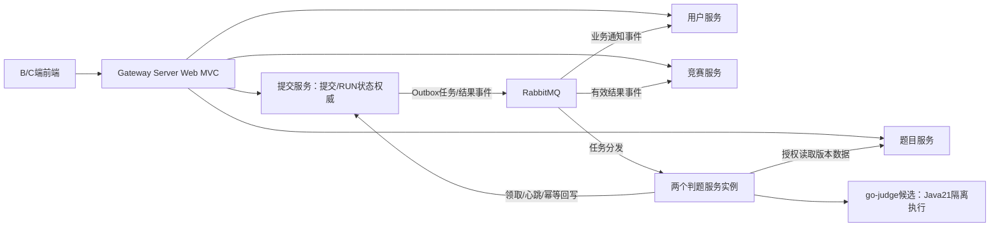

# Byte Judge 技术选型调研

| 文档属性 | 内容 |
| --- | --- |
| 日期 / 版本 | 2026-11-02 / V1.0 |
| 状态 | **技术选型方向已由用户确认；具体制品版本与适配待原型验证；不是实现验收记录** |
| 需求基线 | [02.需求规格说明书.md](./02.需求规格说明书.md)；V1.2，已同步首期 Java 21 范围及变更记录 |
| 证据范围 | 本次实时查阅官方文档、官方发布页；未安装候选组合，未运行兼容性、安全、资源或性能测试 |

## 1. 已确认的技术选型基线

用户通过分轮访谈确认以下方向，并在最后一轮明确回复“全部按推荐”。本版据此结束技术方向访谈，作为后续概要设计和原型验证的基线。**技术方向已确认，具体补丁、制品摘要、参数和端到端兼容性尚未验证**；两者应分别记录。

项目以单人可维护、完整交付全部 P0 为优先；验收基线为 8 vCPU / 16 GiB Linux，先面向受控试用。用户接受复用成熟开源沙箱，首期只支持 Java 21；C++17、Python 3 及语言切换延后。工期和个人技术经验未提供，不作为本版完成的前置条件，也不据此承诺交付日期。

| 层次 | 已确认方案 | 选择理由与边界 |
| --- | --- | --- |
| 后端框架 | Java 21、Spring Boot 4.0.x、Spring Cloud 2025.1.x、Spring Cloud Alibaba 2025.1.x | 用户指定Alibaba方向；采用官方匹配版本线，补丁及第三方starter另行验证 |
| 注册与配置 | Nacos 3.x | 统一服务发现及外置配置；服务端版本与BOM客户端版本分别确定 |
| 网关与调用 | Gateway Server Web MVC、Spring HTTP Service Clients、LoadBalancer | 统一Servlet技术路线，声明式调用并结合服务发现；超时/熔断适配须验证 |
| 流控与熔断 | Sentinel | 保护入口和内部调用；账户/IP登录限频及活跃任务配额仍由业务规则保证 |
| 身份与授权 | Spring Security、Spring Session Redis、Session + Cookie | 保留需求身份路线；各服务验证权限及归属，禁用/改密/退出撤销旧会话 |
| 内部认证 | 独立服务凭据、私有网络访问限制 | 与浏览器会话分离；精确授权领取/心跳/回写及数据读取，凭据不进入沙箱 |
| 业务存储 | MySQL 8.4 LTS，单实例按服务分库、独立账号 | 控制资源和运维成本，保持数据归属；提交服务是提交/RUN状态唯一权威 |
| 数据访问与迁移 | MyBatis-Plus Boot4 starter、Flyway版本化SQL | 常规访问与表结构演进分工明确；锁、唯一约束、迁移及恢复需实测 |
| 会话、缓存与限频 | Redis单实例 | 统一会话和需要共享的临时状态；配额、持久化和命名空间按用途隔离 |
| 消息与可靠发布 | RabbitMQ、Spring AMQP、事务Outbox、幂等消费 | 服务解耦及可靠补偿；不依赖MQ提供业务恰好一次或数据库原子性 |
| 判题执行 | Java 21 单文件，go-judge为优先验证底座 | 复用隔离执行能力，自建判定适配与编排；未通过关键原型前不视为沙箱制品定案 |
| 计划调度 | Spring CronExpression、数据库持久计划/触发/租约 | 直接匹配Spring六字段语义，按BR-15实现去重、撤权、重试和历史 |
| 题库搜索 | MySQL关键词查询及实时可见性检查 | 实现词AND/字段OR语义，按1万题及混合负载验证性能 |
| 测试数据文件 | 题目服务管理受保护持久卷、版本摘要与内部授权读取 | 隐藏数据不公开，任务只读所需版本，数据库/文件共同备份 |
| B/C端前端 | Vue 3、TypeScript、Vite、Element Plus；独立工程 | 两端共用技术栈，按各自业务角色组织页面 |
| 在线编辑器 | Monaco Editor，首期固定Java | 满足高亮、缩进、粘贴等需求；不把完整Java IDE能力纳入本期 |
| Web部署 | 前端和API同源，单台Linux、Docker Compose | 降低跨域与运维复杂度；双判题/双调度及配额需验证，沙箱实际部署方式由原型确定 |
| 观察与诊断 | Actuator、Micrometer、结构化关联日志 | 保护健康/指标入口，关联请求、提交、轮次、尝试与节点 |

### 1.1 比较后首期未采用的方案

| 方案 | 本期取舍理由 |
| --- | --- |
| RocketMQ | 同样能承载任务与事件；当前单人单机项目优先RabbitMQ的部署维护路径，详见第6节，不是吞吐或内存实测胜负结论 |
| Gateway WebFlux、OpenFeign | 统一Servlet模型并选用Spring HTTP Service Clients；它们仍是有效替代方案，不等于不可用 |
| Seata | 先围绕事实所属服务、本地事务、Outbox及补偿设计一致性，未引入额外分布式事务设施 |
| Quartz、SchedulerX | 已选Spring cron持久执行层；Quartz仍需语义适配和业务执行权，暂不叠加调度设施 |
| Elasticsearch | 需求不强制独立搜索引擎，先验证MySQL方案；性能失败须重新评估方案，不能降低既有验收目标 |
| 对象存储服务、集中日志集群、Kubernetes | 首期采用受保护持久卷、基础指标/日志和Compose，避免引入目前无必要性的运维组件 |

这些是本项目资源和交付目标下的工程取舍，相关能力和原型边界见各节官方来源。今后若改变已确认方向，应记录动因、影响和替代方案；修复安全问题或更换匹配补丁属于制品验证过程，但不能静默改动需求范围。

### 1.2 主要协作路径

下图表达选型后的职责关系，具体接口和事件契约由概要设计确定。

Nacos提供注册与配置；Redis承载共享会话等状态；MySQL中各服务只写自己拥有的数据。两判题实例可在同一机器运行，须分别限制编译/运行资源，沙箱无业务网络和基础设施凭据。

## 2. 需求约束追踪

下表来自需求基线和本轮用户确认，是候选方案必须满足的条件，不是实现完成情况。首期评测语言按本轮确认收敛为Java21；相关条款已同步至需求 V1.2。

| 约束 | 对应需求 | 对选型的约束 |
| --- | --- | --- |
| 独立服务和统一入口 | AR-01～AR-03、AR-07、AT-25 | 用户、题目、提交、判题、竞赛及网关独立部署；注册发现协作、配置外置；不另拆空壳管理服务 |
| 唯一业务状态权威 | AR-02、AR-05、DR-04～DR-05、AT-17 | 提交服务拥有正式提交/RUN、轮次、尝试、有效结果；判题节点领取授权并回报，不直接任意写业务表 |
| Session + Cookie | §2.4、AR-04、NFR-06、AT-02/13/19 | 跨实例身份一致；退出/禁用/改密撤销旧身份；每层鉴权、CSRF、Cookie及跨域策略齐备 |
| 受理和任务可靠性 | FR-06/16、BR-05/06、NFR-07、AT-06/15～17 | 先持久化受理与可恢复安排；可重复投递；有界尝试/截止、租约及旧回调隔离；失联60秒、恢复安排或SE120秒目标 |
| 双判题实例及业务隔离 | AR-06、NFR-02/05/07、AT-16/18/21 | 两实例实际分担任务；Linux隔离与资源计量；满载判题不能耗尽查询服务预算 |
| 个人ACM和可重建排名 | FR-18/20～24、BR-10～12、NFR-11 | 持久受理时间决定正式归属；冻结版本、赛前保密；重复/乱序/迟到/重判后从可信正式记录重算，5秒收敛 |
| 消息唯一性及补偿 | FR-17、BR-14、DR-09、NFR-13 | 用户+事件去重；删除后不被重投复活；正常10秒、恢复后60秒可见；消息归用户服务 |
| 安全持久计划 | FR-25、BR-15、DR-11、AT-37/38 | Spring六字段cron、Asia/Shanghai、最小间隔60秒；配置/历史持久化；同触发最多一个有效执行者、最多3尝试、10秒重试、60秒超时撤权 |
| 可复现和资源边界 | NFR-08/10、§10.1 | 制品及限额固定、备份恢复、可关联日志；资源基线不是实测足够的保证 |

### 2.1 现有工程的复用边界

根项目说明已明确历史模板不代表最终选型。本次初始核对中，后端保留Maven等模板但没有业务源码，B/C端没有前端依赖清单；不能将依赖存在写成业务运行通过。[根项目说明](../CLAUDE.md)、[后端依赖模板](../byte-judge-backend/pom.xml)

后端旧指引中的固定盐MD5、将ban当角色，以及旧README/Boot3 starter用法与当前需求或版本线不同。实现时按SRS的随机盐自适应密码摘要、独立账户状态和本版Boot4选型处理；旧说明只作为历史参考，不复制为新安全或权限设计。[后端旧指引](../byte-judge-backend/CLAUDE.md)、[旧README](../byte-judge-backend/README.md)

## 3. Spring Cloud Alibaba 版本与支持边界

### 3.1 已查证的正式版本

SCA 官方版本表列出以下两条 2025.x 适配线；官方 README 对两条线均声明支持 JDK 17 及以上。[SCA版本说明](https://sca.aliyun.com/en/docs/2025.x/overview/version-explain/)、[官方README](https://github.com/alibaba/spring-cloud-alibaba/blob/2025.1.x/README.md)

| SCA候选正式版本 | 官方表列Cloud基线 | 官方表列Boot基线 | 官方分支适配范围 | 集成的nacos-client基线 |
| --- | --- | --- | --- | --- |
| 2025.1.0.0 | 2025.1.0 | 4.0.0 | Cloud2025.1.x / Boot4.0.x | 3.1.1 |
| 2025.0.0.0 | 2025.0.0 | 3.5.0 | Cloud2025.0.x / Boot3.5.x | 3.0.3 |

**适配 Boot 4 / Cloud 2025.1 的正式 SCA 发布确实存在**：官方 `2025.1.0.0` Release 记录了框架支持、上述基线升级与 nacos-client 3.1.1；它不是仅有规划或 SNAPSHOT 的候选。[正式Release](https://github.com/alibaba/spring-cloud-alibaba/releases/tag/2025.1.0.0)；另一条线也有[2025.0.0.0正式Release](https://github.com/alibaba/spring-cloud-alibaba/releases/tag/2025.0.0.0)。

业务后端已选择Java 21：SCA声明17+，本次读取的Boot4.0.9系统要求声明Java17～27。业务JDK与评测JDK21分别固定制品；业务Java21是用户接受的选型，不是从评测语言约束自动推导的架构要求。[Boot4.0系统要求](https://docs.spring.io/spring-boot/4.0/system-requirements.html)

### 3.2 维护声明存在不同层次

本次读取的 SCA FAQ 把 `2025.0.x` 与 `2025.1.x` 均列为 actively maintained；该页面没有给出本项目可据以承诺的固定维护截止日期。[SCA FAQ](https://sca.aliyun.com/en/docs/2025.x/overview/faq/)

与此同时，Spring Cloud 项目页把2025.0.x标为已结束支持；其当前2025.1.x矩阵支持Boot4.0.x，以及从Cloud2025.1.2起支持Boot4.1.x。官方GitHub支持wiki的2025.0列仍未划线，存在官方页面更新不同步。[Spring Cloud项目矩阵](https://spring.io/projects/spring-cloud/)、[官方支持wiki](https://github.com/spring-cloud/spring-cloud-release/wiki/Supported-Versions)

**调研判断**：不能把Spring上游某条线的支持状态直接扩写成“Alibaba全部停止维护”，也不能用Alibaba分支仍维护来保证其上游Boot/Cloud长期安全维护。用户已确认2025.1/Boot4.0/Java21版本线，接下来应核实所用数据库访问、接口文档、网关和安全依赖的适配。2025.0/Boot3.5保留为比较/回退方案；若回退，应记录上游生命周期、维护来源及预计交付时点风险。

### 3.3 补丁版本验证边界

版本表中的初始基线不是要求项目永久停留在初始补丁，也不是证明任意更新补丁全部兼容。SCA官方分支表未声明Boot4.1适配，不能仅依据Spring Cloud允许Boot4.1就认定SCA组合已验证。

**候选验证方法**：采用匹配的Boot、Cloud BOM与SCA BOM，不手动混搭单个Spring组件；在临时原型里记录依赖解析结果、传递版本、启动兼容检查及实际调用。对安全补丁升级、nacos-client覆盖及第三方starter升级分别保留验证结果；任何组件的“最新版”标签都不能代替最终依赖锁定与制品摘要。本轮没有执行这些操作。

## 4. Nacos 注册与配置

Nacos 注册/配置方向已获用户接受，尚未锁定部署模式和服务端版本。SCA Release 中的 `nacos-client` 版本是客户端集成基线，不是Nacos服务器镜像版本。

Nacos 官方发布历史本次显示最新GA为3.3.0，发布日期2026-10-29、要求Java17；其3.3升级手册声明服务器兼容2.x和3.x客户端，1.x不再直接支持。通用发布历史中仍有较宽泛的向后兼容描述，具体行为应以目标版本升级/废弃说明为准。[发布历史](https://nacos.io/en/download/release-history/)、[3.3升级与客户端兼容](https://nacos.io/en/docs/latest/manual/admin/upgrading/)

**调研建议**：优先保留SCA BOM管理的3.x客户端，另选仍维护且安全修复明确的Nacos3.x服务端；较新服务器与3.1.1客户端的协议兼容声明可作为候选依据，不能当作本项目SCA端到端测试通过。对选定服务器补丁验证鉴权、注册/注销、故障摘除、配置读取和重启恢复，避免为了“客户端同号”固定在未经安全核查的旧服务器。

Nacos客户端除主端口默认8848外还使用默认9848的gRPC通信；网络策略不能只放通控制台网页端口。[部署通信说明](https://www.nacos.io/en/docs/v3.2/manual/admin/deployment/deployment-overview/) SCA2025.1正式Release移除了Nacos bootstrap配置支持，要求转用`spring.config.import`，不能沿用旧教程直接复制`bootstrap.yml`方案。[SCA正式Release](https://github.com/alibaba/spring-cloud-alibaba/releases/tag/2025.1.0.0)

**部署边界**：单机受控试用可评估单Nacos实例，注册中心高可用不因采用微服务而自动成为额外目标；双判题节点及双调度实例仍须按规格验证。业务共享配置采用已确认的Nacos Config方向，启动连接信息与敏感凭据由受控环境/文件提供，避免将凭据写入仓库或沙箱。Nacos单节点本身的故障影响、恢复与配置备份须写入部署说明。

## 5. 网关、共享会话与服务身份

Spring Cloud Gateway 有Server Web MVC与WebFlux两条实现。MVC使用Servlet运行时，官方提供基于LoadBalancer选择服务实例的过滤器。[MVC starter](https://docs.spring.io/spring-cloud-gateway/reference/spring-cloud-gateway-server-webmvc/starter.html)、[MVC LoadBalancer](https://docs.spring.io/spring-cloud-gateway/reference/spring-cloud-gateway-server-webmvc/filters/loadbalancer.html)

**已确认**：业务和网关均采用MVC，网关为Gateway Server Web MVC，减少两种安全编程模型并存。WebFlux保留为比较后未采用的方案；仍须验证Nacos发现、路由、Cookie传递、CSRF和超时，不能仅凭相同Servlet运行时认定配置兼容。

Spring Session分别提供Redis支持的HttpSession和WebSession集成，两者使用不同Web集成API。[HttpSession](https://docs.spring.io/spring-session/reference/http-session.html)、[WebSession](https://docs.spring.io/spring-session/reference/web-session.html) Redis配置文档指出默认使用Java序列化；跨应用类版本差异可能造成问题。按用户检索并删除会话需要indexed repository，而不是默认的普通repository。[Redis会话配置](https://docs.spring.io/spring-session/reference/configuration/redis.html)

**已确认**：Spring Security + Spring Session Redis，保留Session + Cookie约束。统一Cookie名/路径、Redis命名空间、序列化和最小身份契约；避免把业务实体直接塞入共享Session。批量撤销可评估indexed repository；每个受保护请求还须检查账户状态或有效会话版本，不能以“Redis中共享了会话”代替禁用立即生效与业务归属检查。并发请求、会话撤销与保存竞争需要原型覆盖。

Spring Security官方要求SPA注意CSRF token处理；登录和退出成功会清理旧token，后续状态变更前应取得新token。[CSRF与SPA](https://docs.spring.io/spring-security/reference/servlet/exploits/csrf.html) **已确认部署方向**为前端和API同源、会话Cookie具备HttpOnly/HTTPS Secure/适当SameSite、写操作携带CSRF token；同源不能替代CSRF保护。CSRF token若需JS读取，其Cookie策略与会话Cookie应分开配置。

业务服务仍须独立鉴权并剥离/拒绝不可信用户身份头；浏览器Session不授予内部判题接口权限。内部服务采用独立受控凭据和私有网络限制；每项内部操作验证调用服务及任务授权，执行凭据另与轮次/尝试绑定。凭据按服务分发、支持轮换、从环境或受控文件注入；敏感传输使用TLS及最小化日志。mTLS作为后续增强，不计入当前额外基础设施。评测沙箱不得获得Redis、Nacos、数据库或内部业务凭据。

**服务调用已确认Spring HTTP Service Clients + LoadBalancer**，以RestClient支撑同步调用，并核对Nacos发现及Sentinel保护的实际集成。官方仍维护OpenFeign，但已将其定位为feature-complete并建议迁移HTTP Service Clients，不应误写为“已经不能用”。[OpenFeign官方定位](https://docs.spring.io/spring-cloud-openfeign/reference/index.html)

## 6. 可靠任务、消息与Outbox

RabbitMQ官方区分publisher confirms和consumer acknowledgements，二者分别覆盖生产者到broker及broker到消费者，互不代表另一端已完成业务；故障恢复可能重复投递，消费者仍需去重/幂等。[确认机制](https://www.rabbitmq.com/docs/confirms)、[可靠性指南](https://www.rabbitmq.com/docs/reliability)

因此 **Outbox与RabbitMQ不是互斥替代品**。本项目可在拥有业务事实的数据库事务内同时写入受理/变更与待处理事件，再由后台投递；这属于设计建议，不是RabbitMQ自带的数据库原子性保证。

RocketMQ5官方部署文档区分NameServer、Broker、Proxy；Local模式允许Broker与Proxy运行于同一进程，Cluster模式才把Proxy分开。官方Compose快速开始给出了三组件分别部署的示例，但这不意味着必须有三个独立进程。[RocketMQ部署模式](https://rocketmq.apache.org/docs/deploymentOperations/01deploy/)、[Compose快速开始](https://rocketmq.apache.org/docs/quickStart/03quickstartWithDockercompose/)

**用户已确认RabbitMQ及Spring AMQP + 事务Outbox + 幂等消费的配套方向**。Spring AMQP提供RabbitMQ集成抽象。[Spring AMQP](https://docs.spring.io/spring-amqp/reference/) 推荐理由是本项目单人维护、16GiB、完整P0优先且尚无大消息吞吐要求，优先减少需要排查的broker拓扑和配置组合。这是项目工程判断，**不是RabbitMQ与RocketMQ内存/性能基准测试结论**；没有声称RocketMQ无法在16GiB运行。RocketMQ此前的推荐侧重Alibaba集成一致性，该优势不直接证明交付成本更低；本轮比较后首期不采用它。

| 候选 | 设计建议 | 收益 | 成本及必须补足的行为 |
| --- | --- | --- | --- |
| Outbox + RabbitMQ + Spring AMQP（方向已确认，实际实现待验证） | Outbox可靠发布，confirm/不可路由处理；受限prefetch、业务落库后ack；补偿扫描 | 适合当前任务队列与事件分发；优先控制单人部署维护范围 | 增加broker资源/备份/恢复及投递状态；不能以ack替代有效结果唯一性、旧凭据隔离和全轮截止 |
| Outbox + RocketMQ（比较后首期不采用） | 若未来变更须验证SCA集成starter及实际SDK；不默认叠加事务消息等能力 | 沿用Alibaba提供的集成路径；可利用已有RocketMQ经验 | 需明确NameServer/Broker/Proxy模式、SDK兼容及资源预算；同样需要Outbox补偿、幂等、执行权和截止 |
| 数据库持久任务/Outbox + HTTP领取/投递（比较/回退） | 提交服务事务保存任务，判题节点通过内部接口领取/心跳/回报；跨服务事件持久投递、接收去重 | 少一个broker设施，较直接追踪受理与恢复 | 需实现公平领取、租约/隔离令牌、退避、监控和清理；轮询负载与延迟须实测 |

若Outbox或持久计划采用数据库并发领取，应核对MySQL8.4目标版本的锁语义、唯一约束和事务边界，并验证领取公平性、租约过期与旧执行者撤权；本轮未执行这些原型。

无论选哪条运输路径，提交服务继续作为唯一状态权威；运行、发布校验和正式提交应区分类型与限额。竞赛排名接收提交服务可信事件并可从正式有效记录重建；通知落在用户服务，以用户+事件/对象修订唯一，并保留删除去重标记。跨服务有超时、重试及补偿，不把比赛结束资格、榜单正确性或消息唯一性依赖于某次调度刚好成功。

## 7. 持久调度与cron语义陷阱

Spring `CronExpression`采用六字段、周日为0或7；其官方Javadoc明确指出Quartz采用周日1～7，两者语义不同。[Spring CronExpression](https://docs.spring.io/spring-framework/docs/current/javadoc-api/org/springframework/scheduling/support/CronExpression.html) **BR-15指定的是Spring风格**，同一字符串不能直接交给Quartz并假设星期含义相同。

Quartz JDBC集群共享数据库并通过锁领取触发，一次触发由一个节点执行；标记请求恢复的任务可能在故障后重新执行。`@DisallowConcurrentExecution`按JobKey约束并发。[Quartz集群](https://www.quartz-scheduler.org/documentation/quartz-2.4.x/configuration/ConfigJDBCJobStoreClustering.html)、[并发注解](https://www.quartz-scheduler.org/api/2.3.0/org/quartz/DisallowConcurrentExecution.html) 这不等于外部副作用天然恰好一次，也不自动撤销失联旧执行者的写权限。

Boot的Quartz默认使用内存JobStore，需显式选择JDBC持久化；官方提示标准初始化脚本可能删掉既有表和trigger，不可把示例`initialize-schema=always`照搬为持久环境配置。[Boot Quartz](https://docs.spring.io/spring-boot/reference/io/quartz.html) Quartz提供DoNothing等misfire策略，但项目仍需定义和验证其与停机、重叠、迟到触发的关系。[CronScheduleBuilder](https://www.quartz-scheduler.org/api/2.3.0/org/quartz/CronScheduleBuilder.html)

| 候选 | 适配办法 | 仍必须实现 |
| --- | --- | --- |
| Spring cron解析 + 数据库持久计划/触发/租约 | 用Spring解析器和Asia/Shanghai计算下次执行及未来3次；原子领取到期触发，停机后跳到下一未来时刻 | 配置修订、唯一触发键、幂等、10秒重试且总共3次、60秒超时撤权、跳过重叠、禁用竞争、180天历史和内置保护 |
| Quartz JDBC集群 + 受控业务执行层 | 不直接接受原始Quartz cron；可评估Spring解析后生成一次性trigger，或有完整验证的语义转换；设置明确misfire策略 | 同样的业务执行权/重试/历史/白名单层；验证同JobKey不并发不被误当作“重叠触发记录为跳过”；验证调度表与业务配置一致性 |

**已确认Spring cron解析 + 数据库持久计划/触发/租约**，首期不引入Quartz和SchedulerX。该方向仍需完成BR-15完整语义原型，不能因为已有`@Scheduled`或Quartz依赖就声称后台任务CRUD与安全执行已完成。竞赛开始/结束必须从服务端时间和持久事实实时判断，内置补偿不可由管理员计划的停用/删除关闭。

## 8. Java 21 沙箱候选与适配缺口

首期语言已收敛为 Java 21，仍须完整覆盖 AC、WA、CE、TLE、MLE、RE、OLE、SE。语言数量减少不会自动解决 JVM 内存、后代进程计量或隔离问题。**go-judge 是用户接受的优先验证候选，尚未通过原型，也未最终冻结。**

| 方案 | 官方事实 | 本项目判断 |
| --- | --- | --- |
| go-judge | 已有执行API，Linux执行层使用 criyle/go-sandbox 的隔离及cgroup能力，不是 runc/crun 路线。[API](https://docs.goj.ac/api)、[Linux执行构建源码](https://github.com/criyle/go-judge/blob/master/env/env_linux.go) | 优先验证，Java服务适配其执行API，评测编排和业务状态仍属于本项目 |
| isolate | 面向竞赛执行，支持cgroup计量和文件系统配额，须满足对应内核及文件系统前提。[官方手册](https://github.com/ioi/isolate/blob/master/isolate.1.txt) | 备选底座；需自行封装执行服务、编译运行和输出收集 |
| nsjail | 提供namespace、cgroup、rlimit、seccomp等限制。[项目及配置](https://github.com/google/nsjail) | 通用底座，累计CPU、OJ判定与证据收集需要更多适配 |
| Judge0 | 提供异步执行平台和提交API。[API](https://ce.judge0.com/)、[执行源码](https://github.com/judge0/judge0/blob/master/app/jobs/isolate_job.rb) | 与本项目提交/worker边界存在重复；现有文档不足以证明Java21和全部判定语义匹配 |
| 直接Docker执行 | 提供资源/网络隔离，但默认无资源约束；CPU带宽不是累计CPU时间截止。[资源限制](https://docs.docker.com/engine/containers/resource_constraints/)、[网络none](https://docs.docker.com/engine/network/drivers/none/) | 不能仅凭容器启动成功证明判题安全与计量正确，需自建更多执行控制 |

### 8.1 go-judge 必须验证和补齐的行为

以下源码链接指向本次检查的 master，正式原型需记录固定commit和制品摘要，不能依赖可漂移的分支名称。

1. **判定优先级**：现有执行代码可能在输出错误后以TLE覆盖，再以MLE覆盖，与BR-04的 MLE > OLE > TLE > RE > WA 不完全相同。应保留独立超限证据，由判题服务按业务规则归类；不能直接透传单一status。[判定源码](https://github.com/criyle/go-judge/blob/master/envexec/run_single.go)、[输出收集](https://github.com/criyle/go-judge/blob/master/envexec/file_collect.go)、[pipe收集](https://github.com/criyle/go-judge/blob/master/envexec/file_pipe.go)
2. **禁止静默降级**：官方提供 -no-fallback，避免cgroup失败后降级至rlimit/rusage。官方设计说明区分内核5.19前后的memory.peak路径；实际验收还需探测内核回移补丁及控制器能力，不能只检查版本字符串。[设计](https://docs.goj.ac/design)
3. **CPU与内存口径**：Linux cgroup v2的cpu.stat记录组及后代CPU，memory.peak记录组及后代峰值；cpu.max是带宽限制，不能当作累计时间截止。PID控制器计数包含线程。须验证并发父子进程、短暂内存尖峰及清理。[Linux cgroup v2](https://www.kernel.org/doc/html/latest/admin-guide/cgroup-v2.html)
4. **总可写配额**：默认 /w、/tmp 各自为128MiB/4k inode tmpfs，与BR-05单点总64MiB/1024文件目录不同；分别调成64MiB也不代表合计符合。需覆盖整个可写面并区分编译256MiB/4096与运行64MiB/1024；文件大小和打开文件数限制不可替代总配额。[挂载配置](https://docs.goj.ac/mount)
5. **固定语言制品**：默认绑定宿主工具链路径不能证明历史重判环境不变；应使用固定rootfs/制品摘要，保存JDK发行版、完整补丁、编译参数与环境ID。[独立rootfs](https://docs.goj.ac/rootfs)
6. **Java内存与线程**：-Xmx限制堆，不包含全部metaspace、code cache、线程栈等。默认512MiB是隔离组总峰值，不能直接设置-Xmx512m后宣称满足。JVM启动、JIT、GC及线程均需在真实制品校准。[Java21参数](https://docs.oracle.com/en/java/javase/21/docs/specs/man/java.html)
7. **网络和特权边界**：seccomp不是网络命名空间的替代品，不得启用网络共享；沙箱无业务凭据、其他任务数据或容器控制接口。执行程序非特权与沙箱管理器所需宿主权限应分开说明，不能假定管理器完全无需特权。[seccomp](https://docs.goj.ac/seccomp)、[配置](https://docs.goj.ac/configuration)、[Docker安全边界](https://docs.docker.com/engine/security/)

### 8.2 Java 原型最小证据集

- 单文件无package的Main正常编译运行；三类业务场景、RUN与发布校验都使用同一不可变环境；未支持语言拒绝。
- AC/WA/CE及稳定TLE/MLE/RE/OLE；缺编译器等故障为SE；编译超限按CE处理。
- 输出恰好1MiB及多1字节、持续输出与死循环组合、异常退出与超输出组合、内存与输出组合，按BR-04归类。
- 后代CPU、父子同时内存、短暂峰值、线程膨胀、全部可写路径总量和inode；缺计量能力拒绝接任务。
- 外网/业务内网/敏感文件/其他任务不可访问；结束10秒及重启60秒内清理；双worker失联和迟到结果按60/120秒恢复目标验证。

任一关键能力不足时保留未决项，评估适配或切换底座，不通过降低安全边界使候选“达标”。

## 9. 数据访问、搜索、前端与运维

### 9.1 数据访问和搜索

MySQL8.4是LTS发布线，用户已接受单实例按服务分库及独立账号的方向；不据此引入跨服务任意写表。[MySQL发布模型](https://dev.mysql.com/doc/refman/8.4/en/mysql-releases.html)

MyBatis-Plus官方已提供Boot4专用starter，文档说明从3.5.13起支持Boot4，当前安装页示例为3.5.18；应使用对应starter并验证BOM、分页插件、事务和逻辑删除，不能继续照搬模板的Boot3 starter。[安装说明](https://baomidou.com/en/getting-started/install/) **已确认**：MyBatis-Plus负责常规数据访问，Flyway版本化SQL管理表结构；MySQL支持模块、Connector/J与实际迁移流程另做验证。[Flyway MySQL](https://documentation.red-gate.com/flyway/reference/database-driver-reference/mysql)

**搜索方向已确认**：首期先实现MySQL查询，按空白拆词，以词AND/公开字段OR匹配并实时检查可见性；不引入独立搜索服务。LIKE中的百分号和下划线是通配符，用户输入须按字面语义转义并参数化；大小写/重音规则由目标collation明确，不能假设默认排序规则恰好符合需求。[MySQL模式匹配](https://dev.mysql.com/doc/refman/8.4/en/pattern-matching.html) 该方案必须在1万题元数据和规定混合负载下实测；未取得证据前不能承诺P95达标。若不达标，先调查询/公开投影，再比较索引方案；任何搜索索引都不能替代实时授权。

### 9.2 前端

用户已接受Vue3、TypeScript、Vite、Element Plus与Monaco方向。Element Plus是Vue3组件库；Monaco是浏览器代码编辑器，并不自动带来Java服务端编译诊断或完整IDE能力。[Element Plus](https://element-plus.org/en-US/)、[Monaco项目](https://github.com/microsoft/monaco-editor)

首期编辑器固定Java，不展示未实现语言；语法高亮、缩进、复制粘贴和草稿恢复按FR-05/UX-03验收。题面/诊断渲染需处理XSS。三浏览器、1366×768、登录失效恢复、换账户隔离及竞赛权限均须验证；编辑器本身不能替代这些业务行为。

### 9.3 部署、文件与观察

业务及中间件按已接受的单机Compose方向规划。go-judge实际运行方式须在Linux资源与权限原型后确定，不能为了全容器化而把宿主控制socket授予用户程序。双worker不构成宿主机高可用，单机故障及恢复边界应写入部署说明。

**已确认**：题目数据由题目服务管理受保护持久卷与摘要，通过内部授权按任务提供；提交源码与业务元数据在所属服务数据库持久化。隐藏数据不放公开静态目录，判题任务只拿所需版本。数据库和文件需共同备份及恢复核验；首期使用受保护持久卷，对象存储作为后续扩展。

**观察方向已确认**：Actuator/Micrometer暴露受保护健康和指标，结构化日志统一携带请求/提交/轮次/尝试ID；压测及故障演练记录真实结果，首期不默认部署整套集中日志基础设施。[Boot指标](https://docs.spring.io/spring-boot/reference/actuator/metrics.html)

## 10. 已确认方向与待验证制品

本轮没有剩余需要用户在技术路线之间选择的事项。以下项目属于后续实现前的制品和参数验证，不能混称为“用户尚未确认”。若验证发现根本不匹配，需记录证据并调整方案，不能将未执行写成通过。

| 项目 | 已确认方向 | 待取得的技术证据 |
| --- | --- | --- |
| 框架版本 | Java21、SCA2025.1、Cloud2025.1、Boot4.0 | 安全补丁、BOM依赖树、第三方starter兼容、最小协作启动 |
| 注册与配置 | Nacos3.x注册/配置 | 客户端与服务端精确版本、鉴权、配置载体、注册/注销/摘除、恢复和资源 |
| 网关与调用 | Gateway Server Web MVC、HTTP Service Clients、LoadBalancer、Sentinel | 发现调用、超时/熔断与重试边界；状态变更重试幂等；Cookie/CSRF协作 |
| 身份与内部认证 | Security、Session Redis、同源部署、独立服务凭据 | Cookie/序列化契约、会话撤销竞争、禁用下一请求、伪造头/直连及凭据轮换 |
| 数据库与访问 | MySQL8.4单实例按服务分库、MyBatis-Plus、Flyway | 唯一约束/事务/领取锁语义、迁移失败和恢复、账号隔离 |
| 会话与缓存 | Redis单实例 | 版本与许可条件、用途隔离、淘汰/持久化策略；会话被淘汰安全失效且不改变持久业务事实 |
| 异步运输 | RabbitMQ、Spring AMQP、Outbox、幂等消费 | 版本、队列持久化/确认/不可路由处理、重复/乱序/故障恢复；重试与轮次预算分离 |
| 调度 | Spring cron与数据库持久计划/触发/租约 | BR-15完整语义、双实例、失联/超时、停用竞争与内置保护 |
| 沙箱及Java制品 | Java21-only、go-judge优先验证 | 固定commit/镜像/rootfs与许可、八类判定、计量/磁盘/隔离/残留、双worker恢复 |
| 搜索 | MySQL查询、实时可见性检查 | 分词/匹配/大小写语义、泄题负面用例、1万题混合负载和判题积压下性能 |
| 前端及编辑器 | Vue3、TS、Vite、Element Plus、Monaco | Node及依赖锁、Java编辑交互、三浏览器、富文本安全、草稿恢复 |
| 文件与恢复 | 受保护持久卷、摘要及内部读取授权 | 文件/数据库版本一致性、权限、备份恢复及任务临时文件清理 |
| 部署与观察 | Linux8vCPU16GiB、Compose、Actuator/Micrometer、关联日志 | 全进程及双判题/双调度实例预算、指标权限、故障隔离、实际资源余量 |

建议按“Java沙箱与框架协作 → 共享身份与可靠任务 → 竞赛计分及持久调度 → 页面闭环与混合压测”的顺序验证。用户未提供工期，本版只确定依赖顺序，不编造工时或完成日期。

## 11. 原型验证门槛与制品锁定条件

以下是后续必须取得的证据，当前全部**未执行、无通过结论**。原型达标只用于降低选型风险，不能代替完整AT-01～AT-41验收。

| 门槛 | 必须证明的结果 | 关联 |
| --- | --- | --- |
| 框架协作 | 固定候选BOM/JDK/镜像；网关通过Nacos发现调用业务服务，无实例地址硬编码；配置外置，记录实际传递依赖 | AR-01～03、AT-25 |
| 身份安全 | 跨实例请求同一Session；退出/改密旧会话失效、禁用下一受保护请求拒绝；CSRF正确轮换；直连/伪造头/网页身份访问内部执行被拒绝 | AR-04、AT-02/13/19 |
| 可靠任务 | 两判题实例均实际领取；在落库后投递前、执行前、回写前、确认前故障不丢受理；重复投递和旧授权不重复生效；满足60/120秒恢复目标及轮次预算 | AT-06/15～17 |
| 竞赛和通知 | start/end边界及赛前所有入口保密；乱序/迟到/重判按可信记录重建榜；消息不重复、不复活删除项，满足5秒榜/10秒消息/60秒补偿 | AT-27/32～35/40 |
| 持久调度 | Spring星期语义、未来3次、最小间隔；双实例同触发唯一有效权；3次上限/10秒重试/60秒超时；重叠跳过、停用竞争和停机不补风暴；历史持久 | AT-37/38 |
| 沙箱与资源 | 首期Java21正常及恶意程序验证八类判定和全部隔离、计量、输出/磁盘/进程/网络约束；双worker和中间件同时运行时记录配额、分配与恢复，判题满载仍满足查询性能；不得泄漏基础设施凭据 | AT-07/08/16～18/21/22 |
| 可复现 | 在独立环境恢复数据库、题目数据、计划/时区与语言制品，核对关联/摘要；记录启动、故障注入、备份及恢复步骤 | AT-23/26 |

制品锁定时应保留最终版本矩阵、实测环境与证据、尚存风险和对应需求编号；技术方向与取舍理由已记录在本版。若资源或期限不足，先调整设计并与项目负责人处理需求变更，不把未验证写成通过，也不在本文暗中削减P0。

## 12. 本轮调研完成记录

| 项目 | 状态 |
| --- | --- |
| 需求读取与架构约束提取 | 已完成，追踪到需求V1.2及既有需求编号 |
| 官方资料与候选比较 | 已完成本轮选型所需资料核查，来源就近列出；可变网页和master源码须在制品锁定时复核 |
| 选型访谈 | 已完成；用户确认Alibaba方向、RabbitMQ、Java21-only，并最终接受Q14～Q20全部推荐 |
| 范围同步 | 01/02已更新V1.2，C++17/Python3及语言切换延后，其余P0及安全/恢复要求保留 |
| 文档检查 | 已核对当前范围、确认状态、标题编号、Markdown本地链接及差异空白；本项仅为文档检查 |
| 依赖构建与技术原型 | 未执行；具体补丁、资源配额和go-judge最终适配结论待第10～11节验证 |
| 业务实现与完整验收 | 未执行；仍须完成AT-01～AT-41的全部当前必测分支 |

本轮产出为技术选型调研与已确认方向。下一阶段据此编写概要设计、接口/事件契约与物理数据模型，再用原型锁定制品；本文不把调研完成等同于系统已可运行。
