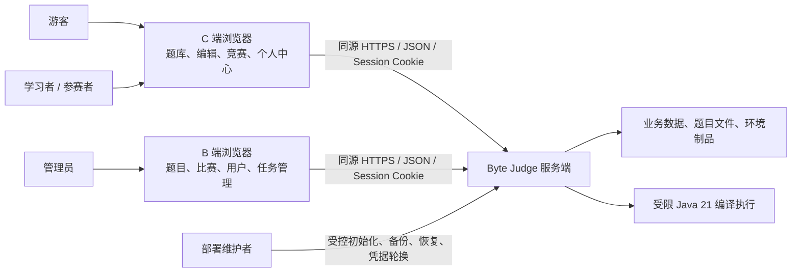
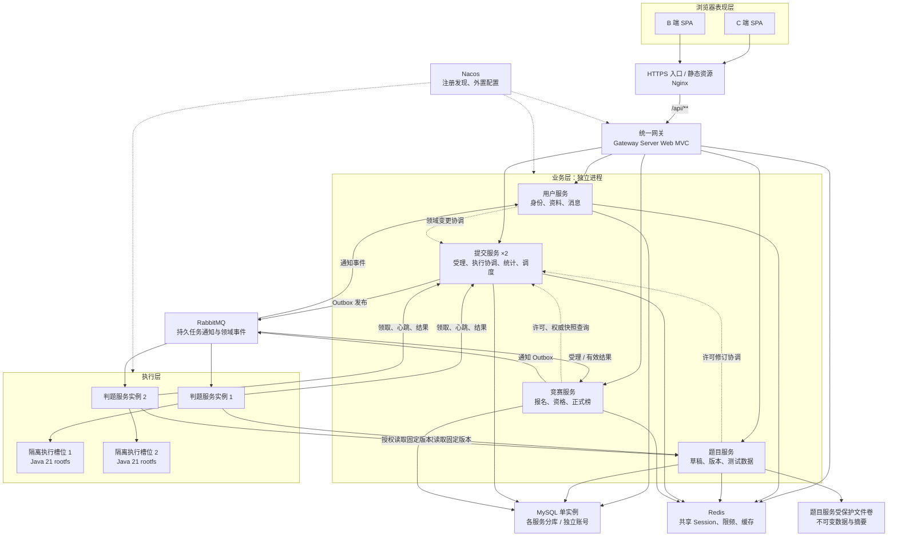
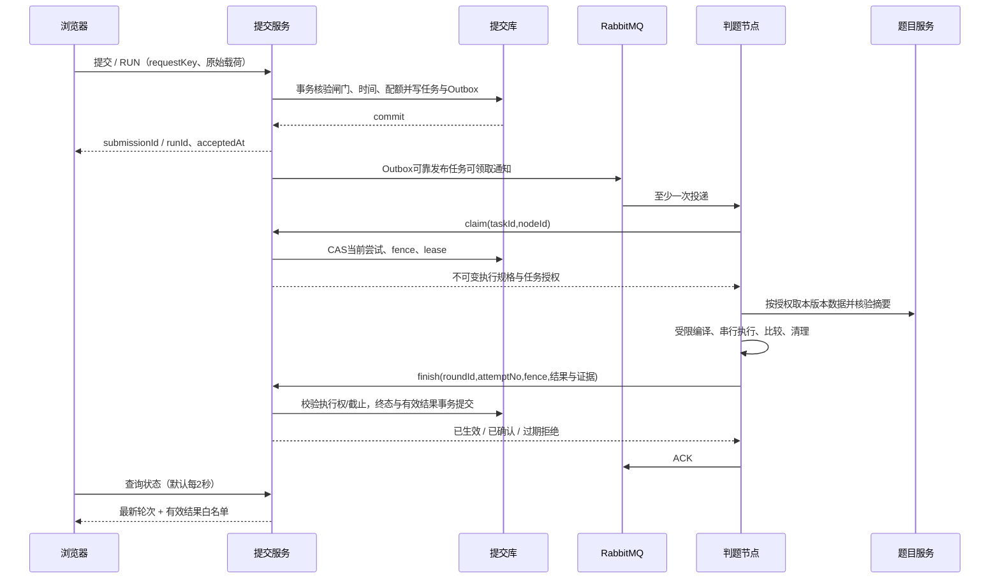
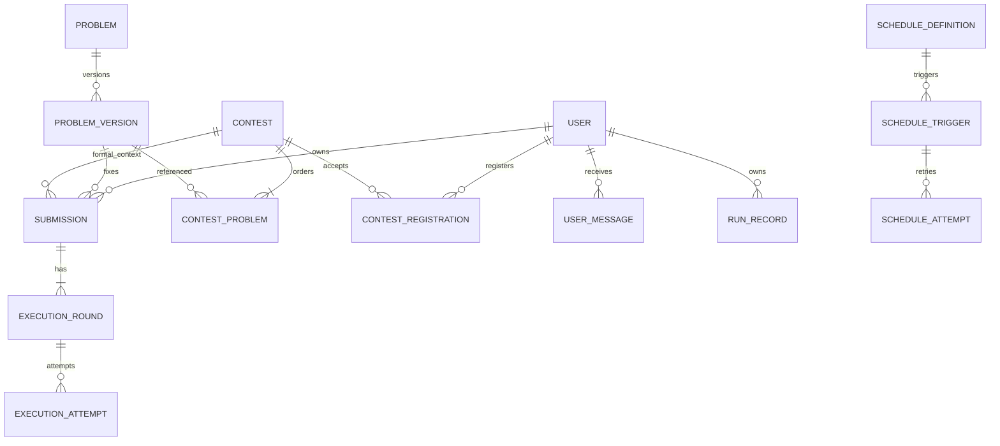
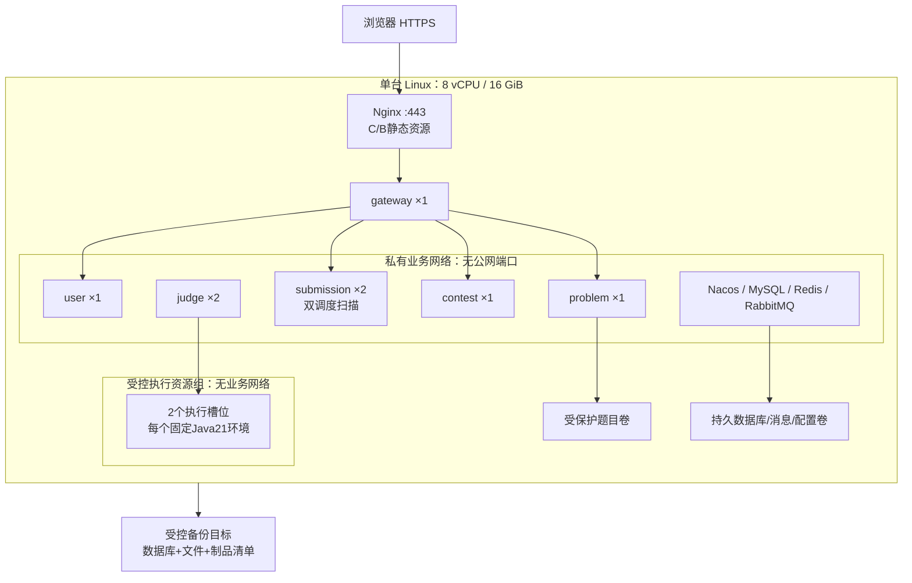

# Byte Judge 系统架构设计

| 文档属性 | 内容 |
| --- | --- |
| 文档编号 | BJ-ARCH-001 |
| 版本 / 日期 | V1.0 / 2026-11-03 |
| 输入基线 | [01.需求文档.md](./01.需求文档.md) V1.2、[02.需求规格说明书.md](./02.需求规格说明书.md) V1.2、[03.技术选型调研.md](./03.技术选型调研.md) V1.0 |
| 设计目标 | 以 B/S 架构组织浏览器、业务服务、隔离执行与持久化，落实全部本期 P0 的职责、协作和失败语义 |
| 状态 | 架构设计方案；尚未完成技术原型、实现或 AT 验收，不是已运行系统说明 |
| 使用约定 | 业务范围和边界以 02 为准，技术方向以 03 为准；本文中的新增协议、表名和配额是设计决策，需在原型及详细设计中验证 |

## 1. 架构定位与关键决策

### 1.1 B/S 架构

系统采用 **Browser/Server（B/S）架构**：浏览器负责页面、编辑和交互；服务器负责身份、业务规则、持久受理、异步判题及可信成绩。服务器内部采用 Spring Cloud 微服务组织方式，两者分别描述访问方式与服务端组织方式，可以同时成立。

项目目录中的 **B 端**是管理员浏览器应用，**C 端**是学习者/参赛者浏览器应用；它们与 B/S 中的 Browser 不是同一种业务分类。用户无需安装判题客户端，浏览器也不能直接连接数据库、消息队列或执行沙箱。

| 视角 | 本设计决策 | 目的 |
| --- | --- | --- |
| 用户访问 | C/B 两个 Vue 工程，同一 HTTPS 源下部署 | 统一 Cookie/CSRF 行为，分别组织用户与管理旅程 |
| 应用划分 | 网关、用户、题目、提交、竞赛、判题分别部署 | 使数据所有权、业务维护和高风险执行职责清楚 |
| 核心一致性 | 提交服务统一持久受理、轮次/尝试及有效结果；使用受理闸门协调许可修订 | 消除先远程预检、后本地受理期间的撤销和截止竞争 |
| 跨服务变化 | 本地事务、持久命令、Outbox、接收去重、版本核验和补偿 | 不依赖跨库事务或消息恰好一次 |
| 计算隔离 | 双判题实例，固定 Java 21 环境，沙箱不接触业务网络/凭据 | 限制不可信程序影响，保留故障恢复演示能力 |
| 调度承载 | 任务管理与调度运行时放在提交服务的独立模块，两实例部署 | 复用已有执行权和恢复基础，不另建管理空壳服务 |
| 资源与可靠性 | 单台 8 vCPU / 16 GiB Linux、Compose，受保护持久卷 | 面向中小型 OJ 和受控试用；双实例不等于宿主机高可用 |

首期保留全部 FR-01～FR-25、UX-01～UX-15、BR-01～BR-15、DR-01～DR-11、IR-01～IR-12、AR-01～AR-07、NFR-01～NFR-13；Java 21 以外语言不进入首期。实施阶段可以有先后，竞赛、RUN、消息和任务管理不能降为扩展项。

### 1.2 技术基线

沿用已经确认的 Java 21、Spring Boot 4.0.x、Spring Cloud 2025.1.x、Spring Cloud Alibaba 2025.1.x、Nacos 3.x、Gateway Server Web MVC、HTTP Service Clients + LoadBalancer、Sentinel、Spring Security、Spring Session Redis；存储使用 MySQL 8.4 LTS、MyBatis-Plus Boot4 starter、Flyway、Redis；异步运输使用 RabbitMQ + Spring AMQP。前端使用 Vue 3、TypeScript、Vite、Element Plus 和 Monaco。

不在本设计重新引入 JWT、Seata、Quartz、SchedulerX、Elasticsearch 或 Kubernetes。go-judge 是优先验证的沙箱底座，尚未冻结；JDK 补丁、BOM、第三方 starter、镜像和 rootfs 摘要以 03 第 10～11 节原型证据锁定。本文沿用输入调研，不新增“某版本已经兼容”或“资源已经足够”的事实声明。

## 2. 系统上下文与总体结构

### 2.1 系统上下文



管理员通过受控初始化建立，无公开默认密码。网页管理员权限不产生内部执行身份；平台不提供用户私信、短信认证、任意脚本调度或直接沙箱访问。

### 2.2 容器与协作关系



图中数据库是一个物理实例，不代表共享写表。所有同步服务调用通过 Nacos 服务名、HTTP Service Clients 和 LoadBalancer 寻址；Outbox 发布器由相应数据所属服务承载。沙箱仅处理任务材料，不接入图中的业务网络。

### 2.3 请求路径与网络面

| 路径/网络面 | 路由与约束 |
| --- | --- |
| `/`、`/assets/**` | C 端静态资源；history fallback 仅匹配前端路径 |
| `/admin/`、`/admin/assets/**` | B 端静态资源；Vite base 与路由 base 固定为 `/admin/` |
| `/api/v1/auth/**`、`/api/v1/users/**`、`/api/v1/me/messages/**`、`/api/v1/admin/users/**` | 网关到用户服务 |
| `/api/v1/problems/**`、`/api/v1/admin/problems/**` | 网关到题目服务 |
| `/api/v1/submissions/**`、`/api/v1/runs/**`、`/api/v1/me/statistics/**`、`/api/v1/admin/submissions/**`、`/api/v1/admin/executions/**`、`/api/v1/admin/schedules/**` | 网关到提交服务 |
| `/api/v1/contests/**`、`/api/v1/me/contests/**`、`/api/v1/admin/contests/**` | 网关到竞赛服务 |
| `/internal/v1/**` | 仅服务私网端口和独立身份；网关无对应公网路由，入口显式拒绝 |
| Actuator、Nacos、DB、Redis、RabbitMQ 管理面 | 不映射到公网；维护者经受控入口访问，健康/指标仍鉴权 |

Nginx 只向网关转发业务请求；不能把 `/api` 错误回退为 SPA 的 HTTP 200。两前端共享会话不等于共享管理权限，所有管理接口由业务服务再次校验。初期不设独立 BFF、消息服务、统计服务或搜索服务。

## 3. 服务职责、模块与数据所有权

### 3.1 服务划分

| 服务 / 建议工程名 | 拥有的职责和数据 | 不应承担的职责 |
| --- | --- | --- |
| 网关 `byte-judge-gateway` | 路由、入口流控、统一追踪、请求大小和公共安全规则 | 不保存分数，不执行判题，不成为唯一授权点 |
| 用户 `byte-judge-user-service` | 用户/角色/账户状态、密码摘要、会话撤销版本、资料、消息/去重墓碑、相关审计 | 不允许客户端设置角色，不把 ban 当角色，不管理提交结果 |
| 题目 `byte-judge-problem-service` | 题目身份、草稿修订、不可变版本、语言/数据清单、校验程序与证明、受保护文件、公开搜索投影、相关审计 | 不修改历史版本，不自行写评测轮次，不将隐藏文件托管为公共附件 |
| 提交 `byte-judge-submission-service` | 正式提交、RUN、校验执行任务、轮次/尝试、执行权、有效结果、受理闸门、配额、个人统计、节点记录、调度配置/运行、相关审计 | 不维护题面草稿、不决定竞赛规则、不从别库直接读取报名/账户 |
| 竞赛 `byte-judge-contest-service` | 赛程/配置修订、有序快照引用、报名、可信提交投影、正式榜/修订/结算、竞赛通知事件、相关审计 | 不产生判定，不用页面按钮决定资格，不直接改提交库 |
| 判题 `byte-judge-judge-service` | 领取与续租客户端、数据校验、编译执行编排、token 比较、资源证据/判定映射、临时目录清理 | 不直接写业务数据库，不承接浏览器请求，不保存用户长期业务状态 |

每个拥有持久事实的服务维护自己的 Outbox、Inbox/命令去重和审计表。判题节点仅保留有界本地恢复信息及执行日志，权威状态在提交服务。

### 3.2 模块与接口

在各服务内部采用 `interfaces → application → domain` 与基础设施 Adapter 分离的组织方式。Controller 做协议转换，应用模块编排事务，领域模块计算规则，存储/MQ/沙箱 Adapter 处理具体外部机制。共享库限于契约、ID、时间、错误和安全协议，不共享 Entity/Mapper，不把所有服务代码装进一个 `common-business`。

| Module | 对外 Interface 的主要操作 | 模块内部集中处理的行为 |
| --- | --- | --- |
| `AdmissionCoordinator` | `accept(command)`、`activatePolicy(command)`、`getDecision(commandId)` | 幂等、许可修订、时间、配额、事务受理、恢复安排 |
| `ExecutionCoordinator` | `claim`、`heartbeat`、`finish`、`recover` | 当前执行权、预算、attempt fence、唯一终态与有效结果切换 |
| `ProblemAccess` | `resolveView(context, principal)` | 公开/历史/赛事/管理预览的统一可见性，返回字段白名单 |
| `ContestStandings` | `rebuild(authoritativeSnapshot)`、`publish(expectedRevision)` | 首 AC、错交、罚时、并列、截止屏障、原子榜单替换 |
| `PersistentScheduler` | `savePlan`、`previewNext`、`claimTrigger`、`authorizeEffect`、`finishTrigger` | Spring cron、修订、跳过、重试、执行权及副作用授权 |
| `SandboxExecutor` | `execute(immutableSpec)` | 编译/运行、资源与隔离验证、证据收集、终止清理 |

接口包含输入、前置条件、顺序、失败模式和性能预算，不仅是 Java 方法签名。token 比较、排名计算、截止计算使用纯规则模块；时钟、存储、队列和执行器通过显式依赖注入。真实 go-judge Adapter 与测试执行 Adapter 位于同一 Seam，避免把底层 status、文件路径或网络配置散落到业务代码。

### 3.3 事务边界

每个数据库事务只写所属服务的库；不使用跨服务外键、跨库 JOIN 或他服务账号直连。服务内可以外键/唯一约束保证引用；跨服务引用使用不可变 ID、修订和摘要校验，并通过对账恢复。所有涉及 HTTP、消息发布、沙箱运行的耗时工作都在数据库事务之外，**不持有行锁跨 HTTP 等待**。

强一致用于本库受理/配额/执行权/有效结果/命令激活；跨服务投影允许有界最终一致。请求授权和赛前保密不能等待事件缓存刷新。统计和榜在有效结果生效后 5 秒内收敛，通知正常 10 秒内、故障恢复后 60 秒内补偿；这些是待验证目标。

## 4. 身份、安全和访问决策

### 4.1 浏览器身份

1. Spring Security 负责注册登录和接口授权，密码使用随机盐自适应摘要；旧模板中的固定盐 MD5、`ban` 角色不沿用。业务角色为 `user/admin`，账户状态独立为正常/禁用。
2. 网关和业务服务使用同一 Spring Session Redis 命名空间、Cookie 名 `BJSESSION`、Path `/`、30 分钟闲置时限及兼容序列化契约；Session 只放 `userId`、角色快照、`authEpoch` 等最小身份，不放 Entity 或完整手机号。
3. 每个受保护请求既验证 Session，又从用户服务核验当前账户状态/`authEpoch`；首期不使用延迟失效的本地正向缓存。用户服务不可用时受保护请求拒绝处理，公开资源仍按游客规则读取。
4. 改密/禁用递增持久 `authEpoch`；退出撤销当前 sessionId，改密和禁用撤销该用户全部旧会话。使用 indexed Session repository 查删，并保留撤销判定，防止并发旧请求保存 Session 后复活。解禁不能降低 epoch，必须重新登录。
5. 禁用涉及新执行受理时，账户修订还须走第 5 节闸门；禁用成功响应晚于闸门撤权和领域状态完成。已受理任务和历史成绩继续保留。

登录失败按账户标识/IP 各自累计，15 分钟 10 次失败后限制 15 分钟并返回可重试时间。Redis 只管理临时限频；账户状态和 epoch 的持久事实在用户库，Redis 丢失 Session 时安全失效，不恢复旧会话。

### 4.2 Cookie、CSRF 与前端安全

对外 HTTPS，Session Cookie 使用 HttpOnly、Secure、SameSite=Lax，显式控制 Path；本地回环 HTTP 调试单独配置。所有状态变更具备 CSRF 防护，SPA 先取得 token 并以约定请求头发送；登录/退出后重新获取 token。可被 JS 读取的 CSRF token 与 HttpOnly Session Cookie 分开配置。同源部署仍须防 CSRF，默认不开放任意 CORS 来源。

网关删除外部伪造的 `X-User-*`、内部鉴权头和不可信转发头，业务服务不以该头代替认证。题面富文本经过白名单净化，源码、编译诊断和 RUN 输出按文本转义显示；不使用输出内容构造 HTML。返回位置只接受站内路径。

### 4.3 服务身份与任务身份

内部 HTTP 使用 TLS、按服务独立的高熵凭据、私网限制及操作权限表。凭据从受控文件/环境注入，轮换期只接受当前和短期过渡版本，日志脱敏。服务认证证明“哪个服务调用”，不能代替任务授权。

| 调用者 | 允许能力 | 进一步约束 |
| --- | --- | --- |
| 用户/题目/竞赛服务 | 提交所属许可修订命令、查询结果 | 只能激活其拥有的政策类型，带预期修订和已准备材料摘要 |
| 提交服务 | 请求准确快照、报名证明、发布校验回传、通知事件 | 带操作 ID、对象修订，接收端检查引用及来源 |
| 判题服务 | 领取、续租、报告结果、读取本任务版本数据 | 校验 nodeId、roundId、attemptNo、fence、lease 及数据授权 |
| 调度模块 | 调用四类白名单处理器 | 带 operationKey、触发键、当前执行权及持久副作用许可 |
| 浏览器管理员 | 管理网页业务 | 无权调用领取/执行/内部结果回写 |

沙箱内不注入服务凭据。worker 在沙箱外取数据，再将本任务只读输入和固定环境传入；每测试点只提供对应数据，期望输出留在可信比较端。隐藏结果不写入用户可读响应或日志。

### 4.4 统一题目可见性

`ProblemAccess` 接收明确上下文：`PUBLIC`、`OWN_SUBMISSION`、`CONTEST`、`POST_CONTEST`、`ADMIN_PREVIEW`。公开题库要求当前公开且未删除；本人历史只给已绑定快照；赛前普通用户不读题名/标签/题面/样例，赛中要求报名，赛后要求仍发布；管理预览需审计。

所有详情、搜索、切题、附件、版本、RUN、个人通过列表和缓存出口使用同一规则。对受保护内容采用 `Cache-Control: no-store`，不让公共代理缓存管理员预览或带身份内容。公开搜索投影只含可公开字段，公开状态变化 5 秒内更新投影，但查询仍实时核验可见性；投影命中不能授权。

## 5. 受理一致性与跨服务许可协议

### 5.1 为什么需要持久受理闸门

一次“题目服务说可提交/竞赛服务说已报名”的远程查询，无法保证之后落库时题目未下架、比赛未撤销或结束。本文在提交服务内设 `AdmissionCoordinator`，将**受理所需的最小许可事实**与受理事务放在同一库，形成确定的业务顺序。题目、竞赛、账户的领域 owner 不变；闸门是按 owner 修订激活的受控许可副本，不提供任意改题、改赛或改用户的接口。

最小事实包括：账户受理状态/epoch、题目当前可受理版本及公开状态/everPublic、私有题目占用、竞赛发布/配置修订/起止时间/有序快照摘要、已验证报名引用。完整题面、密码、手机号、竞赛管理内容仍在所属服务。闸门只接受相应 owner 的命令，不从浏览器信任报名和版本许可。

### 5.2 领域准备 → 闸门激活 → 领域完成

| 阶段 | 持久行为 | 中断/竞争处理 |
| --- | --- | --- |
| 准备 | owner 本地保存 `commandId`、期望修订、新修订、完整候选事实/摘要和 `PREPARED`；关联对象标记变更中 | 相关管理写拒绝并发覆盖；需要一致授权的读取保守拒绝/提示处理中，不以旧投影作新授权 |
| 激活 | owner 在事务外调用提交服务；提交库锁相应闸门，以 expectedRevision CAS 激活新许可并持久保存命令结果 | 同 commandId/同载荷返回原结果，异载荷冲突；旧预期修订及乱序旧命令拒绝；未知响应先查命令结果 |
| 完成 | owner 按激活回执完成领域修订和审计；API 此时才确认变更成功 | 故障后按持久命令补完；已激活不可因网络超时自行回滚，只能发新修订的补偿命令 |

准备记录不超时自动“当作已撤销”。若确认未激活可终止准备，若激活结果未知则持续查证，相关读取 fail-closed。后台可展示处理中/重试提示。激活成功而 owner 尚未完成时，领域读取需核对该命令并完成/保守拒绝，不能向用户展示与许可冲突的赛程或状态。对外成功意味着三阶段完成，而非跨库天然原子事务。

新账户、新题目使用同一协议初始化许可，owner先保存初始事实和命令，闸门确认激活后才确认账户可用或题目可发布；未激活对象默认无受理许可，失败可恢复而非跳过初始化。改密的authEpoch递增也通过该协议同步，准备期间拒绝相关受保护操作，完成旧会话撤销和许可同步后才确认改密成功，防止新Session与旧闸门epoch永久不一致。

题库发布/下架/删除、赛事发布/改期/撤销/重发、账户禁用/解禁通过该协议激活许可。新赛发布在一个提交库事务内检查所有题目从未公开及未被其他未结束赛事占用，并登记占用；失败不得只占用部分题。重新发布生成新竞赛配置修订，原报名不删除。题目曾公开标记单调为真；结束后通过历史入口开放的版本也记录公开事实，不能再伪装从未公开私题。检查从未公开时还须按当前数据库时间检查既有PUBLISHED历史赛事是否已结束，将应公开事实单调物化后判断，不能等待调度更新everPublic而留下复用窗口。

报名由竞赛库唯一约束 `(contestId,userId)` 确认，记录区分PREPARED/CONFIRMED，且本期不退赛、不删除已有成功报名；内部报名证明因此不可凭空撤销。报名事务在核对最新竞赛激活修订后，以可信服务时钟检查 `now < start`；与改期/撤销/账户禁用的提交顺序还需通过许可命令和报名确认命令序列化：报名证明仅在闸门锁账户及赛事、检查正常状态/authEpoch、当前发布修订及数据库时间小于start并持久登记后才有效，竞赛再完成报名/Outbox。列表报名数、我的竞赛及通知只认CONFIRMED，不能将准备记录算成功。若报名本地已准备但未登记，不能返回报名成功；撤销/开赛先激活则新登记失败。既有成功报名的重复请求仍返回原记录，不再次发通知。

### 5.3 新正式提交 / RUN 的受理事务

1. 业务服务验证当前身份与账户状态；按 userId + 类型命名空间 + requestKey 查询已受理记录。同载荷立即返回原 ID，不再受新状态/时间/配额阻止；异载荷冲突。鉴权始终在先。
2. 新请求准备可信的不可变快照、环境清单和报名引用；这些远程获取在本地事务之外。对源码/自定义输入进行 UTF-8 字节、Java 21 和字段检查。
3. 在提交库事务内按固定顺序锁账户配额、相关题目/竞赛闸门与必要幂等键；重新核验当前 epoch、许可修订、当前版本/赛事快照和报名记录。不得持锁发 HTTP。
4. **获得相关闸门锁后**取 MySQL 统一 UTC 时间，作为受理行的 `acceptedAt`；对正式赛提交检查 `start ≤ acceptedAt < end`，普通练习比较当前公开版本，赛后练习要求仍发布且已结束。该时间是成功提交事务中的持久决策点，不是浏览器发送或响应时间；事务回滚不产生受理。
5. 检查同账户新请求距上次受理至少 3 秒，正式初判与 RUN 活跃合计小于 3。受理行、配额扣减、首轮、可恢复任务和 Outbox 同一本地事务提交，随后返回编号/受理时刻。重判/发布校验不扣普通用户新请求配额。

同 key 并发依赖唯一约束收敛，失败竞争方重新读原记录；不能先扣 Redis 配额再依赖异步回滚。载荷比较保留源码的原始 UTF-8 字节，不能自动 trim/换行归一化；指纹用于快速比对，仍保留精确字段与字节用于确认。

**下架竞争示例**：请求 A 先锁到旧公开许可并成功受理，下架命令 B 随后激活，则 A 继续使用原快照评测；B 先激活则 A 锁后见不可公开而拒绝，不产生提交。B 领域准备期间的新相关请求可暂拒绝，不能偷用未经激活的新状态。两种顺序都不依赖客户端页面是否过期。

此协议增加了领域变更到提交服务的可用性依赖，是为满足本期严格受理边界做出的明确取舍。提交服务/数据库不可用时不能新增受理或确认许可变更，已有公开读取可在无变更且授权明确时继续。原型必须验证锁顺序、跨实例并发、未知响应、单调修订和恢复，不以本文替代实现证明。

## 6. 异步评测与有效结果

### 6.1 核心类型与状态

| 维度 | 取值/意义 |
| --- | --- |
| `taskType` | `SUBMISSION`、`RUN`、`VALIDATION`；后两者不生成正式提交成绩 |
| `submissionContext` | `PRACTICE`、`CONTEST`、`POST_CONTEST`，受理后不可改 |
| `roundType` | `INITIAL`、`REJUDGE`，VALIDATION/RUN 使用对应执行轮次 |
| `lifecycle` | `WAITING → RUNNING → FINISHED`，可恢复故障允许 `RUNNING → WAITING` |
| `phase` | 排队、准备、编译、执行、清理；不是最终判定 |
| `attempt` | 同轮最多 3 次有效尝试；自动重试不增加提交 |
| `effectiveRoundId` | 当前用于统计/成绩的轮次，可不同于最新失败重判 |



### 6.2 可靠运输与任务分配

Outbox 与业务事实同事务写入，发布器领取后使用持久消息、publisher confirm 和不可路由检测；确认丢失允许重复发送。持久交换机/队列和消息恢复属于原型验收，不承诺单节点 broker 高可用。Outbox 未确认与业务未完成任务由受保护扫描补偿，不能只依赖 MQ 重投。

MQ 消息只携带任务 ID、类型、期望修订和追踪编号，不携带源码、测试数据或长期执行令牌。消息是“可领取提示”，**有效执行权必须在提交服务领取**。worker 容量满不预先占大量任务，prefetch 初值 1，每实例一个执行槽位；三类执行队列按正式提交:RUN:发布校验为 4:2:1 的有界轮转初值调度，重判单独标注，不无限优先饿死其他类别。权重、吞吐和正常 30 秒目标需实测，不能以放宽截止提高吞吐。

重复投递遇到已有活跃 owner 返回无新执行权；可 ACK 重复提示，由持久协调器负责失联补偿。节点回写已持久确认后 ACK；回写后 ACK 前宕机的重投通过已完成结果无副作用确认。未知/非法消息进入受保护隔离队列并告警，业务任务仍由数据库补偿。

### 6.3 执行权、心跳与截止

`claim` 原子更新轮次/尝试，分配单调递增 `fence`、随机任务凭据及 `leaseUntil`，绑定 nodeId；校验类型、版本、环境、预算和节点能力。心跳初值每 10 秒、lease 初值 30 秒、扫描初值每 5 秒；以上为设计参数，必须证明故障起点起 60 秒内识别失联、设施正常且健康节点有槽位时 120 秒内重排或明确 SE。

续租不得越过单次或整体截止；网络断连 worker 在本地授权到期前终止任务并清理，不能因“可能仍有权”无限执行。恢复先原子撤销旧 fence，再决定重试；不能仅把状态设回 WAITING 而保留旧凭据。旧 worker 即使物理进程短暂残留，也不能生效回写或取得新的数据授权。

结果提交在同一事务检查 `roundId/attemptNo/nodeId/fence`、有效凭据、轮次未终态、租约及所有截止；由数据库取时，严格小于截止才接受。等于/晚于截止执行超时处理，已终态不可翻转。相同完成请求返回原确认，异结果的重复完成拒绝并审计。

预算严格采用 BR-05：

```text
T_exec = 30秒 + 本版本全部测试点墙钟上限之和 + 10秒清理缓冲
W_total = 本轮所有WAITING区间时长之和，最多300秒，重试不清零
D_round = createdAt + 300秒 + 3 × (T_exec + 120秒)
D_attempt = grantedAt + T_exec（不因心跳延后）
```

默认 20 点、每点墙钟 5 秒时 `T_exec=140秒`、整轮最晚 1080 秒；它不是正常任务等待承诺。RUN 只有用户输入一个点，默认 `T_exec=45秒`，使用同一等待/整轮公式。失联/通信等可恢复故障最多额外 2 次，业务判定不重试；确定数据/环境缺失直接 SE。执行看门狗超时是 SE，单点用户程序超时是 TLE。所有终态路径都在本库同事务释放相应活跃配额一次。

### 6.4 结果与重判

一条正式提交最多一个活动轮次，使用提交行 `activeRoundId` + 行锁/CAS 保证，并为 `(submissionId,roundNo)` 建唯一约束。初判终态建立有效结果；重判保留源码、版本、环境和 acceptedAt，并拥有新一轮独立预算。

| 原有效结果 | 新轮次 | 原子处理 |
| --- | --- | --- |
| 任意 | 未完成 | 保留旧有效结果，显示最新轮次进度 |
| 任意/空 | 非 SE 终态 | 切换 effectiveRoundId、递增 resultRevision、写 Outbox |
| 非 SE | SE | 保留旧有效结果/统计，记录最新失败轮次 |
| 空/SE | SE | 允许新 SE 成为有效结果 |

个人统计在提交服务按当前有效结果派生；重复事件用修订覆盖而非盲目累加。累计数按正式受理 ID，AC 数按有效 AC，通过题数按题目身份去重；题目通过率分母只含有效非 SE 已完成正式提交。RUN、VALIDATION 均排除。公共题目统计投影交题目服务，需实时可见性过滤。

## 7. 题目、版本、发布校验与数据文件

### 7.1 不可变链路

```text
Problem（稳定身份）
  → ProblemDraft（可修改、revision递增）
  → ValidationSpec（准确草稿内容/数据/环境/限制摘要）
  → ValidationExecution（提交服务协调、Java21全部点AC）
  → ProblemVersion（不可变快照）
  → 公共发布指针 或 竞赛有序引用
```

每次草稿修改递增 revision 并使旧验证失效。提交服务持久保存 VALIDATION 任务/轮次/尝试，题目服务保存验证请求、内容摘要和证明投影；最终验证回传只有匹配当前草稿/摘要才置通过。可形成从未公开的已验证私有版本供组赛；公共发布与赛事发布均核对证明和资源范围。发布等待校验时不持有数据库事务。

Java 21 为唯一且必须启用语言；至少一组样例、一组隐藏数据，总共最多 20 组，每组输入/期望输出各最多 1 MiB。题面与说明共最多 100 KiB、最多 5 标签等字段边界沿用 FR-11，不由数据库默认截断替代服务端检查。

### 7.2 文件组织与授权

题目文件在受保护卷按内容摘要存储，数据库保存 `artifactId/contentDigest/byteSize` 与版本清单，路径仅内部解析。先写临时文件、核验摘要、原子改名为不可变对象，再在本库事务提交 manifest 引用；事务失败形成的无引用对象延迟清理。不能先提交一个指向尚未落盘文件的可发布版本。

判题节点按当前 attempt 授权读取精确 manifest，校验摘要后缓存只读内容；缓存以摘要索引并受磁盘配额管理，不跨任务暴露路径。数据损坏或读不到属于 SE。RUN 不取测试数据，不能将 `taskType=RUN` 改参数变为隐藏数据下载。

题库下架/删除不撤销既有提交与赛事引用；有未结束赛事占用不得破坏性操作。整个毕设运行期间保留正式提交及关联快照、数据和环境制品；只清理有证据无引用的临时/孤立对象。历史题面返回仍需当前入口授权，不能以知道 versionId 为通用读取许可。

### 7.3 MySQL 搜索

关键词按空白拆词、词 AND/公开字段 OR；大小写规则在目标 collation 验证，LIKE 的 `%/_/转义符` 按字面转义并参数化。难度、个人状态及标签与关键词 AND，多标签全部匹配。查询只扫描公开投影，最后核对激活的公开许可，默认题号升序、标准 10/20/50 分页。

初期不将全文包含搜索伪装成 B-tree 可覆盖的查询。索引先支持公开状态、题号、难度、标签关系及分页，1 万题负载实测不达标时再优化投影/查询和比较索引方案，不能降低搜索语义或允许缓存泄题。

## 8. 竞赛全流程、正式榜与结算屏障

### 8.1 生命周期与权限

发布状态为 `DRAFT/PUBLISHED/WITHDRAWN/DELETED`；时间状态从激活配置和服务端时间计算 `UPCOMING/RUNNING/ENDED`，结算状态另列 `UNSETTLED/SETTLING/SETTLED/CORRECTING`。不能让定时器写入的“进行中”布尔字段授权报名或提交。

赛前修改/撤销通过第 5 节协议，新修订对报名人产生通知；撤销保留报名，重发必须未来开赛。开赛后时间/题集/规则冻结，禁止撤销/删除；仅未发布、无报名/提交草稿可逻辑删除。赛前概要不含题名、题号、标签和快照引用，已报名也不例外。

`CONTEST` 只允许报名者在 `[start,end)` 持久受理；`POST_CONTEST` 要求比赛仍发布且 `now≥end`，无需曾报名；游客赛后只读。管理员预览与个人参赛分开，不因 admin 自动上榜。RUN 同样先检查对应访问上下文，但不生成正式成绩。

### 8.2 计分投影

竞赛服务接收提交服务发出的受理、轮次活动和有效结果修订事件，以 submissionId + revision 去重。投影保存不可变 acceptedAt、context、竞赛/赛题引用及当前有效判定；不接受浏览器或 worker 直接传分。

单题取按 `(acceptedAt,submissionId)` 最早的有效 AC：

```text
单题罚时 = floor((首AC.acceptedAt - start)/60000ms)
           + 20 × 首AC之前有效WA/TLE/MLE/RE/OLE正式提交数
排序 = 解题数降序、总罚时升序、最后一题首AC相对毫秒数升序
```

CE/SE、未解出题、首 AC 之后错交、RUN/赛后提交不罚；0 AC 用户最后 AC 键为 0。三项相同为竞赛并列名次 `1,1,3`，userId 仅稳定显示顺序。有正式提交才入榜，无正式提交报名者显示未参赛。重判按完整当前有效记录重算，不增减一个“重判次数罚分”。

### 8.3 截止完整性屏障

仅因竞赛本地投影“没有待判记录”就结算，会漏掉提交已落库但 Outbox 尚未发布的正式提交。结束后采用提交权威屏障：

1. 提交服务锁竞赛闸门、数据库取时确认 `now≥end`，关闭新 CONTEST 受理并持久建立 `barrierRevision`。受理事务也锁同一闸门，所以屏障建立后不会出现遗漏的更早未提交受理事务。
2. 在提交库一致性快照中给出该赛全部正式提交集合/分页快照令牌、`admissionRevision`、`resultRevision`、活动正式轮次数和每条有效结果。集合以持久事实为准，不以 MQ offset 为准。
3. 竞赛服务按权威快照补齐/替换投影并重算榜；活动数大于 0 保持结算中，结束前受理而结束后完成的结果继续纳入。
4. 活动数为 0 时，竞赛提交候选榜摘要和读取到的水位，请求提交服务 CAS 确认该赛的受理/结果/活动修订仍匹配，取得结算确认。竞赛本地用 expectedRankRevision 原子发布榜及结算通知 Outbox。
5. 新重判创建、结果切换均锁/递增该赛修订；与确认竞争时只一方先通过。若确认之后发起重判，持久标记需更正并产生事件，查询通过权威当前水位识别过期已结算投影，显示更正中；不能把旧结算确认当永久不变承诺。

权威快照接口用版本化分页/稳定快照清单，不能跨页把多个时点拼成一个“完整榜”。事件乱序按修订处理，发现缺口读取权威快照；受保护对账扫描保证遗漏事件可恢复。正式结果生效后榜 5 秒内更新为验收目标，发布候选榜时同时检测更新，避免旧异步重建覆盖新榜。

## 9. 系统消息与持久任务调度

### 9.1 系统消息

报名成功、已报名比赛改期/撤销、结算、有效成绩重判更正由竞赛 owner 写事件 Outbox。多收件人事件将修订时收件人范围持久冻结或分页建立持久投递项；不能在重投时随意读取“当前报名集合”改变一次历史事件的对象。

用户服务消费后以 `(recipientId,eventType,objectId,objectRevision)` 唯一插入消息/去重记录，与 Inbox ACK 同事务。删除只设置 `deletedAt/isDelete` 并至少保留 180 天去重墓碑；重复消息不复活。消息只包含安全概要和站内路由，进入目标后重新鉴权；不在消息内放赛前题名、隐藏数据或完整手机号。正常 10 秒可见、恢复后 60 秒补偿由 Outbox 及投递对账共同保证。

### 9.2 调度归属与数据

提交服务的 `PersistentScheduler` 拥有 `scheduleDefinition/scheduleTrigger/scheduleAttempt`，两提交服务实例同时扫描并领取。四种白名单处理器为竞赛状态核对、竞赛排名重建、评测恢复扫描、消息投递补偿；竞赛和用户处理器通过受控内部命令调用所属服务。内置核心扫描/看门狗/清理独立标记保护，不能被普通管理 CRUD 停掉。

任务配置需名称、handlerCode、schemaVersion、≤8 KiB JSON 对象、Spring 六字段 cron、Asia/Shanghai、修订、启停、内置保护标记、nextFireAt。没有 Shell、任意 SQL、反射类名、外部 URL 或用户代码参数。运行中禁止配置修改/删除；停用后才可删除，自定义变更带 expectedRevision。

### 9.3 BR-15 执行协议

| 行为 | 设计实现 |
| --- | --- |
| cron 语义 | 只由 Spring CronExpression 解析六字段，星期按 Spring 语义；不交给 Quartz。显示未来至少 3 次，非法或无未来触发拒绝 |
| 最小间隔 | 自定义计划至少 60 秒；保存时验证所有允许的秒/分钟组合及日历后续触发间距，不能只检查前 3 次就声称全局满足；首期保守拒绝无法证明满足的表达式并给字段原因 |
| 唯一触发 | `(scheduleId,planRevision,scheduledAt)` 唯一；数据库取时生成/领取，事务锁计划并校验 enabled、未删、修订 |
| 同计划不重叠 | 计划行持有 activeTriggerId；前次含重试待执行仍活动时，新触发记 `SKIPPED_OVERLAP`，不能积压到前次完成后补跑 |
| 有效执行权 | 当前 attemptNo + 单调 fence + owner + lease；数据库事务校验后授予，后续结果需当前权；停用生效后不能新领取或重试 |
| 失败与超时 | 每次失败 10 秒后再试，总共最多 3 次；单次墙钟 60 秒硬截止，超时原子撤权并记失败；心跳不延长硬截止 |
| 停用竞争 | 停用与新领取锁同计划行，谁先提交决定新权能否授予；已在运行的尝试可在原授权/60秒内完成，停用禁止后续尝试；运行中不允许改配置或删除 |
| misfire | 停机错过记录为 `SKIPPED_MISFIRE` 或持久区间摘要，可追踪；恢复计算下一未来触发，不把全部历史时刻排队补跑 |
| 历史 | 定义逻辑删除；触发、尝试、原因及审计至少保留 180 天；核心任务受保护 |

最小间隔采用受限的 cron 准入策略：支持可证明每分钟至多一个秒偏移的表达式，日历筛选可减少触发；对于多个秒偏移而无法证明任意相邻触发≥60秒的配置直接拒绝。展示未来 3 次用于用户确认，不承担全量证明。这不改变 Spring 的解析语义，也不默认接受所有可解析表达式。

### 9.4 跨服务处理器副作用与撤权

仅给“运行记录”加 fence 不足以阻止旧执行者继续重建榜或发通知。四类 handler 都执行可幂等对账，采用以下协议：

1. handler 准备操作意图，不修改目标业务。`operationKey = triggerId + logicalOperation`，携带目标预期修订、参数摘要和当前 attempt/fence。
2. 调度权威在提交库短事务中检查当前有效执行权及严格未到 60 秒截止，持久签发一次 `effectPermit` 并写发往目标服务的命令 Outbox；同 operationKey 只有一个许可，重试复用。旧 fence/超时后不能取得新的副作用许可。
3. 目标服务只处理持久许可对应的白名单命令，验证提交服务身份、许可内容、目标修订和 operationKey，以 Inbox/业务变更同事务生效；不能仅凭旧 worker 附带的 lease 或一次远程预检写库。许可确认和网络传输均不持目标事务锁。
4. 许可在有效权内持久化就是该业务操作的授权点，之后由可靠投递补完；即使触发尝试随后超时，已经授权的操作仍按相同 operationKey 最多生效一次，不再视为旧执行者新发动作。超时后的执行者不能回写成功运行状态，后续尝试/对账查询既有操作结果，防止重做。

排名重建输出须通过第 8 节水位 CAS；消息补偿只投递未完成的既有事件；评测恢复通过执行权 CAS，不让 handler 任意指定新成绩。该协议区分“超时前已持久授权的操作补完”和“超时后旧执行者新请求”，不承诺任意外部动作恰好一次。原型必须分别注入授权前、授权后、目标生效后/ACK 前故障，验证副作用与运行记录都受保护。

## 10. Java 21 执行架构与安全限制

### 10.1 执行分工

判题服务在沙箱外校验执行规格和数据摘要，固定 `Main.java`、无自定义 package 的 `Main` 入口及编译/运行参数。go-judge Adapter 承担隔离执行调用，领域判定模块从可信资源证据归类，不直接透传底层单一 status。环境 ID 绑定 JDK 发行版/完整补丁、rootfs、编译运行参数、沙箱和比较规则版本摘要；历史重判必须能取得原制品，缺失为明确 SE，不用相近版本代替。

编译产物仅在本次 attempt 内复用；每测试点独立目录、环境与进程组，测试点固定顺序串行，首个非 AC 停止，后续标未执行。RUN 仅使用用户显式自定义输入，不加载平台测试数据、不比较答案。

### 10.2 固定资源边界

| 阶段/项目 | 首期限制与口径 |
| --- | --- |
| 源码 / RUN 输入 | 各≤64 KiB UTF-8，源码空白拒绝，RUN 输入可空 |
| 编译 | 墙钟≤30秒、总内存≤1024 MiB、进程/线程≤128、stdout/stderr各≤1 MiB |
| 编译可写面 | 总计≤256 MiB、4096文件或目录；超额 CE |
| 运行时间 | 默认 CPU 2000ms/墙钟5000ms；允许CPU100～10000ms、墙钟100～30000ms且≥CPU |
| 运行内存 | Java 默认512 MiB，允许64～2048 MiB；包括 JVM、线程、后代进程的隔离组总峰值 |
| 运行进程/线程 | ≤128，包含后代与线程 |
| 单点可写面 | 全部可写路径合计≤64 MiB、1024文件或目录；超额 RE |
| 输出 | 单点stdout/stderr各≤1 MiB，严格超过才OLE；达到恰好上限合法 |
| 展示 | 编译诊断≤16 KiB；RUN stdout/stderr各≤16 KiB并标截断；正式评测不展示隐藏运行原始输出/stderr |
| 清理 | 尝试结束10秒内清理；异常重启60秒内清残留 |

CPU 是进程组累计 user+system，不是容器 `cpu.max` 带宽；内存是隔离组及后代峰值，不是 Java `-Xmx`。JVM 堆需为 metaspace、线程栈、code cache 等留空间，固定参数经真实制品校准。编译与运行的总可写面必须合计约束，不能给 `/w` 和 `/tmp` 各64 MiB后声称总额达标。

### 10.3 隔离与判定

沙箱程序非特权，独立 namespace/cgroup、只读语言环境、受限可写盘、无外网/业务内网、无宿主敏感目录及容器控制 socket。沙箱管理器可能需要受控宿主能力，与用户程序权限分别说明；拒绝将业务服务设 privileged 来换取启动成功。计量控制器、内核能力、清理自检失败时节点不接任务，不静默退回不符合要求的计量模式。

真实基础设施故障先判 SE；用户程序限制证据按 `MLE > OLE > TLE > RE > WA`。编译资源触发统一 CE，缺编译器为 SE；正常退出且未超限才 token 比较。仅 ASCII `0x09～0x0D/0x20` 分隔，比较原始 token 字节，区分大小写、`1` 与 `1.0`、不作 Unicode 空白或浮点归一化。所有点 AC 才 AC，资源展示取已执行点 CPU/内存最大值，未知显示“—”。

go-judge 原型必须证明多超限证据可独立取得、cgroup 不降级、后代CPU/峰值/线程、全部可写面配额、网络和跨任务隔离、制品固定及残留清理。若不能满足，记录缺口并适配或替换底座；不能通过降低需求将候选宣称定案。

## 11. 数据模型、约束与索引

### 11.1 数据库与命名

单 MySQL 实例使用 `bj_user/bj_problem/bj_submission/bj_contest` 四库，各服务只获所属库权限，judge 无业务库账号。Flyway 按所属库迁移，启动/发布阶段受控执行，禁止多个实例无序运行破坏性初始化。

沿用后端约定：表内列名为驼峰，与 Entity 逐字一致，`map-underscore-to-camel-case=false`；主键为分配式雪花 `BIGINT`，不混用 AUTO_INCREMENT；对外 ID 一律十进制字符串。雪花节点标识全实例唯一，检测时钟回拨并拒绝重复发号。表名以下为建议物理名，最终字段类型/DDL 在数据库详细设计冻结。

时间使用 UTC `DATETIME(3)` 和一致数据库时钟，Java 按 Instant 处理；接口 ISO 8601 带时区，页面 Asia/Shanghai。数据库/宿主时钟同步并监控偏差，可控业务时钟用于边界测试；业务不能信任浏览器时间。

### 11.2 主要表与完整性

| 库 | 表组 | 必要约束/说明 |
| --- | --- | --- |
| 用户 | `userAccount`、`authRevocation` | accountNormalized唯一；role与accountStatus分列；authEpoch单调；手机号可空不唯一，phoneDigits保存去前置+的精确查找值 |
| 用户 | `userMessage`、`messageDedup` | recipient+事件类型+对象+修订唯一；删除去重墓碑不被普通逻辑删除过滤隐藏；已读/删除只操作本人 |
| 题目 | `problem`、`problemDraft`、`problemVersion` | problemNo唯一不复用；draftRevision CAS；(problemId,versionNo)唯一；版本不可更新 |
| 题目 | `testArtifact`、`versionTestCase`、`validationRecord`、`languageEnvironment` | digest/大小、点序唯一、样例/隐藏分类；验证绑定准确内容/环境；环境不可变 |
| 提交 | `submission`、`submissionPayload` | (userId,requestKey)唯一且同提交寿命；代码分离便于列表不读取大字段；context/版本/acceptedAt不可改 |
| 提交 | `runRecord`、`runDedup`、`validationTask` | RUN独立命名空间与expiresAt，VALIDATION独立类型；RUN24小时后清内容，过期ID/必要幂等元信息可识别，不冒充原结果 |
| 提交 | `executionRound`、`executionAttempt`、`testCaseResult` | (taskId,roundNo)、(roundId,attemptNo)、(attemptId,caseNo)唯一；逐尝试保留测试点证据，轮次最终仅引用获授权完成的attempt；当前fence/截止/CAS保证唯一终态 |
| 提交 | `admissionPolicy`、`admissionCommand`、`registrationGrant`、`userQuota`、`contestBarrier` | ownerType+ownerId许可修订；commandId唯一并校验摘要；竞赛报名引用唯一；账户配额行锁；屏障/修订持久 |
| 提交 | `userStatistics`、`userProblemState`、`judgeNode` | 统计可重建；用户+题目唯一；节点健康带时间/能力/暂停状态 |
| 提交 | `scheduleDefinition`、`scheduleTrigger`、`scheduleAttempt`、`effectPermit` | 唯一触发键；单计划activeTrigger；operationKey唯一；租约/fence和60秒硬截止 |
| 竞赛 | `contest`、`contestRevision`、`contestProblem`、`contestRegistration` | 有序快照引用；(contestId,orderNo)和(contestId,problemId)唯一；报名user+contest唯一 |
| 竞赛 | `contestSubmissionProjection`、`contestRankRevision`、`contestRankEntry`、`notificationRecipient` | submissionId+revision覆盖；榜修订/权威水位；整榜切换可追溯；通知目标修订冻结 |
| 各owner | `outboxEvent`、`inboxReceipt`、`auditLog` | eventId/inbox接收键唯一；事务内落事实与Outbox；审计不可普通页面修改删除 |

`isDelete` 用于业务配置逻辑删除，但不能把“删除不再显示”套用于需要长期去重的唯一键。消息墓碑、历史引用、已删账户标识/题号唯一性均需专门查询路径与保留策略。不能依赖 MyBatis-Plus 普通查询自动排除删除行后重新创建重复事件。

### 11.3 逻辑关系



跨服务线表示业务关联，不表示跨库物理外键；RUN/VALIDATION 的轮次可用统一 taskId 关联，正式 submissionId 是其中一种 task 引用。

### 11.4 查询索引与重建

重点索引包括：提交 `(userId,acceptedAt,id)`、`(contestId,context,acceptedAt,id)`、活动轮次/截止、未发布 Outbox 的 `(status,nextAttemptAt,id)`；报名 `(userId,contestId)`；竞赛发布状态/开始时间和结束时间；消息 `(recipientId,isDelete,createdAt,id)` 及未读；调度 `(enabled,nextFireAt,id)` 与租约截止。组合筛选以真实执行计划调整，不为每种可选条件建立笛卡尔积索引。

个人统计、公开题目统计和正式榜均保留来源修订，可从可信正式记录重建。跨服务重建通过分页权威接口/快照，不越权直连别库。正式提交/关联快照在毕设运行期保留，RUN内容24小时、审计/任务历史/删除消息去重至少180天，临时文件按10/60秒清理。

## 12. 接口与事件契约骨架

### 12.1 通用约定

响应保留 `{ code, data, message }`，另给 `requestId/serverTime`；仅 `code=0` 为业务成功。安全拒绝、参数/冲突/限流可配合 HTTP 401/403/400/409/429，网关/网络5xx同样处理；不能只依据HTTP200判成功。错误示例类型包括 `NOT_LOGIN/ACCOUNT_DISABLED/ACCESS_DENIED/VERSION_CONFLICT/REQUEST_KEY_CONFLICT/QUOTA_EXCEEDED/CONTEST_NOT_OPEN/RESOURCE_EXPIRED/SYSTEM_UNAVAILABLE`，最终数值码在接口文档统一冻结。

分页 `pageNum≥1`、`pageSize∈{10,20,50}`，默认20，过末页空；时间区间统一 `[from,to)`。修改类命令携带 expectedRevision/目标状态/必要理由，提交与RUN携带16～64位 `[A-Za-z0-9_-]` requestKey；返回当前版本可供冲突提示但不能泄漏无权对象存在性。

### 12.2 外部接口分组

| 需求接口 | 建议主要路由 | 关键契约 |
| --- | --- | --- |
| IR-01 | `/auth/register`、`/auth/login`、`/auth/logout`、`/auth/csrf`、`/users/me`、`/users/me/password` | 会话/CSRF轮换、账户状态、字段白名单、失败限频 |
| IR-02 | `/problems`、`/problems/{id}`、`/problems/{id}/navigation` | 搜索语义/实时可见性、版本/环境/限制、无隐藏字段 |
| IR-03/04 | `/submissions`、`/submissions/{id}`、`/submissions/{id}/rounds`、`/me/statistics` | requestKey、readVersionId、environmentId、source、context/赛事；effective与latestRound并列 |
| IR-05 | `/admin/problems/**`、`/admin/users/**`、`/admin/submissions/**`、`/admin/executions/**` | 管理鉴权/理由/修订/审计；校验和重判返回异步任务ID |
| IR-09 | `/me/messages`、`/me/messages/{id}`、`/me/messages/unread-count`、`/me/contests` | 本人收件人/报名，查看标已读用明确写操作并校验CSRF |
| IR-10 | `/runs`、`/runs/{id}` | 自定义输入纳入精确幂等载荷，输出归属/截断/过期，正常终态无AC |
| IR-11 | `/contests`、`/contests/{id}`、`/contests/{id}/registrations`、`/contests/{id}/problems/**`、`/contests/{id}/standings`、`/admin/contests/**` | 服务器时间、报名/赛程/题序、结算水位，赛后显式POST_CONTEST |
| IR-12 | `/admin/schedules`、`/{id}/enabled`、`/{id}/runs`、`/handlers`、`/cron-preview` | schema/未来3次/最小间隔、内置保护、expectedRevision、运行中限制 |

表内路由均相对 `/api/v1`，是概要接口骨架；具体动词、字段示例、数值错误码和 OpenAPI 在详细接口设计补齐。敏感管理搜索参数如手机号不进入访问日志；必要时用受控查询请求体承载完整值并关闭该字段日志。

### 12.3 内部接口

| 操作 | 最小输入/输出 | 原子条件 |
| --- | --- | --- |
| 激活许可 `/internal/v1/admission/policy-commands` | commandId、owner、expected/newRevision、factsDigest、准备引用 | owner凭据、CAS修订、完整占用约束；重复命令查询结果 |
| 报名许可确认 | 用户/authEpoch、竞赛/修订、报名准备ID、commandId | 账户正常、当前发布及DB时间<start，唯一登记；已有许可幂等 |
| 执行 claim/heartbeat/finish | task/round/attempt、node、fence、lease、证据摘要 | 当前执行权及全部截止，终态幂等 |
| 数据manifest读取 | task授权、versionId、artifactId | 当前任务授权、确切摘要，RUN拒绝隐藏数据读取 |
| 竞赛权威快照/屏障确认 | contestId、snapshotToken、expected水位、榜摘要 | 同闸门串行、稳定分页、CAS结果与活动修订 |
| 调度副作用授权/查询 | trigger、attempt/fence、operationKey、目标修订、payloadDigest | 有效权内持久许可，逻辑操作唯一 |

### 12.4 事件信封与演进

```json
{
  "eventId": "string-id",
  "eventType": "SubmissionEffectiveResultChanged",
  "schemaVersion": 1,
  "producer": "submission-service",
  "aggregateId": "string-id",
  "aggregateRevision": 3,
  "occurredAt": "2026-11-03T00:00:00.000Z",
  "traceId": "opaque-trace-id",
  "payload": {
    "submissionId": "string-id",
    "context": "CONTEST",
    "contestId": "string-id",
    "acceptedAt": "2026-11-03T00:00:00.000Z",
    "effectiveRoundId": "string-id",
    "verdict": "AC",
    "resultRevision": 3
  }
}
```

主要事件为 `SubmissionAccepted`、`ExecutionRoundActivityChanged`、`SubmissionEffectiveResultChanged`、`ProblemPublicStatisticsChanged`、`ContestRegistrationConfirmed`、`ContestScheduleRevised`、`ContestWithdrawn`、`ContestSettled`、`ContestStandingCorrected` 和 `ValidationFinished`。不把源码、Session、手机号或测试数据放入普通事件。

Inbox 对 eventId 去重，业务投影同时核验 aggregateRevision：旧修订忽略、缺口对账；不假设 RabbitMQ 跨队列全局有序。新增可选字段可向后兼容，破坏性变更提升 schemaVersion 并配置兼容消费者。消息 TTL/死信不能删除数据库唯一业务事实，重放只由有权限的运维操作执行。

## 13. 前端架构与交互状态

两前端分别构建，按功能组织 `features/auth/problems/editor/submissions/contests/messages/admin`，共享契约可由版本化生成类型保证，不复制后端实体。请求层统一解析 HTTP、业务 code、traceId、会话失效、CSRF及网络未知写状态；路由守卫只是体验优化，权限在服务端。

编辑器草稿使用当前标签页 `sessionStorage`，key含账户/游客、场景/赛事、problemVersionId、language/environmentId；1秒内暂存，切题/刷新恢复。登录失效先存本账户草稿，同账户重登恢复；不同账户登录丢弃受保护暂存，主动退出清理本账户草稿。游客触发登录后由用户确认导入，已有账户草稿时选择保留哪份，导入后清游客副本；暂存失败显示提示并离开警告。

发送提交/RUN后禁重复点击，响应未知显示“正在确认”，保留原 key/原字节载荷重试；用户编辑后主动再交用新 key。活动状态默认2秒查询、网络故障退避最多10秒、离页停止；终态停止，重判时并列显示旧有效结果和新进度。比赛结束保留代码并提示显式进入赛后练习，不把一次正式提交悄悄改成 POST_CONTEST。

列表保留加载/空/失败/无权限状态；敏感操作确认具体对象；榜显示更新时间/结算或更正中；内部地址、隐藏输出和完整手机号不因前端折叠而仍存在响应。三个浏览器及1366×768全旅程对应 UX-01～UX-15，尚待端到端验收。

## 14. 部署、资源预算与恢复

### 14.1 单机部署图



业务及基础设施由 Compose 编排；go-judge 管理器具体使用受控容器或宿主服务由隔离原型确定。只允许 worker 在沙箱外连接管理接口，管理器不暴露公网/普通业务调用入口。Compose 网络本身不自动证明用户程序不能访问业务网，必须在执行层另作网络隔离并测试。

### 14.2 初始内存与 CPU 预算

以下为 **规划上限，非实测结果或最终配置**。内存单位均为 MiB；每进程总限额包含堆、元空间、线程、直接内存和进程自身，不能把 Xmx 当总额。

| 进程/资源组 | 实例数 | 单实例总内存上限 | 合计 | 初始CPU总上限（vCPU） |
| --- | --- | --- | --- | --- |
| Nginx | 1 | 128 | 128 | 0.1 |
| Gateway | 1 | 640 | 640 | 0.4 |
| 用户服务 | 1 | 640 | 640 | 0.4 |
| 题目服务 | 1 | 768 | 768 | 0.5 |
| 提交服务/调度 | 2 | 768 | 1536 | 1.0 |
| 竞赛服务 | 1 | 768 | 768 | 0.5 |
| 判题Java控制进程 | 2 | 512 | 1024 | 0.4 |
| Nacos | 1 | 768 | 768 | 0.3 |
| MySQL | 1 | 2048 | 2048 | 1.0 |
| Redis | 1 | 384 | 384 | 0.2 |
| RabbitMQ | 1 | 640 | 640 | 0.3 |
| 沙箱执行资源组（含管理器开销） | 2 | 2304 | 4608 | 2.0 |
| **进程/资源组合计** |  |  | **13952** | **7.1** |
| **宿主系统、额外页缓存与余量** |  |  | **2432** | **0.9** |
| **整机合计** |  |  | **16384（16 GiB）** | **8.0** |

沙箱每组2304 MiB为运行最大2048 MiB及控制开销预留；每实例同一时刻只编译或运行一个任务，编译1024 MiB与运行2048 MiB不并行叠加。默认512 MiB运行不能据此放任更多线程/进程。cgroup层次必须验证用户程序2048 MiB额度与管理器预留隔开，避免管理器先被总组OOM误杀；tmpfs及文件缓存计入实际资源组口径，不能重复当成免费内存。

业务 JVM Xmx 初值约为进程总额的一半至六成，最终逐实例按实测非堆/线程/直接内存调整；不在本架构冻结补丁/GC参数。Redis `maxmemory` 小于384 MiB并预留运行/持久化开销，Session/限频/缓存采用命名空间隔离及配额，缓存写入须预防挤出会话；被淘汰会话安全失效。MySQL连接池各实例初值最大5、网关/worker不持业务库连接，监控总连接及锁等待。

CPU 总预算为业务/中间件5.1、沙箱2.0、宿主0.9；沙箱限额与累计CPU时间计量分别配置。判题满载不得借用业务内存预算；两个worker均需实际处理任务。若框架启动或混合负载无法满足该预算，先取得数据并调整进程资源/并发和架构，保留既定NFR目标，不能把这张表当作16GiB已验证足够的证明。

### 14.3 健康、启动与依赖故障

启动顺序为持久设施/卷与权限 → 数据迁移与环境清单 → 注册配置 → 业务服务 → 网关/静态资源 → worker能力探测和受控接单。readiness 要求关键依赖可用及迁移完成；liveness 不因一次下游超时触发全体重启。worker缺少环境/隔离能力进入暂停接单而非接单后批量SE。

| 故障 | 系统行为 |
| --- | --- |
| 单worker停止 | ≤60秒识别失联，撤旧fence；有容量/设施正常时≤120秒重排或SE，公开查询可用 |
| RabbitMQ暂不可用 | 已受理数据/Outbox不丢；发布重试/扫描恢复；达到等待预算SE，不能无限等待 |
| 提交实例停止 | 另实例从同库继续闸门/Outbox/调度；旧租约和超时按数据库权威处理 |
| Redis失效 | 受保护请求/新登录按不可用或游客安全失效；持久提交/成绩不回滚，恢复不复活旧会话 |
| MySQL不可用 | 停止新受理和状态变更，不以MQ或内存确认成功；已执行worker保留有界结果并按授权/截止重试回报 |
| Nacos不可用 | 已有可用发现缓存可继续既有调用；无可用目标拒绝，不硬编码备用实例；恢复后重新注册/取配置 |
| 题目文件损坏/环境缺失 | 精确版本无法执行则SE并告警，保留历史，拒绝近似环境替代 |
| 整机停止 | 所有服务不可用；按持久卷和备份恢复，不宣称单机容灾/高可用 |

### 14.4 备份与恢复

首期采用受控维护窗口的一致备份：关闭新业务变更/受理，等待或安全暂停在途执行及持久命令，使数据库、版本manifest、文件和环境清单形成一致备份点。备份包括四业务库、必要调度/事件历史、测试数据、Nacos配置、语言制品与digest、部署/时区/权限清单；凭据以独立受控方式备份，不写入仓库。

恢复到隔离环境后，先核对版本摘要/跨服务引用/许可激活命令/任务与有效结果，再重建派生统计和榜，清理过期执行权与残留目录，恢复Outbox/Inbox补偿，最后开放流量。按AT-23核验账户、报名、提交、消息、计划和审计，按AT-26由未参与开发者完成部署提交。未要求在线零丢失备份，不编造RPO/RTO成绩。

## 15. 可观察性与质量验证

### 15.1 日志、指标和审计

结构化日志统一 `traceId/requestId/userId（必要时脱敏）/submissionId/taskId/roundId/attemptNo/nodeId/contestId/triggerId/operationKey`。不记录密码、Session、凭据、完整手机号、源码、自定义输入或隐藏原始输出。内部路径从用户诊断移除。审计按owner持久保存，管理端通过受控聚合查询，不共享写库。

Actuator/Micrometer受保护指标覆盖：受理P95/错误率、各类等待与运行轮次数、等待累计预算、Outbox滞留、lease失效/旧回写拒绝、节点健康/暂停、CPU/内存/磁盘/进程、排名/统计修订延迟、消息10/60秒延迟、任务重试/超时/跳过。SE比例按最近24小时完成轮次数，分母0显示“—”；管理页10秒刷新并标时间，用户提交总数排除RUN/VALIDATION。

### 15.2 验证数据与负载

按02第10节准备1万题元数据、10万提交、100竞赛元数据、至少50账户、1000消息、100任务定义（默认不全部启用），另有至少3道授权可运行题、至少2场真实私有题赛事。生成元数据不能冒充可判题题库。

性能验收严格使用：预热60秒、50登录会话、20 RPS持续5分钟、五类查询各20%，各接口及总体P95≤1秒、总体非预期错误率<1%，先空闲再持续判题积压复测；受理20账户10秒各交1次、5批共100样本，P95≤2秒。Java21参考小程序2组小数据至少10次、每次≤30秒；RUN10次受理P95≤2秒且每次≤30秒。统计P95按规定位置值，HTTP/网络失败与非零业务码都计错误，不删超时样本。

原型优先验证安全和一致性 Interface，再做完整旅程。单元规则测试覆盖token、罚时/并列、预算/边界；数据库集成验证唯一键、锁/CAS、并发受理、命令恢复；故障测试覆盖Outbox/领取/执行/回写/ACK各切点；浏览器验收覆盖三浏览器和全部UX。本文没有执行这些测试。

## 16. 需求到架构追踪

### 16.1 功能与业务规则

| 需求 | 架构落点 | 验收场景 |
| --- | --- | --- |
| FR-01/02/13、BR-14手机号 | 第4节身份/撤销、第11节用户数据、第12～13节接口/交互 | AT-01/02/13/19/39 |
| FR-03/04/05、BR-07可见性 | 第4.4/7节访问搜索版本、第13节草稿 | AT-03/04/11/30/40 |
| FR-06、BR-06/11 | 第5节受理闸门/幂等/acceptedAt | AT-05/06/11/32/33/40 |
| FR-07/08/16、BR-01～05 | 第6/10节异步、执行权、预算、八判定 | AT-07～09/15～18/22 |
| FR-09/10/14、BR-07～09 | 第6.4/11节历史、有效结果、统计与保留 | AT-09/12/14/15/23 |
| FR-11/12、BR-02/06/08 | 第5/7节草稿、校验、不可变版本与文件 | AT-10/11/19/30 |
| FR-15 | 第6/15节分类指标、节点健康及审计 | AT-16/20 |
| FR-17、BR-14消息 | 第9.1节事件、收件人、消息墓碑 | AT-27/40/41 |
| FR-18/20/21/22/23/24、BR-10～12 | 第5/8节报名/时间/保密/计分/屏障/管理 | AT-28/31～36/40/41 |
| FR-19、BR-13 | 第5/6/10/13节RUN、配额/输出/24小时 | AT-29/33/35/40/41 |
| FR-25、BR-15 | 第9.2～9.4节计划、执行权、副作用许可 | AT-37/38/40/41 |

### 16.2 架构、质量、数据与交互

| 编号集合 | 设计落实 | 验收入口 |
| --- | --- | --- |
| AR-01～03 | 第2/3/14节同源网关、独立服务、Nacos与配置 | AT-25/26 |
| AR-04 | 第4/5节共享Session、逐请求状态/epoch、撤销竞争 | AT-02/13/19/25 |
| AR-05/06 | 第6/10/14节持久安排、双worker、故障预算 | AT-06/15～18/21/22 |
| AR-07 | 第3/8/9节竞赛owner、消息owner、调度承载 | AT-27～38/40 |
| NFR-01/05 | 第10/15节判定、全部资源与隔离 | AT-07/08/18/22 |
| NFR-02/03/04/12 | 第6/13/14/15节资源隔离、混合读/受理/参考任务 | AT-21/22/29/41 |
| NFR-06/09 | 第4/13节权限、CSRF/XSS、浏览器体验 | AT-04/19/24/39/40 |
| NFR-07/08/10 | 第6/11/14/15节恢复、持久化、观察与可复现 | AT-16/17/20/23/25/26 |
| NFR-11/13 | 第8/9节排名水位、消息与调度唯一副作用 | AT-27/32～38/41 |
| DR-01～11 | 第3/7/11节owner、不可变关系、唯一约束/保留 | 对应AT-01～41的数据断言 |
| IR-01～12 | 第4/5/12节外部/内部契约 | AT-05/06/19/25～40 |
| UX-01～15 | 第4/13节浏览器导航、草稿、状态与确认 | AT-04/09/24/27～40 |

追踪表证明设计有落点，不代表代码或验收已覆盖；后续测试报告逐AT记录实际证据，不以编号出现代替通过。

## 17. 原型门槛与后续交付

| 门槛 | 必须取得的证据 | 未达标处理 |
| --- | --- | --- |
| P-01 框架协作 | 精确BOM/JDK/镜像、Nacos发现配置、MVC网关与HTTP Clients、Boot4数据访问/迁移实际启动 | 调整匹配补丁/Adapter并记录，不擅改技术方向 |
| P-02 共享身份 | Session序列化跨实例、登录/退出CSRF轮换、禁用下一请求拒绝、旧Session保存不复活、内部伪造头拒绝 | 不进入业务公开试用 |
| P-03 受理协调 | 准备/激活/完成各切点、下架/撤销/报名/禁用/start/end竞争、同key并发、无跨HTTP持锁 | 细化协议直到可证明，不能降为远程预检 |
| P-04 可靠执行 | 双worker实际处理、全部Outbox/ACK故障切点、fence/预算、60/120秒恢复、无重复配额/结果 | 保持未通过，不以队列有消息代替完整闭环 |
| P-05 竞赛结算 | 权威快照分页/屏障、落库未发事件、迟到/乱序/重判并发CAS、5秒榜收敛 | 保持结算中/更正中，禁止发布无完整性证明的最终榜 |
| P-06 持久调度 | cron星期/最小间隔/未来3次、双实例、10秒3次/60秒撤权、跨服务副作用许可、停用/misfire | 收窄无法证明的cron准入并提示，保留完整业务能力 |
| P-07 沙箱与资源 | 固定go-judge/rootfs候选、Java21八判定、多证据/后代计量/总可写面/隔离/清理、整机13952MiB规划验证 | 适配或换底座；不放宽安全规则 |
| P-08 完整质量 | 三浏览器、规定混合读/受理/RUN、50人报名、消息10/60秒、隔离恢复 | 修复并保留真实报告，不删P0或失败样本 |

通过门槛后交付数据库物理DDL/迁移、OpenAPI与事件schema、沙箱/语言制品清单、Compose/配置/密钥注入说明、测试与故障注入报告、备份恢复记录。详细设计应展开本文已确定协议，不再把相同技术路线作为待访谈事项；制品和资源参数仍以证据冻结。

本次只新增架构文档，没有修改需求范围、旧工程模板或业务代码，也没有执行构建、原型、压测及 AT-01～AT-41。新增的受理闸门、结算屏障和副作用许可是满足既有边界的具体设计方案，其正确性和成本是下一阶段优先验证项。
